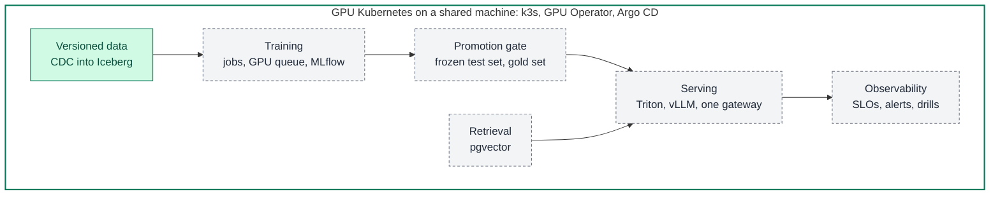
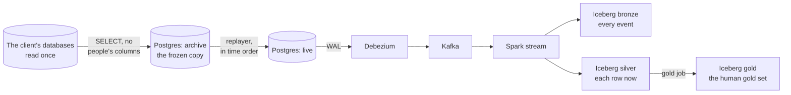
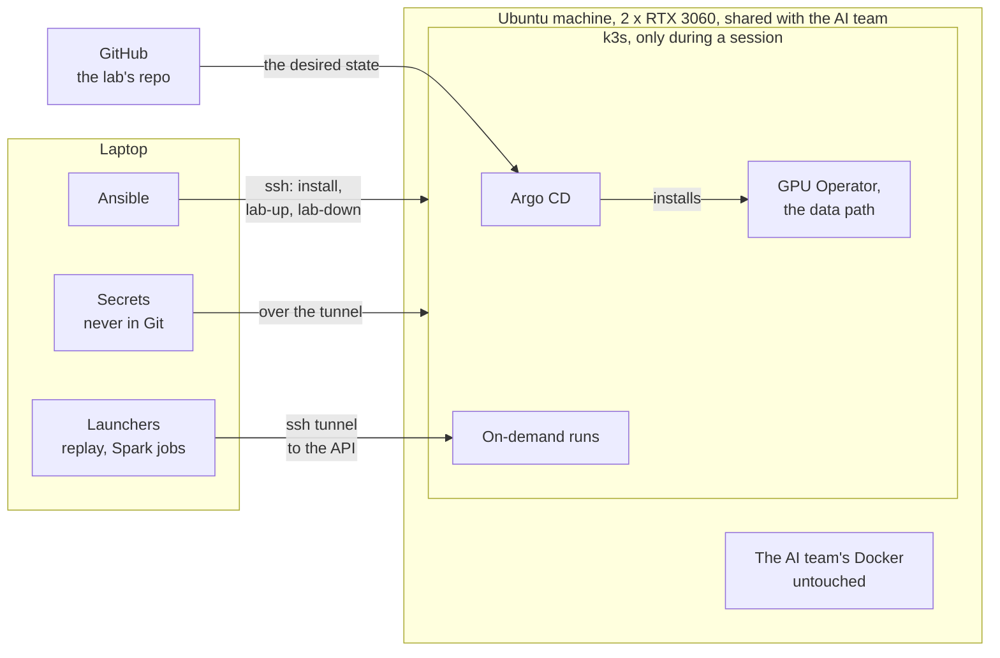
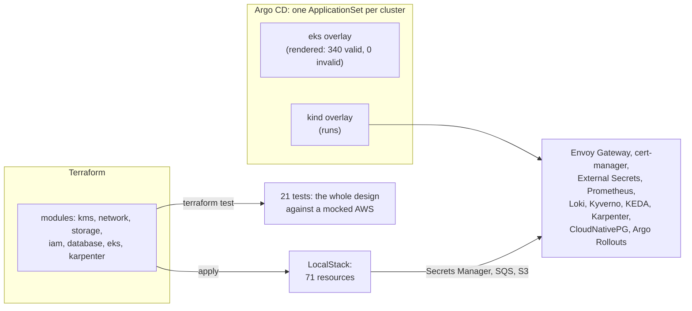

# ocr-platform

**An ML platform that gives an AI team one path to train, check, serve and watch its models on its own GPUs, built
around a real OCR system and its real data.**

Green is built and checked; grey is planned, and each part is published here when its acceptance checks pass.

- **The system:** an OCR service that reads the garment specification documents a garment manufacturer, my team's
  client, receives from its brand customers, and pre-fills the client's own template for a person to confirm
  ([the use case](docs/use-case.md)).
- **Who the platform serves:** my team's AI engineers (the AI team), who train the detector and own the prompts, and
  the engineers whose services call the OCR.
- **Where it runs:** one Ubuntu machine with two RTX 3060 GPUs, shared with the AI team, on the client's real data.
- **Built:** the GPU cluster, run by GitOps; the versioned data path; and [the same platform on AWS](#the-aws-track),
  proven without an AWS account.
- **Next:** training, the gate, serving, retrieval and observability ([the roadmap](#the-roadmap)).

I am a cloud, DevOps and data platform engineer at the same company. I built and run this lab, and every step is
checked against acceptance criteria with real output.

## Problem statements

**The AI team's OCR models are trained by hand, judged by eye, served on CPU and changed by configuration, so nobody
can say whether a change made the OCR better or worse.** Each problem below is the AI team's, and through them the
client's. [The use case](docs/use-case.md) follows one document through the system and gives
[the full evidence](docs/use-case.md#where-it-falls-short-today).

| # | Problem | Evidence, measured on the real system |
|---|---|---|
| P1 | Detector training cannot be reproduced | Trained by hand in the Ultralytics Platform web UI; about 15 datasets in the workspace, none marked as the one behind production (2026-10-21) |
| P2 | There is no trustworthy evaluation | The validation split is by page: 99 of its 146 pages come from documents also in training; no frozen test set (2026-10-23) |
| P3 | Changes ship with no gate and no lineage | Nothing records which detector weights made a run, and weight file names do not match their contents; models and prompts change by configuration with no evaluation before use (2026-10-22) |
| P4 | No dataset can be rebuilt | Human picks sit in Odoo's JSON, predictions in the service's database, joined only by run, page and an approximate box match (2026-10-31) |
| P5 | Every element goes to GPT, at a cost and with unstable answers | One 10-page document: 28 GPT calls and 488,836 input tokens (development, 2026-10-24); over 16 runs of one document with one model, 7 of 31 elements changed pick at least once, about 1 in 4 (staging, 2026-10-24) |
| P6 | The detector runs on CPU, inside the OCR container | The service's code and image (2026-10-19) |
| P7 | There is no self-service way to train or serve on the team's own GPUs | Training needs a person in a cloud web UI; on the shared machine, the AI team's workloads use both GPUs with nothing scheduling between jobs (2026-10-25) |
| P8 | Past human picks are never reused | No route or job reads the people's picks back from Odoo; each run starts from nothing (2026-10-24) |
| P9 | Nobody can see the model serving's health | The service logs to stderr only: no metrics, no tracing, no alert (2026-10-24) |

## Outcomes

**The lab builds one platform that takes a versioned dataset to a model that is gated, served and observed, for the
engineers who build the models, and measures every step against today's system.** Each outcome is an acceptance criterion, shown on the
shared machine with the real data. Its metric, today's baseline and its target, fixed before the run and never after,
are in [the design](docs/design.md#outcomes).

| # | Outcome | Solves | Phase | Status |
|---|---|---|---|---|
| T1 | Reproducible detector training: the production recipe reproduced within a stated tolerance; a rerun gives the same numbers | P1 | 2b | Planned |
| T2 | Gold sets and a scoreboard: a test split frozen by document, a human gold set, one table of every model version's scores, each with its interval | P2 | 2a, 2b | **Half done:** the test split (26 of 132 documents, 341 pages) and the gold set (200 human picks), 2026-11-01 |
| T3 | Fewer GPT calls: a self-hosted vision-language model behind the gateway answers a share of the elements at equal top-1 on the gold set | P5 | 3a | Planned |
| T4 | Versioned datasets from a CDC path: a replayed edit in the lakehouse within 60 s with no polling; a training run rebuilt from its dataset version | P4 | 2a, 2b | **Half done:** the slowest of 10 edits in 31.7 s, nothing polling (2026-11-01) |
| T5 | GPU serving with measured trade-offs: accuracy, latency and throughput per precision (FP32, FP16, INT8), against today's CPU | P6 | 3a | Planned |
| T6 | Serving and GPU observability: SLOs for serving and training, each alert proven by a drill | P9 | 3c | Planned |
| T7 | One gate and full lineage: a deliberately worse model and a worse prompt both blocked; every output names its weights, prompt and deployment | P3 | 2b, 3a | Planned |
| T8 | Self-service training and serving: one command per task for an AI engineer; a second GPU job waits in its queue within its quota | P7 | 2b, 3a | Planned |
| T9 | Past picks reused by retrieval: the nearest human-picked crops as context, measured by recall@k, latency and the effect on top-1 | P8 | 3b | Planned |

## For a reviewer: each skill and where it is proven

Five minutes, one row per skill; every row links its proof, most of them a command with its real output.

| Skill | The proof | Measured |
|---|---|---|
| GPU Kubernetes on a shared machine (Ansible, k3s, NVIDIA GPU Operator, Argo CD) | [The platform spec](docs/specs/gpu-box-platform.md), [its acceptance](docs/runbooks/gpu-box-bootstrap.md#8-acceptance) | Both RTX 3060s schedulable, a CUDA pod at 7,193 GFLOP/s; `lab-up` in 17 to 19 s, `lab-down` in 12 to 13 s with 0 leftovers; the AI team's containers unchanged |
| A data platform for ML: CDC into a lakehouse (Postgres, Debezium, Kafka, Spark, Iceberg) | [The data path spec](docs/specs/data-path.md), [its acceptance](docs/runbooks/data-path.md#verify-end-to-end) | 245,221 writes replayed in 601 s; Debezium lag p99 1.19 s; an edit in silver in 31.7 s; 0 duplicates in 245,234 events |
| AWS infrastructure in Terraform (VPC, IAM, KMS, S3, RDS, EKS) | [Modules and tests](infra/aws/terraform/modules/), [the checks](docs/runbooks/aws-track.md#21-every-check-that-needs-no-account), [the LocalStack apply](docs/runbooks/aws-track.md#22-apply-to-localstack) | 21 tests against a mocked AWS; 71 resources applied, replan clean, destroy clean |
| Kubernetes platform by GitOps (Argo CD, Helm, Gateway API, cert-manager, secrets, policy) | [The overlays](infra/argocd/clusters/), [the platform on kind](docs/runbooks/aws-track.md#3-kind-with-the-platform), [the EKS render](docs/runbooks/aws-track.md#8-the-eks-overlay-and-ci-c5) | 9 Applications healthy; HTTPS with the lab CA; a secret change in 14 s; EKS overlay 0 invalid |
| Autoscaling: HPA, KEDA, Karpenter with spot | [HPA](docs/runbooks/aws-track.md#41-hpa-under-load-c10), [KEDA](docs/runbooks/aws-track.md#42-keda-on-an-sqs-queue-c11), [Karpenter](docs/runbooks/aws-track.md#43-karpenter-on-kwok-spot-first-a-reclaim-consolidation-c12) | 1 to 5 pods in 40 s (decided at 33 s) at 899 req/s, p95 106 ms, 0 failed of 211,658; 0 to 5 workers in 31 s; a spot reclaim with 11 of 12 ready |
| Cost: pricing models and the bill | [The estimate](docs/aws-cost-estimate.md) | 958, 654 and 576 USD a month: on-demand, spot, spot plus commitments |
| Databases: restore, failover, major upgrade | [PITR](docs/runbooks/aws-track.md#51-point-in-time-restore-c15), [failover](docs/runbooks/aws-track.md#52-failover-c14), [PG 16 to 17](docs/runbooks/aws-track.md#53-major-upgrade-by-logical-replication-c13) | RTO 79 s (restored to 3 s before a DELETE), RPO bounded at 60 s by the WAL archive; 30.5 s failover gap; 9.5 s upgrade cutover with zero data lost (checksums equal) |
| Git flow and CI | [Workflows, rulesets, CODEOWNERS](.github/), [a pull request](https://github.com/caokgit/ocr-platform/pull/1), [a release](https://github.com/caokgit/ocr-platform/releases/tag/v0.3.0) | CI caught two real faults on the first push; both fixed through PR #1 |
| Observability and releases | [An alert finds a bad release](docs/runbooks/aws-track.md#61-an-alert-finds-a-bad-release-c16), [canary](docs/runbooks/aws-track.md#62-canary-with-analysis-c17) | Alert in 1 min 58 s, failures traced in Loki; a faulty build aborted in 37 s |

## Built so far

Two phases on the shared machine, each closed by its acceptance checks. Every number below comes from a run, with its
output in the runbooks.

### Phase 1: GPU Kubernetes beside the AI team's work

**A k3s v1.36.5 cluster that exists only while the lab works, installed beside the AI team's Docker workloads without
changing them** (acceptance A1 to A11, [the table](docs/runbooks/gpu-box-bootstrap.md#8-acceptance)).

| Result | Measured |
|---|---|
| Up and down by playbook | `lab-up` in 17 to 19 s, `lab-down` in 12 to 13 s, every leftover counted 0 (`lab-up` takes 3 min 16 s once the data path is installed) |
| GPUs by GitOps | Ansible installs k3s, k3s installs Argo CD, Argo CD installs the NVIDIA GPU Operator on the machine's own driver: both RTX 3060s schedulable, a CUDA test pod at 7,193 GFLOP/s |
| The shared machine protected | The AI team's containers, configs and firewall chains unchanged; the API and kubelet ports (6443, 10250) closed, tested from a laptop on the office VPN; 76 MB used on a root disk that was 98% full; every addition listed with its removal in a teardown playbook |

### Phase 2a: the data path

**The client's OCR history, copied once and replayed, flows by change data capture (CDC) into an Iceberg lakehouse,
so a dataset is a versioned table, not a file someone exported** (acceptance B1 to B16,
[the table](docs/runbooks/data-path.md#verify-end-to-end)).

The lab never puts a replication slot on the client's database
([why](docs/notes/wal-slot-debezium.md#decision-1-no-slot-on-a-shared-database)): it captures changes from its own
replayed copy, `live`.

| Result | Measured |
|---|---|
| A copy without people | The client's OCR tables read once, read-only, one SELECT per table leaving people's columns behind: 239,880 rows, 28 tables across two environments; 0 copied rows holding a user's name |
| The stack by GitOps | Six Argo CD applications healthy in 3 min 17 s: CloudNativePG (Postgres 17.11), Strimzi (Kafka 4.3.1, 30 topics), Debezium, Kubeflow Spark, SeaweedFS as the S3 store, the lab's own objects |
| History replayed | 86.8 days of the client's history rewritten in time order: 245,221 writes in 601 s, more than the rows because each row's past versions come before its current one |
| Change capture | Debezium's lag p99 1.19 s; Spark 4.1.4 writes bronze (every event as it arrived) and silver (the current state of each row); silver equals the copy for all 28 table and environment pairs |
| **T4, first half** | 10 replayed saves reached silver within 31.7 s of their commit (the limit is 60 s); nothing polls: only the replayer's writes and Debezium's heartbeat touched `live` |
| No duplicates, through failures | 0 duplicates in bronze's 245,234 events (the writes plus 13 from the T4 checks) through five stream failures; `lab-down` then `lab-up` changed no count |
| **T2, its two datasets** | The human gold set: 200 picks joined to the model output they were cut from (50 excluded: their page image is gone), read twice the same; from 27 curated results, 15 last saved by my team and 12 by the client's staff, so it can be cut to the client's own work. The detector's test split: 26 of the 132 documents in the AI team's labelled set of 2,040 page images (341 pages in the split), none on both sides, its list's sha256 recorded |

## The architecture

**Three owners, no overlap: Ansible owns the machine's operating system, Argo CD owns the cluster's services from Git,
and the laptop brings the Secrets and the on-demand runs.**

Each on-demand run is stamped with the commit it came from (checked offline so far). From home, the laptop reaches the
machine through the office VPN.

## The AWS track

**The same platform written for AWS and EKS in Terraform, and proven without an AWS account:** RDS and EKS by
`terraform test` against a mocked AWS, the network, identity, keys, storage, queues and secrets applied to LocalStack
4.14, and the Kubernetes layer run on kind on a laptop. The measured results are in
[the reviewer table](#for-a-reviewer-each-skill-and-where-it-is-proven); every run is in
[the runbook](docs/runbooks/aws-track.md), the checks are C1 to C20 of [the spec](docs/specs/aws-track.md#acceptance).

| Area | What was built |
|---|---|
| Network | A three-AZ VPC, one NAT gateway in dev and one per AZ by a switch; an S3 gateway endpoint; flow logs |
| Keys and storage | One KMS key for S3, RDS, Secrets Manager and EKS secrets; a private, versioned, TLS-only lake bucket |
| Database | RDS for PostgreSQL 17, logical replication on, its password managed by RDS |
| Kubernetes | EKS 1.35 with access entries, an on-demand system node group and IAM roles for Pod Identity; Karpenter's role and its spot interruption queue, fed by four EventBridge rules |
| Checks | tflint and Trivy clean, every Trivy finding fixed in code; the mocked apply caught a `for_each` over IDs unknown at plan time, which a real plan would have failed on |
| The platform on kind | HTTPS through Envoy Gateway (Gateway API) with a cert-manager certificate; External Secrets from Secrets Manager; Kyverno `ValidatingPolicy` rules that deny a `:latest` image and a pod without limits, and report a root pod in audit mode |
| Drills | HPA under load, KEDA on SQS, Karpenter on simulated nodes (spot first, on-demand past spot's limit, consolidated to none); point-in-time restore, failover, a PostgreSQL 16 to 17 upgrade; an alert that finds a bad release; an Argo Rollouts canary that stops one |
| Cost | From AWS's public price list ([the estimate](docs/aws-cost-estimate.md)) |
| Git flow | CI on every pull request, scoped to what a change touches ([ci.yml](.github/workflows/ci.yml)); rulesets for `main` and release tags as JSON ([rulesets](.github/rulesets/)); [CODEOWNERS](.github/CODEOWNERS); a pull request template; releases from tags |

## How it is built

| Area | The evidence here |
|---|---|
| Infrastructure and GitOps | [Ansible playbooks](infra/ansible/), k3s, [Argo CD applications](infra/argocd/); operators running stateful services (Postgres, Kafka, Debezium, Spark) |
| Data platform | CDC into a lakehouse with versioned tables ([pipelines](pipelines/)); datasets named by version |
| Safe operation on shared hardware | A memory quota, a free-memory floor before each start, a teardown inventory, the AI team's Docker checked unchanged |
| Operations discipline | Acceptance checks, [runbooks](docs/runbooks/README.md) with real output, failure modes with their fixes |
| Engineering judgement | Nine [design notes](docs/notes/README.md), each a question the lab settled with real values |
| AWS in Terraform | [Modules with tests](infra/aws/terraform/modules/), a [LocalStack env](infra/aws/terraform/envs/localstack/) and the [full dev design](infra/aws/terraform/envs/dev/); [the checks](tools/check-terraform.sh) |
| One platform, several clusters | [ApplicationSets and overlays](infra/argocd/clusters/), [values per cluster](infra/platform/values/), [cluster-wide objects](infra/platform/manifests/) |
| Operations drills | [Autoscaling, databases, alerts, canary](infra/drills/), each with its output in [the runbook](docs/runbooks/aws-track.md) |
| CI and Git flow | [Workflows, rulesets, CODEOWNERS](.github/) |
| Governing an AI agent | [AGENTS.md](AGENTS.md) and the [git hooks](tools/hooks/) |

Built with an AI coding agent under the rules of [AGENTS.md](AGENTS.md): a spec before code, every external fact
sourced, the specs, phase reviews and public pages checked against their sources by a second AI agent with no stake in
the text, runbooks written as each step runs. [How I work](docs/how-i-work.md) shows the method and three errors it caught before they shipped.

This repo is published from the lab's private repo. In its code and outputs, the client's names and field names,
internal terms, the team's module prefix, resource and account names and the private repo's URL are replaced,
internal addresses masked, and the AI team's firewall rules elided; everything else is as it ran.

## The roadmap

Phases 1 and 2a and the AWS track are built, with the evidence above. Next, the design of the whole platform is
published first: its users and their interfaces, every layer marked built or planned, the lineage chain from a
dataset version to each response, and the plan for sharing two 12 GB GPUs with the AI team. Then each phase below is
built on the shared machine and published here when its acceptance checks pass.

| Phase | Builds | Outcomes |
|---|---|---|
| 2b, the training platform | One job template an AI engineer submits with a dataset version and a recipe; GPU queueing and quotas on the two GPUs; namespaces with RBAC and NetworkPolicy; MLflow tracking and registry; the detector's production recipe reproduced; one promotion gate on the frozen test split; lineage from the dataset version to the weights. The orchestrator, Argo Workflows or Airflow, is chosen in its spec | T1, T2's scoreboard, T4's second half, T7, T8 |
| 3a, model serving | The detector on NVIDIA Triton: ONNX, then TensorRT FP32, FP16 and INT8, against today's CPU. A small open vision-language model on vLLM, on one RTX 3060. One OpenAI-compatible gateway in front of the GPT deployments and vLLM: models switched by configuration, usage and cost per key, the answering model recorded | T3, T5, T7, T8 |
| 3b, retrieval | Crop and element embeddings in pgvector on the lab's existing Postgres; the nearest human-picked crops retrieved as context for the model (RAG on the OCR's own data) | T9 |
| 3c, observability and day 2 | GPU metrics (DCGM), Triton and vLLM metrics, the platform's SLOs, GPU use per namespace; drills of a bad model, a full GPU and a stuck queue; an upgrade drill (k3s, the GPU Operator, a Helm rollback) | T6 |

Not scheduled: KEDA scaling on Kafka; a student ranker distilled from GPT's scores, grown by active learning; the AWS
track applied to a real account (`envs/dev` with its S3 state bucket, then the eks overlay).

## Where to read next

1. [The use case](docs/use-case.md): the workload, one document through it, and its gaps.
2. [How I work](docs/how-i-work.md): the method, and three errors it caught.
3. [The design notes](docs/notes/README.md): nine engineering questions the lab settled, each with its real values.
4. [The design](docs/design.md): each outcome's metric, baseline and target, then each decision with its why; and the
   specs, [phase 1's platform](docs/specs/gpu-box-platform.md) and [phase 2a's data path](docs/specs/data-path.md),
   with their acceptance checks as worded and as run.
5. [The runbooks](docs/runbooks/README.md): the whole journey, from a fresh laptop to a running lab and back to a
   clean machine, each command with its real output.
6. The phase reviews, [phase 1](docs/phases/phase-1-gpu-box.md) and [phase 2a](docs/phases/phase-2a-data-path.md):
   each phase's story in one read, and its acceptance tables:
   [phase 1](docs/runbooks/gpu-box-bootstrap.md#8-acceptance), [phase 2a](docs/runbooks/data-path.md#verify-end-to-end).
7. The AWS track: [its spec](docs/specs/aws-track.md), [its review](docs/phases/aws-track.md), [its runbook](docs/runbooks/aws-track.md), [the cost estimate](docs/aws-cost-estimate.md).
8. [AGENTS.md](AGENTS.md): the rules the work follows.
