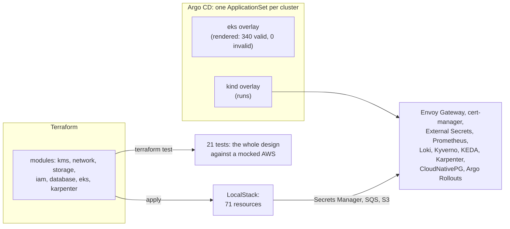
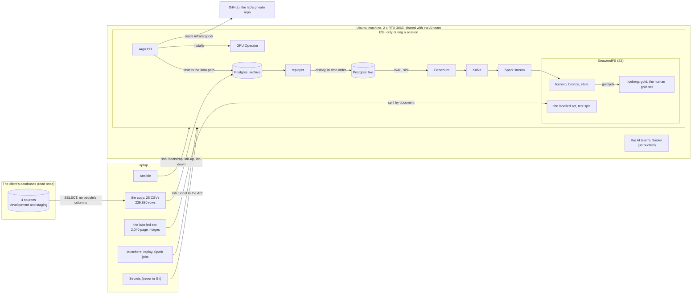

# ocr-platform

An ML platform for the engineers who build and run a real OCR workload. The workload extracts documents for a garment
manufacturer, my team's client: it maps each brand customer's garment specification onto the client's own template.
The platform's users are my team's AI engineers (the AI team), who train the workload's detector and own its prompts,
and the engineers whose services call it. It runs on an Ubuntu machine in the office with two GPUs, shared with the AI
team, on the client's real data. Built so far: a GPU cluster run by GitOps on k3s, and a change data capture (CDC)
path into an Iceberg lakehouse with datasets named by version. Next to it, [the AWS track](#the-aws-track) writes the
same platform for AWS and EKS in Terraform and proves it without an AWS account. Training, the promotion gate, GPU and
LLM serving, retrieval and their observability are [the roadmap](#the-roadmap), each published here when its
acceptance checks pass. I am a cloud, DevOps and data platform engineer in the same company; I built and run the lab,
every step checked against acceptance criteria with real output.

## Problem statements

**The AI team's OCR models are trained by hand, judged by eye, served on CPU and changed by configuration, so nobody
can say whether a change made the OCR better or worse.** Each problem below is the AI team's, and through them the
client's. [The use case](docs/use-case.md) follows one document through the system and gives
[the full evidence](docs/use-case.md#where-it-falls-short-today).

| # | Problem | Evidence, measured on the real system |
|---|---|---|
| P1 | Detector training cannot be reproduced | Trained by hand in the Ultralytics Platform web UI; about 15 datasets in the workspace, none marked as the one behind production (2026-10-21) |
| P2 | There is no trustworthy evaluation | The validation split is by page: 99 of its 146 pages come from documents also in training; no frozen test set (2026-10-23) |
| P3 | Changes ship with no gate and no lineage | Nothing records which detector weights made a run, and weight file names do not match their contents; models and prompts change by configuration with no evaluation before use (2026-10-22) |
| P4 | No dataset can be rebuilt | Human picks sit in Odoo's JSON, predictions in the service's database, joined only by run, page and an approximate box match (2026-10-31) |
| P5 | Every element goes to GPT, at a cost and with unstable answers | One 10-page document: 28 GPT calls and 488,836 input tokens (development, 2026-10-24); over 16 runs of one document with one model, 7 of 31 elements changed pick at least once, about 1 in 4 (staging, 2026-10-24) |
| P6 | The detector runs on CPU, inside the OCR container | The service's code and image (2026-10-19) |
| P7 | There is no self-service way to train or serve on the team's own GPUs | Training needs a person in a cloud web UI; on the shared machine, the AI team's workloads use both GPUs with nothing scheduling between jobs (2026-10-25) |
| P8 | Past human picks are never reused | No route or job reads the people's picks back from Odoo; each run starts from nothing (2026-10-24) |
| P9 | Nobody can see the model serving's health | The service logs to stderr only: no metrics, no tracing, no alert (2026-10-24) |

## Outcomes

**The lab builds one platform that takes a versioned dataset to a model that is gated, served and observed, for the engineers who build
the models, and measures every step against today's system.** Each outcome is an acceptance criterion, shown on the
shared machine with the real data. Its metric, today's baseline and its target, fixed before the run and never after,
are in [the design](docs/design.md#outcomes).

| # | Outcome | Solves | Phase | Status |
|---|---|---|---|---|
| T1 | Reproducible detector training: the production recipe reproduced within a stated tolerance; a rerun gives the same numbers | P1 | 2b | Planned |
| T2 | Gold sets and a scoreboard: a test split frozen by document, a human gold set, one table of every model version's scores, each with its interval | P2 | 2a, 2b | **Half done:** the test split (26 of 132 documents, 341 pages) and the gold set (200 human picks), 2026-11-01 |
| T3 | Fewer GPT calls: a self-hosted vision-language model behind the gateway answers a share of the elements at equal top-1 on the gold set | P5 | 3a | Planned |
| T4 | Versioned datasets from a CDC path: a replayed edit in the lakehouse within 60 s with no polling; a training run rebuilt from its dataset version | P4 | 2a, 2b | **Half done:** the slowest of 10 edits in 31.7 s, nothing polling (2026-11-01) |
| T5 | GPU serving with measured trade-offs: accuracy, latency and throughput per precision (FP32, FP16, INT8), against today's CPU | P6 | 3a | Planned |
| T6 | Serving and GPU observability: SLOs for serving and training, each alert proven by a drill | P9 | 3c | Planned |
| T7 | One gate and full lineage: a deliberately worse model and a worse prompt both blocked; every output names its weights, prompt and deployment | P3 | 2b, 3a | Planned |
| T8 | Self-service training and serving: one command per task for an AI engineer; a second GPU job waits in its queue within its quota | P7 | 2b, 3a | Planned |
| T9 | Past picks reused by retrieval: the nearest human-picked crops as context, measured by recall@k, latency and the effect on top-1 | P8 | 3b | Planned |

## For a reviewer: each skill and where it is proven

Five minutes, one row per skill; every row links its proof, most of them a command with its real output.

| Skill | The proof | Measured |
|---|---|---|
| GPU Kubernetes on a shared machine (Ansible, k3s, NVIDIA GPU Operator, Argo CD) | [The platform spec](docs/specs/gpu-box-platform.md), [its acceptance](docs/runbooks/gpu-box-bootstrap.md#8-acceptance) | Both RTX 3060s schedulable, a CUDA pod at 7,193 GFLOP/s; `lab-up` in 17 to 19 s, `lab-down` in 12 to 13 s with 0 leftovers; the AI team's containers unchanged |
| A data platform for ML: CDC into a lakehouse (Postgres, Debezium, Kafka, Spark, Iceberg) | [The data path spec](docs/specs/data-path.md), [its acceptance](docs/runbooks/data-path.md#verify-end-to-end) | 245,221 writes replayed in 601 s; Debezium lag p99 1.19 s; an edit in silver in 31.7 s; 0 duplicates in 245,234 events |
| AWS infrastructure in Terraform (VPC, IAM, KMS, S3, RDS, EKS) | [Modules and tests](infra/aws/terraform/modules/), [the checks](docs/runbooks/aws-track.md#21-every-check-that-needs-no-account), [the LocalStack apply](docs/runbooks/aws-track.md#22-apply-to-localstack) | 21 tests against a mocked AWS; 71 resources applied, replan clean, destroy clean |
| Kubernetes platform by GitOps (Argo CD, Helm, Gateway API, cert-manager, secrets, policy) | [The overlays](infra/argocd/clusters/), [the platform on kind](docs/runbooks/aws-track.md#3-kind-with-the-platform), [the EKS render](docs/runbooks/aws-track.md#8-the-eks-overlay-and-ci-c5) | 9 Applications healthy; HTTPS with the lab CA; a secret change in 14 s; EKS overlay 0 invalid |
| Autoscaling: HPA, KEDA, Karpenter with spot | [HPA](docs/runbooks/aws-track.md#41-hpa-under-load-c10), [KEDA](docs/runbooks/aws-track.md#42-keda-on-an-sqs-queue-c11), [Karpenter](docs/runbooks/aws-track.md#43-karpenter-on-kwok-spot-first-a-reclaim-consolidation-c12) | 1 to 5 pods in 40 s at 899 req/s; 0 to 5 workers; a spot reclaim with 11 of 12 ready |
| Cost: pricing models and the bill | [The estimate](docs/aws-cost-estimate.md) | 958, 654 and 576 USD a month: on-demand, spot, spot plus commitments |
| Databases: restore, failover, major upgrade | [PITR](docs/runbooks/aws-track.md#51-point-in-time-restore-c15), [failover](docs/runbooks/aws-track.md#52-failover-c14), [PG 16 to 17](docs/runbooks/aws-track.md#53-major-upgrade-by-logical-replication-c13) | RTO 79 s (restored to 3 s before a DELETE), RPO bounded at 60 s by the WAL archive; 30.5 s failover gap; 9.5 s upgrade cutover with zero data lost (checksums equal) |
| Git flow and CI | [Workflows, rulesets, CODEOWNERS](.github/), [a pull request](https://github.com/caokgit/ocr-platform/pull/1), [a release](https://github.com/caokgit/ocr-platform/releases/tag/v0.3.0) | CI caught two real faults on the first push; both fixed through PR #1 |
| Observability and releases | [An alert finds a bad release](docs/runbooks/aws-track.md#61-an-alert-finds-a-bad-release-c16), [canary](docs/runbooks/aws-track.md#62-canary-with-analysis-c17) | alert in 1 min 58 s, failures traced in Loki; a faulty build aborted in 37 s |

## Built so far

**Phase 1, the platform** (acceptance A1 to A11, [the table](docs/runbooks/gpu-box-bootstrap.md#8-acceptance)):

- A single-node k3s v1.36.5 cluster next to the AI team's Docker workloads, running only during lab sessions,
  started and stopped by two playbooks: `lab-up` in 17 to 19 s and `lab-down` in 12 to 13 s, with every leftover counted 0
  (phase 1's figures; with the data path, `lab-up` takes 3 min 16 s).
- Ansible installs k3s, and k3s installs Argo CD from a file; from then on Argo CD installs the cluster's services from
  the lab's repo, first the NVIDIA GPU Operator on the machine's own driver: both RTX 3060s schedulable, a CUDA test pod at
  7,193 GFLOP/s.
- The shared machine protected: the AI team's containers, configs and firewall chains unchanged; the cluster's API and
  kubelet ports (6443, 10250) closed, tested from a laptop on the office VPN; 76 MB used on `/` (the root disk was 98% full); every addition listed
  with its removal in a teardown playbook.

**Phase 2a, the data path** (acceptance B1 to B16, [the table](docs/runbooks/data-path.md#verify-end-to-end)):

- The client's OCR tables copied once, read-only, through a SELECT per table that leaves people's columns behind:
  239,880 rows, 28 tables across the two environments; no column naming a person, and no copied row holding a user's
  name (0 found).
- Six Argo CD applications, all healthy in 3 min 17 s: four operators (CloudNativePG with Postgres 17.11, Strimzi with
  Kafka 4.3.1 and 30 topics, Debezium, Kubeflow Spark), SeaweedFS as the S3 store, and the lab's own objects.
- The lab never puts a replication slot on the client's database
  ([why](docs/notes/wal-slot-debezium.md#decision-1-no-slot-on-a-shared-database)), so it captures changes from its
  own: a replayer rewrote 86.8 days of the client's history from the frozen copy (`archive`) into a second database
  (`live`) in time order: 245,221 writes in 601 s, more than the 239,880 rows because each row's past versions are
  written before its current one. Debezium reads `live`'s write-ahead log (WAL) through a replication slot and sends
  each change to Kafka, with a lag p99 of 1.19 s; Spark 4.1.4 streams the changes into Iceberg tables: bronze keeps
  every event as it arrived, silver the current state of each row. Silver equals the copy for all 28 table and
  environment pairs, 239,880 rows.
- **T4, first half:** ten replayed saves of one result each reached silver within 31.7 s of their commit (the limit
  is 60 s). Around a second slice of 3 saves, Postgres's statement statistics showed only the replayer's writes and
  Debezium's heartbeat in `live`: the WAL pushes each change, nothing polls.
- Every retried batch landed once: 0 duplicates in bronze's 245,234 events (the 245,221 writes plus 13 from the T4 checks), through five stream failures. After
  `lab-down` and `lab-up`, the row counts of `archive`, `live`, Kafka and silver were unchanged, and the resumed
  stream added no row.
- **T2, its two datasets:** the human gold set, 200 picks joined to the model output they were cut from (50 more
  excluded, all because their page image is gone), a gold Iceberg table read twice the same. They come from 27 curated
  results, 15 of them last saved by my team and 12 by the client's staff; each pick carries its
  result's `saved_by_domain`, so the gold set can be cut to the client's own work. The detector's test
  split, 26 of the 132 documents in the AI team's labelled set (341 pages), none on both sides, its list's sha256
  recorded.

## The AWS track

**How it is proven.** RDS and EKS are covered by `terraform test` against a mocked AWS provider; the network,
identity, keys, storage, queues and secrets are applied to LocalStack 4.14; the Kubernetes layer runs on kind on a
laptop. No AWS account is used. Every number below comes from a run, in [the runbook](docs/runbooks/aws-track.md); the
acceptance checks are C1 to C20 of [the spec](docs/specs/aws-track.md#acceptance).

- **Terraform:** seven modules, each with its tests: a three-AZ VPC with one NAT gateway in dev and one per AZ as a
  switch, an S3 gateway endpoint, flow logs; one KMS key for S3, RDS, Secrets Manager and EKS secrets; a private,
  versioned, TLS-only lake bucket; IAM roles for EKS Pod Identity; RDS for PostgreSQL 17 with logical replication on
  and its password managed by RDS; EKS 1.35 with access entries, an on-demand system node group and its add-ons;
  Karpenter's controller role and its spot interruption queue fed by four EventBridge rules. tflint and Trivy clean,
  with every Trivy finding fixed in code; the mocked apply caught a `for_each` over IDs unknown at plan time that a
  real plan would have failed on.
- **The platform on kind:** HTTPS through Envoy Gateway (Gateway API) with a cert-manager certificate; a value
  changed in Secrets Manager reached the cluster in 14 s through External Secrets; Kyverno `ValidatingPolicy` rules
  denied a `:latest` image and a pod without limits, and reported a root pod in audit mode.
- **Autoscaling:** under 899 requests a second (0 failed of 211,658, p95 106 ms) the HPA decided on 5 replicas after
  33 s, running at 40 s, and went back to 1 after; KEDA scaled an SQS worker from 0 to 5 in 31 s and back to 0; Karpenter, on KWOK's
  simulated nodes, chose spot first, used on-demand only past spot's limit, drained a reclaimed spot node with 11 of 12
  pods ready at worst, and consolidated to no nodes.
- **Databases (CloudNativePG):** an accidental `DELETE` undone by a point-in-time restore to 3 s before it, ready in
  79 s; a crashed primary replaced with a 30.5 s write gap; PostgreSQL 16 to 17 by logical replication under writes,
  checksums equal, a 9.5 s write gap at the cutover.
- **Alerts and releases:** a bad release shipped by commit raised an alert (an Alertmanager notification) 1 min 58 s after its pod started, Loki held the
  failing requests, and the alert resolved after the revert; an Argo Rollouts canary aborted a faulty build 37 s
  after release, with one pod of six ever serving it.
- **Cost:** 958 USD a month all on-demand, 654 with spot workers, 576 with a Compute Savings Plan on the system nodes
  and an RDS reservation, from AWS's public price list ([the estimate](docs/aws-cost-estimate.md)).
- **Git flow:** CI on every pull request ([ci.yml](.github/workflows/ci.yml)), rulesets for `main` and release tags as
  JSON, imported in the repo's settings ([rulesets](.github/rulesets/)), [CODEOWNERS](.github/CODEOWNERS), a pull request template, releases from tags.

## The architecture

Ansible owns the machine's operating system; Argo CD owns the cluster's services, from Git; the Secrets and what runs
on demand (a replay, a Spark job) come from the laptop, and the launchers stamp each run with the commit it came from (tested offline so far). From home, the laptop reaches the
machine through the office VPN.

## How it is built

| Area | The evidence here |
|---|---|
| Infrastructure and GitOps | [Ansible playbooks](infra/ansible/), k3s, [Argo CD applications](infra/argocd/); operators running stateful services (Postgres, Kafka, Debezium, Spark) |
| Data platform | CDC into a lakehouse with versioned tables ([pipelines](pipelines/)); datasets named by version |
| Safe operation on shared hardware | A memory quota, a free-memory floor before each start, a teardown inventory, the AI team's Docker checked unchanged |
| Operations discipline | Acceptance checks, [runbooks](docs/runbooks/README.md) with real output, failure modes with their fixes |
| Engineering judgement | Nine [design notes](docs/notes/README.md), each a question the lab settled with real values |
| AWS in Terraform | [Modules with tests](infra/aws/terraform/modules/), a [LocalStack env](infra/aws/terraform/envs/localstack/) and the [full dev design](infra/aws/terraform/envs/dev/); [the checks](tools/check-terraform.sh) |
| One platform, several clusters | [ApplicationSets and overlays](infra/argocd/clusters/), [values per cluster](infra/platform/values/), [cluster-wide objects](infra/platform/manifests/) |
| Operations drills | [Autoscaling, databases, alerts, canary](infra/drills/), each with its output in [the runbook](docs/runbooks/aws-track.md) |
| CI and Git flow | [Workflows, rulesets, CODEOWNERS](.github/) |
| Governing an AI agent | [AGENTS.md](AGENTS.md) and the [git hooks](tools/hooks/) |

Built with an AI coding agent under the rules of [AGENTS.md](AGENTS.md): a spec before code, every external fact
sourced, the specs, phase reviews and public pages checked against their sources by a second AI agent with no stake in
the text, runbooks written as each step runs. [How I work](docs/how-i-work.md) shows the method and three errors it caught before they shipped.

This repo is published from the lab's private repo. In its code and outputs, the client's names and field names,
internal terms, the team's module prefix, resource and account names and the private repo's URL are replaced,
internal addresses masked, and the AI team's firewall rules elided; everything else is as it ran.

## The roadmap

Phases 1 and 2a and the AWS track are built, with the evidence above. Next, the design of the whole platform is
published first: its users and their interfaces, every layer marked built or planned, the lineage chain from a
dataset version to each response, and the plan for sharing two 12 GB GPUs with the AI team. Then each phase below is
built on the shared machine and published here when its acceptance checks pass.

| Phase | Builds | Outcomes |
|---|---|---|
| 2b, the training platform | One job template an AI engineer submits with a dataset version and a recipe; GPU queueing and quotas on the two GPUs; namespaces with RBAC and NetworkPolicy; MLflow tracking and registry; the detector's production recipe reproduced; one promotion gate on the frozen test split; lineage from the dataset version to the weights. The orchestrator, Argo Workflows or Airflow, is chosen in its spec | T1, T2's scoreboard, T4's second half, T7, T8 |
| 3a, model serving | The detector on NVIDIA Triton: ONNX, then TensorRT FP32, FP16 and INT8, against today's CPU. A small open vision-language model on vLLM, on one RTX 3060. One OpenAI-compatible gateway in front of the GPT deployments and vLLM: models switched by configuration, usage and cost per key, the answering model recorded | T3, T5, T7, T8 |
| 3b, retrieval | Crop and element embeddings in pgvector on the lab's existing Postgres; the nearest human-picked crops retrieved as context for the model (RAG on the OCR's own data) | T9 |
| 3c, observability and day 2 | GPU metrics (DCGM), Triton and vLLM metrics, the platform's SLOs, GPU use per namespace; drills of a bad model, a full GPU and a stuck queue; an upgrade drill (k3s, the GPU Operator, a Helm rollback) | T6 |

Not scheduled: KEDA scaling on Kafka; a student ranker distilled from GPT's scores, grown by active learning; the AWS
track applied to a real account (`envs/dev` with its S3 state bucket, then the eks overlay).

## Where to read next

1. [The use case](docs/use-case.md): the workload, one document through it, and its gaps.
2. [How I work](docs/how-i-work.md): the method, and three errors it caught.
3. [The design notes](docs/notes/README.md): nine engineering questions the lab settled, each with its real values.
4. [The design](docs/design.md): each outcome's metric, baseline and target, then each decision with its why; and the
   specs, [phase 1's platform](docs/specs/gpu-box-platform.md) and [phase 2a's data path](docs/specs/data-path.md),
   with their acceptance checks as worded and as run.
5. [The runbooks](docs/runbooks/README.md): the whole journey, from a fresh laptop to a running lab and back to a
   clean machine, each command with its real output.
6. The phase reviews, [phase 1](docs/phases/phase-1-gpu-box.md) and [phase 2a](docs/phases/phase-2a-data-path.md):
   each phase's story in one read, and its acceptance tables:
   [phase 1](docs/runbooks/gpu-box-bootstrap.md#8-acceptance), [phase 2a](docs/runbooks/data-path.md#verify-end-to-end).
7. The AWS track: [its spec](docs/specs/aws-track.md), [its review](docs/phases/aws-track.md), [its runbook](docs/runbooks/aws-track.md), [the cost estimate](docs/aws-cost-estimate.md).
8. [AGENTS.md](AGENTS.md): the rules the work follows.
