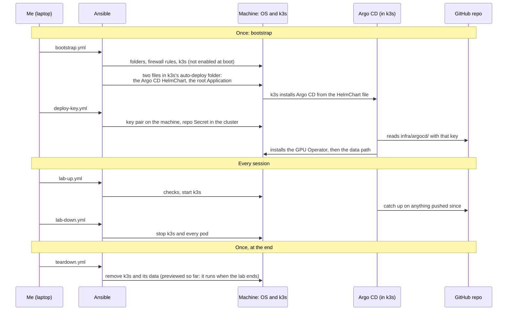

# Ansible for the machine, Argo CD for the cluster: where the handoff is

A design note: how the lab splits the work between Ansible and Argo CD, and why each layer gets its own tool. The
[notes](README.md) list the others; [How I work](../how-i-work.md) gives the method behind them.

**The one idea: the machine is split at one line, the edge of the cluster. Ansible owns everything below it (the OS,
k3s, starting and stopping); Argo CD owns every long-running service above it. They meet at exactly three objects
that Ansible places once, so that Argo CD can start. The on-demand runs and the Secrets come from the laptop instead
([two paths](gitops-and-direct-runs.md)).**

## Why Ansible below the line, and not a shell script

Reading a machine is a script's job. Changing a machine another team uses is Ansible's, because a change must be
shown before it is made, be safe to repeat, and stop at the first surprise. A script gives none of that by itself.

Follow one real change. On 2026-10-30 the lab's firewall rules had to move from the bottom of the list to the top
and gain three denies, on a machine whose other rules belong to another team, the AI team that builds the workload.

**As a shell script** (illustrative, never run):

```bash
ssh machine 'sudo ufw delete allow from 10.42.0.0/16
             sudo ufw delete allow from 10.43.0.0/16
             sudo ufw insert 1 allow from 10.42.0.0/16 comment "ml-lab k3s"
             sudo ufw insert 2 allow from 10.43.0.0/16 comment "ml-lab k3s"
             sudo ufw insert 3 deny proto tcp to any port 6443 comment "ml-lab k3s"
             ...                     # 10250, 8472, then the IPv6 list: at which number does it start?'
```

| What happens | With the script |
|---|---|
| Before it runs | Nothing shows what it will do: you read the script and imagine the result |
| Run a second time | It deletes and re-inserts the rules again: for a moment the pods cannot reach the API, every run |
| The IPv6 position | A number to compute by hand from `ufw status numbered`, different on every machine |
| A command fails halfway | The rest still runs unless the script says `set -e`; the machine is left half-changed either way |
| Afterwards | No record of what changed and what was already right |

**As the playbook** (real results, condensed, 2026-10-30 22:10,
[bootstrap, step 3](../runbooks/gpu-box-bootstrap.md#3-bootstrap-after-the-owners-go)):

```text
 preview   --check --diff   Take the lab's allows out ...   changed (2)        nothing changed on the machine
                            Then k3s's ports are closed ...  changed (3)
                            And to everyone over IPv6        changed (3)
 go        I read it and say go
 run       changed=4                                         the AI team's rules unchanged, same order
 again     changed=0                                         the move happens only once
```

| Gain | How Ansible gives it | Seen in phase 1 (real, 2026-10-30) |
|---|---|---|
| **Shown before it is made** | `--check --diff`: every task reports what it would change | Every change to the machine was previewed before my go |
| **Safe to repeat** | Tasks describe the end state; a task whose state already holds reports `ok` | A second run of bootstrap, lab-up, lab-down and deploy-key: `changed=0` (the acceptance check that a second run changes nothing) |
| **Positions and checks built in** | The `ufw` module's `insert_relative_to: first-ipv6` finds the IPv6 list's start; `copy` with `validate: visudo -cf` refuses a broken sudo rule | The lab's five rules landed first in the IPv4 list, the three denies first in the IPv6 list |
| **Stops at the first failure** | A failed task ends the play for that host | A pre-check stopped the preview of a bootstrap rerun because k3s held its own ports: a real bug, fixed the same evening ([bootstrap.yml](../../infra/ansible/bootstrap.yml)) |
| **One place for shared steps** | `tasks/pre-checks.yml` imported by bootstrap and lab-up; `vars.yml` read by every playbook that changes the machine | The memory floor and the port checks are written once |
| **A record** | Each run prints `ok`, `changed`, `skipped` per task | The runbooks show those lines as each step's real output |

**What Ansible does not give, also seen:** check mode cannot run commands, so a preview shows the k3s installer as
`skipped`; and a preview of a delete-then-insert reports the insert `ok`, because the delete was only simulated. The
runbooks say so next to those previews.

**Where scripts stay:** reading. `box-check.sh` and `footprint.sh` are plain read-only scripts; Ansible only carries
them to the machine, runs them and brings their report back ([check.yml](../../infra/ansible/check.yml),
[footprint.yml](../../infra/ansible/footprint.yml)).

## The handoff

Seven playbooks: five change the machine (bootstrap and deploy-key once, lab-up and lab-down every session, teardown
at the end, so far only previewed), two only read (check, footprint). Above the line, Argo CD keeps the cluster equal to Git. The whole life
of the lab, one picture:



**The three meeting points**, the only cluster objects Ansible creates:

| Object | Placed by | Why Ansible, not Argo CD |
|---|---|---|
| The Argo CD HelmChart file | `bootstrap.yml`, into k3s's auto-deploy folder | Argo CD cannot install itself before it exists; k3s's built-in Helm controller reads the file and installs the chart |
| The root Application | `bootstrap.yml`, the same folder | Tells the new Argo CD where in the repo to look (`infra/argocd/apps/`); from there it finds everything else |
| The repo Secret (a read-only deploy key) | `deploy-key.yml`, in the running cluster | The private key is born on the machine and never becomes a file in the repo, so it cannot come from Git |

**Who does what, by the kind of change:**

| Change | Done by | How |
|---|---|---|
| The machine's OS: a folder, a firewall rule, k3s's version or config | Ansible | Edit a playbook, `--check --diff`, run after my go |
| Start or stop the lab | Ansible | `lab-up.yml`, `lab-down.yml`; `lab-down` also stops the on-demand runs before it stops k3s |
| Something in the cluster: a chart, its version, its values, a new service | Argo CD | Edit `infra/argocd/`, commit, push |
| Run a job: a replay, a Spark job | The laptop, through an SSH tunnel to the Kubernetes API (no port open on the machine) | A launcher creates the Job; Argo CD does not own runs ([two paths](gitops-and-direct-runs.md)) |
| Cluster data that must never be in Git: Secrets | The laptop | [lab-credentials.py](../../infra/scripts/lab-credentials.py) |
| Remove the lab | Ansible | `teardown.yml` |

From Git, Argo CD installed the GPU Operator in phase 1 and, in phase 2a, the data path (the CDC pipeline from
Postgres through Kafka to the lakehouse): six applications, all healthy 3 min 17 s after a manual refresh. The
Secrets and the namespace came from the laptop, and the Debezium server was applied by hand once before Argo CD
adopted it ([the outcomes](../../README.md#the-outcomes-so-far)).

## In this lab

Both tools follow the same idea, a declared state checked against reality, at different speeds: Ansible when I run
it, always previewed first; Argo CD continuously while k3s runs. The playbooks' contracts are in the
[platform spec](../specs/gpu-box-platform.md#ansible-playbooks); the first install, step by step with its output, is
the [bootstrap runbook](../runbooks/gpu-box-bootstrap.md).
