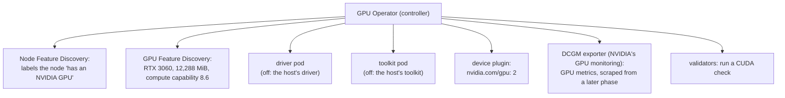

# GPUs in Kubernetes on the machine's own driver

A design note: how the lab makes the machine's two GPUs schedulable in Kubernetes without installing a second NVIDIA
driver or toolkit, and what Kubernetes still cannot see on a machine where the AI team (the team that builds the
workload) uses the same cards. It builds
on [Kubernetes on a machine another team uses](kubernetes-on-a-shared-machine.md).

**The one idea: the AI team's Docker workloads already use the machine's NVIDIA driver and container toolkit (the
toolkit hands a GPU and the driver's files into a container), so the
GPU Operator installs only the Kubernetes half (discovery, the device plugin, metrics, validation) and leaves the
driver and toolkit to the host. Kubernetes then counts the two GPUs, but it cannot see the other team's use of them.**

## The first design, and what reading the machine changed

The first design let the NVIDIA GPU Operator install its own driver, the chart's default: "A default installation
deploys the NVIDIA GPU driver, NVIDIA Container Toolkit, NVIDIA Device Plugin", plus a metrics exporter and Node
Feature Discovery ([GPU Operator, getting started](https://docs.nvidia.com/datacenter/cloud-native/gpu-operator/latest/getting-started.html)).
It was written before the machine was read. Reading it (2026-10-25) showed the host's own driver and container toolkit,
already used by the AI team's Docker workloads. A second driver would have changed their work. So the design was
revised before anything was built, with the two switches the same page gives:

| Value | NVIDIA's docs | Means |
|---|---|---|
| `driver.enabled=false` | "Set this value to `false` when using the Operator on systems with pre-installed drivers." | The Operator uses the host's driver and never installs one |
| `toolkit.enabled=false` | "Set this value to `false` when using the Operator on systems with pre-installed NVIDIA runtimes." | The Operator uses the host's toolkit; it does not rewrite a container runtime's config |

**Why the toolkit pod stays off, too.** When on, it rewrites a containerd config and restarts containerd through its
socket, and on k3s it must be given the paths of k3s's own containerd config and socket. On a machine with two
containerds (k3s's own, and the one under Docker), a wrong path is how a k3s install ends up editing the config Docker
reads. With the host toolkit there is nothing for that pod to do, because k3s wires itself
to it: k3s "will automatically detect alternative container runtimes if they are present when K3s starts" and "will
automatically add NVIDIA runtimes to the containerd configuration" ([k3s advanced options](https://docs.k3s.io/advanced)),
with an `nvidia` RuntimeClass a pod asks for.

## What the Operator runs

Argo CD installs the GPU Operator from NVIDIA's chart with the lab's values
([gpu-operator.yaml](../../infra/argocd/apps/gpu-operator.yaml)). On the machine (2026-10-30):



## Following one GPU request

The lab's test pod asks for `nvidia.com/gpu: 1`, with `runtimeClassName: nvidia`, and runs NVIDIA's `nbody` CUDA sample
([cuda-nbody.yaml](../../infra/tests/cuda-nbody.yaml)). Each stage of its life proves one layer:

| If the pod... | Then this layer works | On the machine (2026-10-30) |
|---|---|---|
| Is scheduled | The scheduler, and the device plugin counting GPUs | Scheduled on the node offering `nvidia.com/gpu: 2` |
| Starts | The runtime and the toolkit handing the GPU in | `Completed` 16 s after the apply; one of the two cards used |
| Prints the card and a result | The driver and the card | "NVIDIA GeForce RTX 3060", compute 8.6, 7,193 GFLOP/s single precision (nbody's built-in benchmark: proof the card computes, not a performance target) |

k3s alone has no device plugin, so without the Operator no node would offer `nvidia.com/gpu`, and the pod would wait as `Pending`.

## What Kubernetes cannot see

The device plugin counts whole GPUs; it does not know who else uses them. "A typical resource request provides
exclusive access to GPUs", and the device plugin's sharing (time-slicing) has "no memory or fault-isolation between
replicas" ([GPU sharing](https://docs.nvidia.com/datacenter/cloud-native/gpu-operator/latest/gpu-sharing.html)); the
isolated alternative, MIG (Multi-Instance GPU, one card split into isolated parts), is not available on GeForce
cards.

```text
 one reading, 2026-10-25   GPU 0                                     GPU 1
 the AI team               in use (their processes, invisible to k8s)  in use (their processes, invisible to k8s)
 Kubernetes sees           nvidia.com/gpu: 2   ("two free GPUs")
```

At the machine's first read (2026-10-25), both cards were in use by the AI team's work, while Kubernetes would have
offered both; their use changes through the day. A lab pod placed on a card in use shares its memory with no limit, and whichever process allocates last
gets the out-of-memory error. So GPU work in the lab looks at the cards first: `lab-up` shows both GPUs' memory and
load at every start, and whether the lab is pinned to one card, or uses time-slicing among its own pods, is decided
with real loads when GPU training is built.

## In this lab

The decisions are rows 3 to 5 of the [platform spec](../specs/gpu-box-platform.md#decisions); the install
and the test pod, with their output, are [bootstrap, steps 6 and 7](../runbooks/gpu-box-bootstrap.md#6-argo-cd-syncs-the-gpu-operator).
