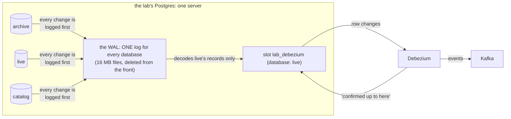

# The WAL, the slot and Debezium: who holds what

A design note: how change data capture holds on to Postgres's log, why the lab never puts a replication slot on a
shared database, and why an idle database still needs a heartbeat. The data path it belongs to is in the
[README](../../README.md#built-so-far).

**The one idea: the WAL is one log for the whole Postgres server; a slot is a bookmark in it for one reader; Debezium
is that reader. Postgres deletes old log files only from the front, and never past the slot's bookmark, which moves
only when Debezium says "I have read up to here". Everything else follows from that.**

## Follow one change

The lab copies the client's OCR tables once, read-only, into its own Postgres server. That server holds three lab
databases, plus Postgres's default `postgres`: `archive`, the frozen copy; `live`, where a replayer writes the copy's
history back in time order, one row version at a time, so that it looks like the client's real traffic; and
`catalog`, Iceberg's catalog. Debezium watches `live` only.



1. **The WAL.** The replayer inserts a row into `live`. Before the change may reach the table's file, Postgres
   appends a record describing it to the write-ahead log: "changes to data files ... must be written only after
   those changes have been logged" ([PostgreSQL, WAL](https://www.postgresql.org/docs/17/wal-intro.html)). The record
   gets the next LSN, its position in the log. There is one WAL per server, not per database: "WAL is shared by all
   databases" ([Debezium's Postgres connector](https://debezium.io/documentation/reference/stable/connectors/postgresql.html)).
2. **The slot.** Postgres may delete old log files once they are no longer needed for recovery, but a logical
   replication slot pins the log from its reader's position on: slots "will prevent removal of required resources
   even when there is no connection using them"
   ([logical decoding](https://www.postgresql.org/docs/17/logicaldecoding-explanation.html)).
3. **Debezium.** It reads `live`'s changes through the slot, sends each one to its table's Kafka topic, and confirms
   the position it has handled; only then does the slot's bookmark move, and the log behind it can go. Debezium keeps
   its own copy of that position, the offset, in a file on a persistent volume, so a restart resumes where it stopped.

So the slot is the reason no change is lost while Debezium is away, and the reason the log grows while it is.

## Decision 1: no slot on a shared database

The obvious design captures changes straight from the client's development database. The lab does not, because a
slot holds the log for as long as its reader is away, and this reader is away whenever the lab is offline: between
sessions, when its cluster is stopped ([a cluster only during sessions](kubernetes-on-a-shared-machine.md)), or
whenever its machine has no path to the client's network.

```text
 reader running:   log kept ▁▁▁▁▁▁▁▁▁▁▁▁▁▁▁▁▁▁   (released as the slot advances)
 reader away:      log kept ▁▂▃▄▅▆▇██████████    until storage hits 95% -> server read-only
                              ▲
                   the lab goes offline
```

A managed Postgres server is often shared by several applications' databases, and on Azure, for example, "The
primary server automatically switches to read-only mode when the storage usage reaches 95 percent, or when the
available capacity is less than 5 GiB"
([Azure, logical replication](https://learn.microsoft.com/en-us/azure/postgresql/flexible-server/concepts-logical)).
A forgotten slot on a shared server could make every application on it read-only, so keeping slots off a server the
lab does not own is a decision, not a setting to rely on.

**Instead:** the copy and the replayer above, on a server the lab owns. Its slot has a cap,
`max_slot_wal_keep_size` of 4 GB, so even a forgotten slot cannot fill the lab's disk. The cap's price: past it,
Postgres gives up the slot, the changes it held are lost, and the lab rebuilds from its own copy with a new fill (one
full replay), which the client never sees.

## Decision 2: a heartbeat for a quiet database

The slot is in `live`, but the other databases write to the same log. While `live` is idle (between fills, during an
`archive` load, during a gold build, the Spark batch job that commits a dataset to the Iceberg catalog), Debezium
receives nothing, so it confirms nothing, and the slot keeps everything the other databases write. Debezium's
documentation describes this case: "As WAL is shared by all databases, the amount used tends to grow until an event is
emitted by the database for which Debezium is capturing changes"
([connector, WAL disk space](https://debezium.io/documentation/reference/stable/connectors/postgresql.html)).

**The fix**, from the same page: a heartbeat. Every 10 seconds, Debezium runs one statement against `live`, which
comes back to it through the slot, and it confirms that position. The lab's statement updates one row
(`INSERT ... ON CONFLICT` on a one-row table), so the table stays one row forever; the heartbeat's two small topics
are kept for a day.

## Measured

On 2026-11-01, with `live` idle, 58 MB were written into the server's default `postgres` database, and the slot's
retained log (the WAL bytes behind the slot's position, so more than the data written) was read before the write,
right after it, and 35 s later ([data path, step 4.5](../runbooks/data-path.md#4-fill-live-and-the-lake-box)):

```text
 Debezium running (B8):  before 272 bytes | right after the write 74 MB | 35 s later 562 kB    (the heartbeat confirms)
 Debezium stopped (B7):  248 bytes        | after the write 74 MB       | 35 s later 74 MB     (held; cap 4 GB)
 Debezium started again:  74 MB, then 7,152 bytes at its first heartbeat, then 248 bytes
```

Running, the slot released the other database's log within 35 s, about three heartbeats; stopped, it held it, far
under the cap, and released it at Debezium's first heartbeat after the restart. Acceptance check B7 is worded with
the replayer writing during the stop; this run stopped Debezium while another database wrote 58 MB.

## In this lab

The decisions are rows 9 to 12 of the [data path spec](../specs/data-path.md#decisions): the Debezium operator, the
heartbeat, the offset file on a volume, and the topics. The full path, from the copy to the lakehouse, is the
[data path runbook](../runbooks/data-path.md).
