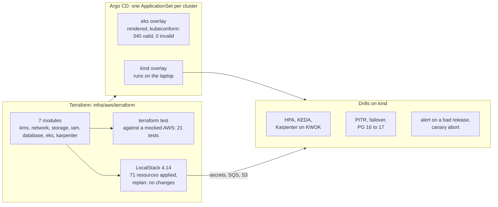

# The AWS track: the platform on AWS and EKS, without an AWS account

The story of the AWS track in one read: what it built, how each part was proven, what went wrong and what it taught.
It links to the facts and never copies them: the [spec](../specs/aws-track.md), the [runbook](../runbooks/aws-track.md)
(every command with its output), the [cost estimate](../aws-cost-estimate.md).

## 1. The phase in one picture

**The one idea: the same platform is written once for AWS, and every part is proven as far as it can be without an
account: Terraform by a mocked apply and a real apply on an emulator, the cluster layer by running it on kind, and the
operations by drills that measure what a user would see.**

## 2. What it delivered, with evidence

| Check | Result | Evidence |
|---|---|---|
| C1 to C3 | fmt, validate, tflint, Trivy clean; 21 `terraform test` runs pass, the whole design applied against a mocked AWS | [runbook 2.1](../runbooks/aws-track.md#21-every-check-that-needs-no-account) |
| C4 | 71 resources on LocalStack in 79 s, replan `No changes`, destroy leaves nothing | [runbook 2.2](../runbooks/aws-track.md#22-apply-to-localstack) |
| C5 | The EKS overlay and every add-on chart: 441 resources, 340 valid, 0 invalid, 101 CRD definitions with no schema to check against | [runbook 8](../runbooks/aws-track.md#8-the-eks-overlay-and-ci-c5) |
| C6 to C9 | 9 Applications healthy; HTTPS through Envoy Gateway with a cert-manager certificate; a Secrets Manager value in the cluster 14 s after a change; `:latest` and limit-less pods denied, a root pod reported by the audit policy | [runbook 3](../runbooks/aws-track.md#3-kind-with-the-platform) |
| C10 | HPA: 5 replicas decided 33 s into 899 requests a second and running at 40 s, 0 failed of 211,658, back to 1 after the load | [runbook 4.1](../runbooks/aws-track.md#41-hpa-under-load-c10) |
| C11 | KEDA: an SQS worker from 0 to 5 in 31 s, the queue drained, back to 0 | [runbook 4.2](../runbooks/aws-track.md#42-keda-on-an-sqs-queue-c11) |
| C12 | Karpenter: spot first, on-demand past spot's limit, a reclaimed spot node drained with 11 of 12 ready at worst, consolidation to no nodes | [runbook 4.3](../runbooks/aws-track.md#43-karpenter-on-kwok-spot-first-a-reclaim-consolidation-c12) |
| C13 | PostgreSQL 16 to 17 by logical replication under writes: checksums equal, a 9.5 s write gap | [runbook 5.3](../runbooks/aws-track.md#53-major-upgrade-by-logical-replication-c13) |
| C14 | Failover: 30.5 s write gap on a crash; a graceful delete held the primary 3 minutes first | [runbook 5.2](../runbooks/aws-track.md#52-failover-c14) |
| C15 | An accidental `DELETE` undone by a restore to 3 s before it, ready in 79 s | [runbook 5.1](../runbooks/aws-track.md#51-point-in-time-restore-c15) |
| C16 | A bad release raised an alert (an Alertmanager notification) 1 min 58 s after its pod started; Loki held the failing requests; resolved after the revert | [runbook 6.1](../runbooks/aws-track.md#61-an-alert-finds-a-bad-release-c16) |
| C17 | A canary of a faulty build aborted by its analysis 37 s after release, one pod of six ever serving it | [runbook 6.2](../runbooks/aws-track.md#62-canary-with-analysis-c17) |
| C18 | 958 USD a month all on-demand, 654 with spot workers, 576 with a Savings Plan and an RDS reservation | [cost estimate](../aws-cost-estimate.md) |

Not done: an apply to a real AWS account (none was available), and so a real spot interruption message; the README
says so. C19 (CI green on GitHub) and the rulesets' application wait for the push.

## 3. What runs, and who installed it

| Layer | Installed by | Where |
|---|---|---|
| kind cluster, LoadBalancer controller, local Git server, LocalStack | [up.sh](../../infra/kind/up.sh) | The laptop's Docker |
| Argo CD | `up.sh`, with Helm | kind |
| cert-manager, Envoy Gateway, External Secrets, metrics-server, kube-prometheus-stack, Loki, Alloy, podinfo | Argo CD, from [platform.yaml](../../infra/argocd/clusters/kind/apps/platform.yaml) | kind |
| Kyverno, KEDA, Argo Rollouts, CloudNativePG, Barman Cloud | Argo CD, applied per drill from [optional/](../../infra/argocd/clusters/kind/optional) | kind |
| Karpenter's KWOK provider, KWOK | [install.sh](../../infra/drills/karpenter/install.sh), built from source | kind |
| VPC, IAM, KMS, S3, SQS, EventBridge, Secrets Manager | Terraform | LocalStack |

## 4. Who does what

| Tool | Its job here |
|---|---|
| Terraform, `terraform test` | The AWS design, and its tests against a mocked provider |
| LocalStack | Real API calls for the services its free image has |
| tflint, Trivy, kubeconform, gitleaks | The checks CI runs with no account |
| Argo CD + ApplicationSet + Kustomize | One template per cluster; the overlay is the only difference between kind and EKS |
| Envoy Gateway, cert-manager | HTTPS in through the Gateway API |
| External Secrets | Secrets from AWS Secrets Manager, never in Git |
| Kyverno | Admission policies in CEL |
| HPA, KEDA, Karpenter | Pods by CPU, workers by queue depth, nodes by pending pods |
| CloudNativePG, Barman Cloud, PgBouncer | Postgres with replicas, WAL archive and PITR, and a switchable entry point |
| Prometheus, Alertmanager, Loki, Alloy | Metrics, alerts, logs |
| Argo Rollouts | Releases decided by a metric |
| k6 | Load |

## 5. The decisions that shaped it

The full table is the [spec's](../specs/aws-track.md#decisions). The four that mattered most:

- **Proof without an account (decision 1):** an emulator where it has the service, a mocked apply where it does not,
  and the README saying which is which.
- **One template, two overlays (decision 11):** moving the k3s platform to EKS is a new overlay, not a rewrite.
- **The laptop's memory (decision 23):** the drills' add-ons come and go; the API server's memory grows with every
  CRD.
- **Measure what a user sees:** every drill records a client's view (write gaps, failed requests, time to page), not
  only the controller's status.

## 6. What we learned

| Lesson | From |
|---|---|
| A mocked apply finds real bugs: a `for_each` over IDs unknown at plan time would have failed a real plan | the database module |
| A refactor uses `moved`, never `state rm` | a bucket moved into a module |
| An emulator needs every endpoint the provider calls, or one call leaves for real AWS | S3 Control |
| A graceful stop of a Postgres primary behind a pooler waits for the smart shutdown timeout | the failover drill |
| A pooler is bound to its cluster: cut over by moving a Service, and resume first if a step fails | the upgrade drill |
| `for: 1m` is most of the time to page; a 5xx-only rule under-reads a failure that is also 4xx | the alert drill |
| Every CRD costs API server memory | the first full sync |

## 7. What the next phase inherits

- The Terraform modules and envs, and `tools/check-terraform.sh`, ready for a real account: `envs/dev` with an S3
  state bucket is the first apply.
- The eks overlay, rendered and validated; Karpenter's NodePools and the interruption queue's wiring.
- The drills as scripts, rerunnable on kind, and the cost script.
- CI and the repo's Git flow (ruleset, CODEOWNERS, PR template, release workflow).

## 8. Read next

1. The [spec](../specs/aws-track.md): every decision with its why, and the acceptance checks.
2. The [runbook](../runbooks/aws-track.md), sections 2 to 9, each command with its output.
3. The [cost estimate](../aws-cost-estimate.md).
