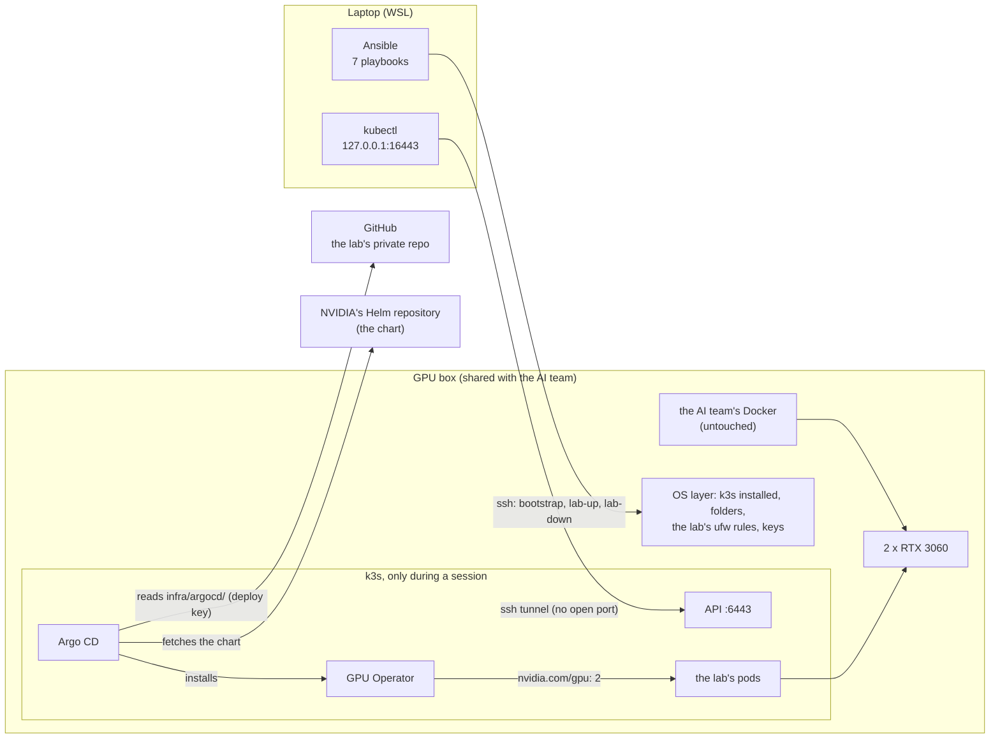
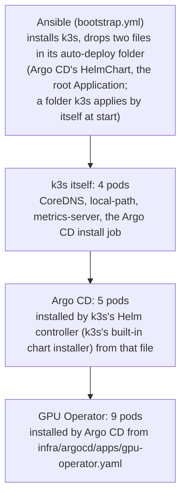
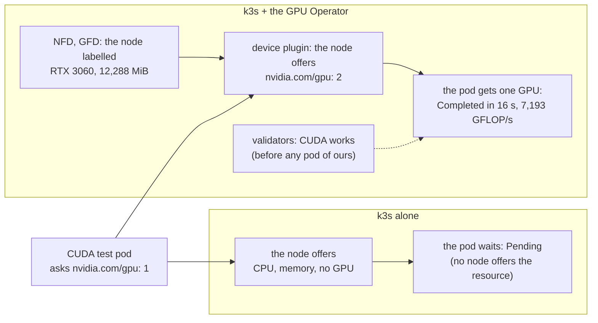

# Phase 1 review: the GPU box

The story of phase 1 in one read, written at its end (2026-10-31): what it built, how the pieces fit, why each tool,
what we learned, and what phase 2 inherits. It tells the story and points to where each fact lives: the
[spec](../specs/gpu-box-platform.md) (why), the [runbooks](../runbooks/README.md) (how, now), the
[design notes](../notes/README.md) (the concepts).

## 1. The phase in one picture

**Phase 1 gave the lab a GPU cluster of its own on a machine shared with the AI team (the team that builds the OCR
workload), which runs only while the lab works,
changes nothing of theirs, and has every trace it leaves listed with its removal.**

Words in the picture: `lab-up` and `lab-down` are the playbooks that start and stop the lab at each session; the
deploy key is a read-only key that lets Argo CD read the lab's private repo (this public one is exported from it);
`nvidia.com/gpu: 2` is how the node tells Kubernetes it has two GPUs to hand out. One GPU request step by step:
[following one GPU request](../notes/gpus-on-the-hosts-driver.md#following-one-gpu-request).

## 2. What it delivered

| Achievement | Evidence (2026-10-30 unless dated) | Where |
|---|---|---|
| The machine is reachable from the laptop, at the office and from home over the office VPN | SSH by key; WSL mirrored mode and a Windows relay (2026-10-25) | [Reach the box](../runbooks/reach-the-box.md), [why the relay](../notes/wsl-and-a-full-tunnel-vpn.md) |
| A design agreed before anything was built | The spec: 16 decisions, acceptance A1 to A11, the teardown inventory; approved before the build | [Spec](../specs/gpu-box-platform.md) |
| A cluster that exists only while the lab works | k3s v1.36.5, one node; `lab-up` 17 to 19 s; `lab-down` 12 s, with every leftover counted 0; not started at boot | [Lab session](../runbooks/lab-session.md) |
| Everything inside the cluster comes from Git | Argo CD installed by k3s from a file; it installs the GPU Operator as the repo describes it (the Application and its values; the chart from NVIDIA), reading the repo through a read-only key | [Bootstrap, steps 4 to 6](../runbooks/gpu-box-bootstrap.md#4-the-first-lab-up) |
| GPUs usable from Kubernetes, on the machine's own driver | `nvidia.com/gpu: 2`; a CUDA pod on one RTX 3060, 7,193 GFLOP/s | [Bootstrap, steps 6 and 7](../runbooks/gpu-box-bootstrap.md#6-argo-cd-syncs-the-gpu-operator) |
| The shared machine protected | The AI team's containers, configs and firewall chains unchanged; k3s's ports closed to everyone but the pods; 76 MB on `/`; about 2.2 GiB of memory at rest | [Acceptance](../runbooks/gpu-box-bootstrap.md#8-acceptance) |
| A way out | Every addition inventoried with its removal; `teardown.yml` previewed (the real run waits for the lab's end); nothing the lab wrote acts at boot, so kernel settings clear at the machine's next reboot | [Teardown](../runbooks/gpu-box-teardown.md), [inventory](../specs/gpu-box-platform.md#teardown) |
| Every step repeatable | A runbook for each stage the lab runs, from a fresh laptop to a clean machine, each command with its real output (teardown's removal step gets its output when it runs) | [The journey](../runbooks/README.md) |

All eleven acceptance checks hold; four were run narrower than the spec words them (A5, A6, A9, A10, [as run](../specs/gpu-box-platform.md#acceptance)). The table, with each output, is [bootstrap, step 8](../runbooks/gpu-box-bootstrap.md#8-acceptance).

## 3. What runs, and who installed it

**Three layers install each other, so only the first needs a hand on the machine.**

18 pods in three namespaces during a session. The full list, real, with each pod's role:
[lab session, step 3](../runbooks/lab-session.md#3-reach-the-cluster-the-tunnel-and-kubectl). Our own test pod,
`cuda-nbody`, ran for acceptance A3 and again after restarts, and is deleted after each run
([bootstrap, step 7](../runbooks/gpu-box-bootstrap.md#7-the-cuda-test-pod)).

## 4. Who does what: Ansible, k3s, Argo CD, the GPU Operator

**Ansible owns the machine's operating system, Argo CD owns everything inside the cluster, and k3s is the bridge:
Ansible installs it, and it installs Argo CD; the GPU Operator is what Argo CD installs, the piece that lets pods use
the GPUs** ([D4](../design.md#decisions), [the handoff](../notes/ansible-and-argo-cd.md#the-handoff)).

| Tool | What it did in phase 1 | Why this tool |
|---|---|---|
| Ansible, from the laptop | 7 playbooks: `bootstrap` (once), `deploy-key` (once), `lab-up` and `lab-down` (every session), `check` and `footprint` (read-only), `teardown` (previewed only) | Every change to a shared machine shown first, safe to repeat, stopped at the first surprise: [why Ansible and not a shell script](../notes/ansible-and-argo-cd.md#why-ansible-below-the-line-and-not-a-shell-script) |
| k3s | Runs the cluster; installed Argo CD from a file, and applies the root Application | One light program, a full Kubernetes, easy to run only while the lab works: [Kubernetes on a shared machine](../notes/kubernetes-on-a-shared-machine.md) |
| Argo CD | Installed the GPU Operator (NVIDIA's chart, with the repo's Application and values) under its root Application, the one app that lists all the others, and keeps it equal to Git; re-synced 21 s after a `lab-up` | The repo is the record of what runs; it pulls, so no port opens: [the handoff](../notes/ansible-and-argo-cd.md#the-handoff) |
| GPU Operator, installed by Argo CD | 9 pods: Node Feature Discovery and GPU Feature Discovery label the node (RTX 3060, 12,288 MiB, ampere, compute capability 8.6); the device plugin offers `nvidia.com/gpu: 2` and hands one GPU to each pod that asks; the DCGM exporter publishes GPU metrics (for phase 3b); two validators check that a pod can run CUDA. Its driver and toolkit pods stay off: the machine's own are used | Kubernetes counts CPU and memory but knows nothing about GPUs; the Operator, NVIDIA's own chart, makes them a resource pods can ask for, in one install: [what the Operator runs](../notes/gpus-on-the-hosts-driver.md#what-the-operator-runs) |

**The GPU Operator's purpose, following one GPU request.** The CUDA test pod asks for `nvidia.com/gpu: 1`. Without
the Operator, no node offers that resource, so the scheduler finds no place for the pod and it stays `Pending` (not
tried here: the lab never ran k3s without it); with the Operator, as run on 2026-10-30
([bootstrap, steps 6 and 7](../runbooks/gpu-box-bootstrap.md#6-argo-cd-syncs-the-gpu-operator)):

## 5. The decisions that shaped it

| Decision | Why | Spec |
|---|---|---|
| The GPU Operator uses the machine's own driver and toolkit | The AI team's Docker already uses them; installing others would change their work | [Rows 3, 4](../specs/gpu-box-platform.md#decisions) |
| Everything bulky on `/mnt/data` | `/` was 98% full | [Row 1](../specs/gpu-box-platform.md#decisions) |
| k3s runs only during lab sessions | Between sessions the machine is the AI team's alone | [Row 11](../specs/gpu-box-platform.md#decisions) |
| The lab's ufw rules go first | ufw takes the first matching rule, and a rule already on the machine, higher in the list, let a laptop on the office VPN reach k3s's ports | [Row 8](../specs/gpu-box-platform.md#decisions) |
| kubectl through an SSH tunnel, never an open port | The API stays closed to the office network | [Row 10](../specs/gpu-box-platform.md#decisions) |
| Teardown leaves no trace, and nothing the lab writes acts at boot | Any reboot of the machine finishes the cleanup by itself | [Teardown](../specs/gpu-box-platform.md#teardown) |

## 6. What we learned

**From the incidents** (each a row in [known failure modes](../known-failure-modes.md)):

| Lesson | From |
|---|---|
| A VPN that carries all traffic (full tunnel) can starve WSL's own; let Windows carry it | The AI coding agent's session dropped when the VPN came on |
| Read the code, not a summary, before describing a component | The ufw rules' direction, the device plugin's role, both written wrongly first |
| Read a shared firewall's whole rule set before trusting its default | Port 6443 reachable over the VPN, through a rule already on the machine |
| Anything that prints from the machine goes through `tools/mask.py` (it hides the hostname and public addresses) and shows a summary only | An address, the hostname, the AI team's container and staff names in the agent's session |

**About working:**
- Runbooks written as each step runs, not after the phase; every command with its real output.
- A choice with several ways to do it is planned first, in the agent's Plan mode (it can only write a plan until I
  approve).
- Mask little, keep values real; check when a path was created before calling it the lab's.

## 7. What phase 2 inherits

| The platform's contract | How |
|---|---|
| New cluster components | A file in `infra/argocd/apps/`, pushed to GitHub; Argo CD installs it |
| Anything added to the machine | Its teardown row and step in the same commit ([AGENTS.md](../../AGENTS.md#living-docs-and-the-journal-never-mixed-owner-2026-10-25)) |
| A working session | `lab-up` at the start, `lab-down` before the end ([lab session](../runbooks/lab-session.md)) |
| GPU work | Check the GPUs' load first: Kubernetes cannot see the AI team's use ([why](../notes/gpus-on-the-hosts-driver.md#what-kubernetes-cannot-see)) |
| The budget | About 2.2 GiB of memory at rest; the machine's free memory swung from 2.8 to 26 GiB available on 2026-10-30 |

Open at the phase's end: the image registry ([O2](../design.md#open-decisions)), still open, and how the machine reads
Blob, since settled by the 2a spec: the laptop copies, the machine holds no Azure key
([row 4](../specs/data-path.md#decisions)). Next was phase 2a, the data path ([its review](phase-2a-data-path.md)).

## 8. Catch up in order

1. This page.
2. [GPUs on the host's driver](../notes/gpus-on-the-hosts-driver.md) and
   [Kubernetes on a shared machine](../notes/kubernetes-on-a-shared-machine.md).
3. [Ansible and Argo CD](../notes/ansible-and-argo-cd.md): why not a script, and the handoff.
4. [Lab session](../runbooks/lab-session.md): what every session looks like.
5. [Bootstrap, step 8](../runbooks/gpu-box-bootstrap.md#8-acceptance): the proof.
6. [The spec's teardown](../specs/gpu-box-platform.md#teardown): how the lab leaves.
