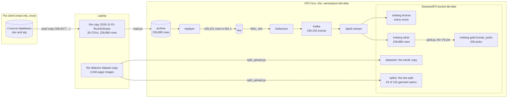
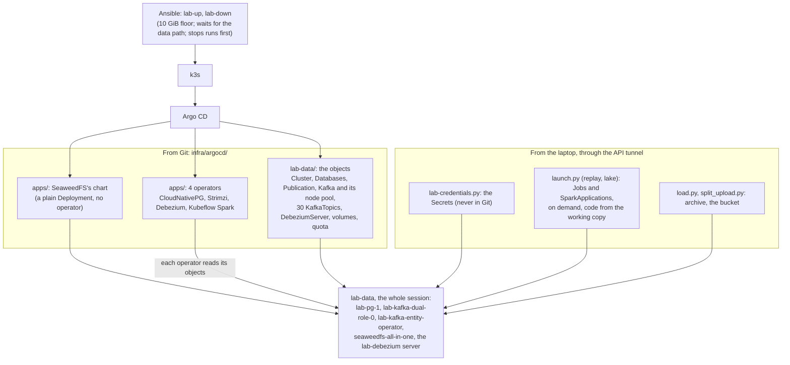
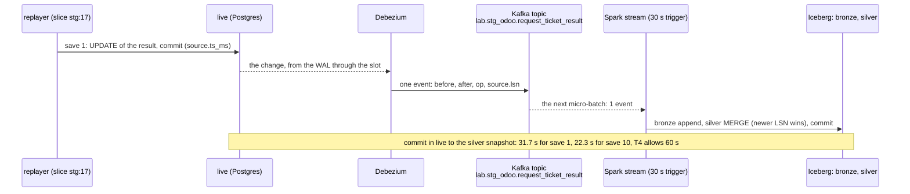
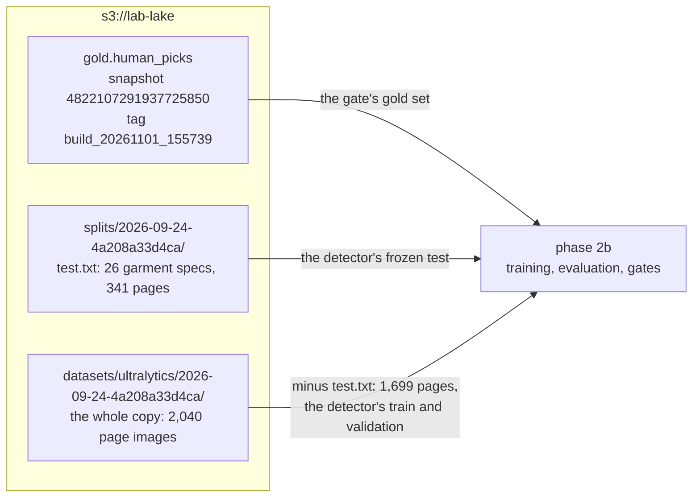

# Phase 2a review: the data path

The story of phase 2a in one read, written at its end (2026-11-02): what it built, how the pieces fit, why each tool,
what we learned, and what phase 2b inherits. It tells the story and points to where each fact lives: the
[spec](../specs/data-path.md) (why), the [runbook](../runbooks/data-path.md) (how, now), the
[design notes](../notes/README.md) (the concepts). It builds on [phase 1](phase-1-gpu-box.md), which gave the lab its
cluster.

## 1. The phase in one picture

**Phase 2a read the OCR tables of my team's client, a garment manufacturer, once, without any person in them, and rebuilt inside the lab the path a real
platform runs: every change captured as an event, carried on a log, and kept as versioned tables, from which the two
datasets of the later phases are cut, each with a version id.**

Words in the picture: dev and stg are the client's development and staging environments; `archive` is the lab's
frozen copy and `live` the database the replayer writes the client's history back into, in time order; the WAL is
Postgres's change log and the slot the bookmark Debezium reads it from; bronze keeps every event as it arrived and
silver the latest state of each row; a gold table is a dataset with its own version id (an Iceberg snapshot id); the
V6 join is the rule that finds, for each crop a person chose, the service's unit it was cut from
([gold sets](../specs/data-path.md#gold-sets)). Kafka holds 13 events more than the fill wrote: the two slices of the
T4 checks (section 4).

## 2. What it delivered

| Achievement | Evidence (2026-11-01) | Where |
|---|---|---|
| A design agreed before anything was built | The spec: 25 decisions and acceptance B1 to B16, checked against its sources by an independent read (17 findings), approved on 2026-11-01 before any code | [Spec](../specs/data-path.md) |
| The client read once, no person leaving it | The copy `2026-11-01-ffcc03c52aea`: 28 files, 239,880 rows, 4 min 21 s through the reader roles; the people counts all 0 (B1) | [Runbook step 1](../runbooks/data-path.md#1-take-the-snapshot-laptop), [the contract](../specs/data-path.md#snapshot) |
| The data path installed from Git | Six new Argo CD apps, everything `Healthy` in 3 min 17 s: four operators, Postgres 17.11, Kafka 4.3.1 with 30 topics, SeaweedFS with its bucket | [Step 2](../runbooks/data-path.md#2-install-the-data-path-box) |
| The lab's own copy of the client's tables | `archive`: 28 of 28 tables match the manifest (B2) | [Step 3](../runbooks/data-path.md#3-load-archive-laptop-to-box) |
| History replayed, captured and kept | 245,221 rows written in 601 s, `live` equal to `archive` (28 of 28); Debezium's lag p99 1.19 s; silver equal to the copy, 239,880 rows (B4); 232 PDFs (B5); Spark 4.1.4 under the Kubeflow operator (B3) | [Step 4.4](../runbooks/data-path.md#4-fill-live-and-the-lake-box) |
| T4's first half: a replayed human edit in silver within a minute, without polling | 10 saves, the slowest 31.7 s of 60; no role but the replayer queried the copied tables (B6); the slot holds WAL only while Debezium is stopped (B7, B8) | [Step 4.5](../runbooks/data-path.md#4-fill-live-and-the-lake-box), [T4](../design.md#outcomes) |
| A path that survives failure | 0 bronze duplicates through five stream failures, and silver still equal to the copy (B9); `lab-down` and `lab-up` keep every count (B12) | [Verify end to end](../runbooks/data-path.md#verify-end-to-end) |
| T2's two datasets | `gold.human_picks`: 200 picks, 50 excluded with their reason, read twice the same (B10); the detector test split: 26 of 132 garment specs, none in both sides, its sha256 recorded (B11) | [Step 5](../runbooks/data-path.md#5-the-gold-sets-box-then-laptop), [T2](../design.md#outcomes) |
| The shared machine protected | `lab-data` within its 8 GiB quota (B13); the AI team's Docker unchanged (B15); teardown previewed and nothing outside k3s's folders (B16) | [Verify end to end](../runbooks/data-path.md#verify-end-to-end) |
| Every step repeatable | The data path's stage of the journey, each command with its real output; 11 new failure-mode rows | [The journey](../runbooks/README.md), [known failure modes](../known-failure-modes.md) |

All sixteen acceptance checks passed as run: the table, with each result and where its output is, is
[verify end to end](../runbooks/data-path.md#verify-end-to-end). Three were run narrower than the spec words them
(B7, B9, B12); the spec's [as run table](../specs/data-path.md#acceptance) gives each as it was run.

## 3. What runs, and who installed it

**Phase 1's chain of installers gained one level: Argo CD now installs four operators and SeaweedFS's chart, and each
operator runs one kind of software (Postgres, Kafka, Debezium, Spark) from objects in Git; what runs only on demand is
started from the laptop, never by Argo CD.**

During a session, `lab-data` holds the five long-running pods above, and the operators run five pods in their own
namespaces (the Spark operator has two: its controller and its webhook), next to phase 1's pods; their sizes are the
[box budget](../specs/data-path.md#box-budget). A replay or a Spark job adds its own pods only while it runs. Why Argo
CD owns none of the runs: it would restart a finished Job or a stopped stream ([layout](../specs/data-path.md#layout)).
That split is also why a run's code can differ from GitHub's: the launchers send the laptop's working copy
([GitOps and direct runs](../notes/gitops-and-direct-runs.md)), so since 2026-11-02 the launchers stamp every run
with the commit it came from (section 7).

## 4. Who does what: the tools

**Each tool answers one question of the path: Postgres holds the rows, Debezium notices each change, Kafka keeps the
changes in order, Spark writes them as Iceberg tables in the bucket; an operator (a program that runs one kind of
software for you) runs Postgres, Kafka, Debezium and Spark on Kubernetes.**

| Tool | What it did in phase 2a | Why this tool |
|---|---|---|
| `psql \copy (SELECT ...)`, from the laptop | Read the client's four sources, each in one consistent transaction, only the allowed columns and rows; a manifest of counts and checksums | A SELECT drops people's columns **before** anything leaves the client; `pg_dump` copies whole tables ([spec row 2](../specs/data-path.md#decisions)) |
| CloudNativePG | One `Cluster`, `lab-pg`, with `archive`, `live` and `catalog`; the publication Debezium reads; logical WAL by default | Postgres as Kubernetes objects, its roles, Secrets and Services made for us ([spec row 8](../specs/data-path.md#decisions)) |
| The replayer (`replay.py`), a Job | Wrote the client's 86.8 days of history into `live` in about 10 minutes, each row as it was at that moment; `verify` compared `live` with `archive` | Realistic changes without touching the client ([replay](../specs/data-path.md#replay)) |
| Debezium (operator and server) | Read `live`'s WAL through the slot `lab_debezium` and sent each change to its table's topic; a heartbeat keeps the slot moving while `live` is idle | Change capture without asking the tables: [the WAL, the slot and Debezium](../notes/wal-slot-debezium.md) |
| Kafka, run by Strimzi | One broker that is also its own controller (KRaft mode, no ZooKeeper); 28 table topics kept without a time limit, the 2 heartbeat topics one day | A log any reader can reread from offset 0, so bronze can be rebuilt ([CDC and Kafka](../specs/data-path.md#cdc-and-kafka)) |
| SeaweedFS | The bucket `lab-lake`: the Iceberg warehouse, the dataset copy, the split | An S3 store under Apache-2.0 after MinIO's community edition was archived: [why](../notes/object-storage.md#why-seaweedfs) |
| Spark 4.1.4 under the Kubeflow operator, with Iceberg | One streaming job on a 30 s trigger: each micro-batch appends to bronze and merges into silver; batch jobs for the checks and the gold set | Iceberg's snapshots give each table a version id; its catalog is a row in `catalog`: [the JDBC catalog](../notes/iceberg-jdbc-catalog.md) |
| Argo CD and Ansible, from phase 1 | Argo CD installed all of the above from Git; `lab-up` and `lab-down` learned the data path | The platform's contract, unchanged: [phase 1, section 4](phase-1-gpu-box.md#4-who-does-what-ansible-k3s-argo-cd-the-gpu-operator) |

**Following one save through the path: the T4 check.** The stg result 17 was saved ten times at the client (its
history versions, then the current row). In the check, the replayer's slice mode wrote those saves into the filled
`live` 30 s apart, while the stream ran (2026-11-01 22:13 to 22:19,
[step 4.5](../runbooks/data-path.md#4-fill-live-and-the-lake-box)). Two words in the picture: the LSN is a change's
position in the WAL, so a higher LSN is a newer change; a micro-batch is one round of the stream, run when new events
are waiting, at most every 30 s:

Each save was its own micro-batch. Then, around a shorter slice (`stg:1`, 3 saves), `pg_stat_statements` showed only
the replayer's writes and Debezium's heartbeat in `live`: a change reaches silver because the WAL pushes it, not
because anything asks the table.

## 5. The decisions that shaped it

**The one rule behind them (the [spec's](../specs/data-path.md#decisions)): the client is read once, through reader
roles; everything after the copy runs on the lab's own data, and each stage can be rebuilt from the one before it.**

| Decision | Why | Spec |
|---|---|---|
| A slot on the lab's own Postgres, never on the client's | A slot on dev holds WAL whenever the machine is off and, on a managed server, can make it read-only | [Not chosen](../specs/data-path.md#not-chosen), [why](../notes/wal-slot-debezium.md#decision-1-no-slot-on-a-shared-database) |
| The copy by SELECT, people's columns and non-OCR rows left at the client | Nothing that names a person leaves the client; the catalog read found two more person columns and names in titles and results, added before any code | [Rows 1, 2](../specs/data-path.md#decisions), [snapshot](../specs/data-path.md#snapshot) |
| The laptop copies Blob files; the machine holds no Azure key | No credential on a shared machine, no live change in the client's cloud | [Row 4](../specs/data-path.md#decisions) |
| `live` mirrors the client's four sources; dev and stg merge in silver | CDC captures a source as it is; a merge mistake is fixed by rebuilding silver | [Rows 7, 18](../specs/data-path.md#decisions) |
| The replay writes each row's past, not its final state | A run inserted with its result would show the future at its start | [Row 24](../specs/data-path.md#decisions) |
| The Debezium Operator, not Kafka Connect | Connect needs an image of our own, so a registry (O2 is still open) | [Row 9](../specs/data-path.md#decisions) |
| SeaweedFS for the bucket | MinIO's community edition was archived; SeaweedFS is Apache-2.0, with a Helm chart | [Row 13](../specs/data-path.md#decisions) |
| Iceberg's JDBC catalog in Postgres | No extra service: a commit is one Postgres transaction | [Row 14](../specs/data-path.md#decisions) |
| One streaming job for bronze and silver | Half the Spark memory of two jobs, one hop less toward T4's minute | [Row 16](../specs/data-path.md#decisions) |
| Spark only while needed; a quota of 8 GiB; a 10 GiB floor at `lab-up` | The AI team comes first; Spark holds about 3 GiB while it runs | [Rows 17, 22](../specs/data-path.md#decisions), [box budget](../specs/data-path.md#box-budget) |
| The human gold set as its own Iceberg table; the test split by whole garment spec | One id per dataset version, readable after silver is rebuilt; no test page seen in training ([V9](../design.md#to-verify)) | [Rows 19, 20](../specs/data-path.md#decisions) |

## 6. What we learned

**From the incidents** (each a row in [known failure modes](../known-failure-modes.md)):

| Lesson | From |
|---|---|
| Size a Spark pod as heap plus overhead, and give the overhead room: it holds the JVM's own memory and the driver's Python | Executors, then the driver, `OOMKilled` in three of the six stream starts of the first fill ([why](../notes/spark-pod-memory.md)) |
| Know where an operator runs your command: the Kubeflow operator runs `spark-submit` in its own pod | `--packages` failed there; the jars are fetched once onto Spark's volume |
| Read a CRD's wording literally, then check where the file landed | Debezium's offset file "relative to data root" went to an unwritable folder |
| A rule in `.gitignore` matches at every depth | `infra/argocd/data/` silently left out of a commit |
| An operator's webhook adds defaults that Argo CD then sees as drift; write them out in Git | The Postgres `Cluster` `OutOfSync` with no field different |
| One `kubectl port-forward` per connection (kubectl 1.36 ends it on a reset) | The `archive` load failed at its second connection |
| A count that is off by a little is a real bug | `silver.pdf` 230 of 232: Iceberg's catalog cache read a stale table |
| A retried batch must be harmless by design | Bronze's batch id per table and silver's LSN rule absorbed five stream failures (B9) |

**About working:**
- The spec changes first, then the code: each finding during the build (the bootstrap database's password, Debezium's
  start order, the person columns, Spark's jars) was written into the spec before the fix.
- Test offline what can be tested offline: the loader and the replayer ran on a local PostgreSQL 17 first, and the V6
  join was prototyped on the copy's CSVs before the Spark job, which found the two details that took it from 70 to 200
  joins.
- An independent read against the sources before I read (a fresh agent with no stake in the text): 17 findings on
  the spec, and two of the three acceptance checks run narrower than written (B9, B12), found by this review's own
  reader; the same check, repeated, found B7 ([how I work](../how-i-work.md)).
- What reached the machine from the laptop can differ from GitHub until it is pushed: hence the commit stamp
  (section 7).

## 7. What phase 2b inherits

| The data path's contract | How |
|---|---|
| A dataset is named by its version | `gold.human_picks` by its snapshot id or tag, with the copy id and silver snapshots it read; the test split by its copy id and the list's sha256 ([gold sets](../specs/data-path.md#gold-sets)) |
| Train and validation are cut in 2b, from the rest of the garment specs | The test split is frozen; no test garment spec may enter training ([row 20](../specs/data-path.md#decisions)) |
| A run started from the laptop is traceable to its code | Two labels on each Job and `SparkApplication` the launchers create, and on its pods: the commit, and whether the launcher's folder had uncommitted changes ([the commit stamp](../specs/data-path.md#layout)) |
| Spark runs one job at a time, after a memory check | `launch.py` refuses below the job's limits plus 2 GiB; the gold job never beside the stream ([box budget](../specs/data-path.md#box-budget)) |
| The budget | Spark and the replayer at once fill `lab-data`'s 8 GiB quota, on a machine whose free memory swings by the hour; 2b's GPU jobs must fit beside it |
| A new copy of the client's tables | Always a full new copy and a full new fill, in the spec's order; gold tables are never dropped ([replay](../specs/data-path.md#replay)) |

Still open for 2b: the image registry ([O2](../design.md#open-decisions)), needed once training has an image of its
own, and what CI needs from the machine ([O3](../design.md#open-decisions)). Phase 2b is planned, not built yet
([the roadmap](../../README.md#the-roadmap)).

## 8. Catch up in order

1. This page.
2. [The data path spec](../specs/data-path.md): its layout, then the decisions.
3. [The WAL, the slot and Debezium](../notes/wal-slot-debezium.md), then
   [the JDBC catalog](../notes/iceberg-jdbc-catalog.md).
4. [The runbook](../runbooks/data-path.md): what each step looks like, with its output.
5. [Verify end to end](../runbooks/data-path.md#verify-end-to-end): the proof.
6. [The spec's gold sets](../specs/data-path.md#gold-sets): what 2b starts from.
