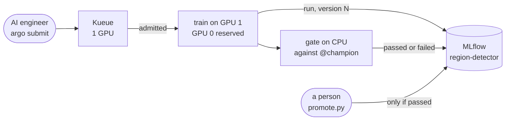

# Phase 2b: the training platform

The story of phase 2b in one read, built and accepted on 2026-11-15: what it delivered, what runs, the decisions, what
went wrong and what it taught. It points to where each fact lives: the [spec](../specs/training-platform.md) (why),
the [runbook](../runbooks/training-platform.md) (how, now, with every output), the
[design note on the gate](../notes/promotion-gate.md). The phase before it: [2a, the data path](phase-2a-data-path.md).

## 1. The phase in one picture

**An AI engineer gives a dataset id and a recipe name; the job waits for GPU 1 in a queue, trains, records every id it
used, faces a gate written before any run, and only a person can move `@champion`; and the first honest retrain showed
that nobody can say which data made the production detector.**

Words in the picture: Kueue is the queue that holds a GPU job until a GPU is free; MLflow keeps every run and the
registry of model versions; `@champion` is the alias of the version in use, here version 1, the production weights;
GPU 0 is reserved for the AI team, whose Docker work uses it, so the lab trains on GPU 1.

## 2. What it delivered

12 of 14 acceptance checks passed; E5 (T1 as written) was not met and E9 was shown in part
([the table](../runbooks/training-platform.md#verify-end-to-end)).

| Outcome | What the machine showed (REAL, 2026-11-15) |
|---|---|
| T8, self-service with a queue | One `argo submit` with a dataset id and a recipe, from a restricted identity that cannot create a pod or read a Secret; a second job waited `SchedulingGated` in Kueue until the first ended (E3, E7) |
| T7, one gate and lineage | Every version carries its run, and the run its dataset id, commit, image digest, base weights, split lists and card (E4); the 5-epoch model scored 0.787 and was blocked, `promote.py` refused it (E8) |
| T2, the scoreboard | One MLflow experiment, `region-detector-gate`, with every version's test-split scores and intervals (E10) |
| T1, reproducible training | **Reproducible, but not to production's score.** A rerun matched the first run to four decimals (E6); the production recipe without the 26 test documents scored 0.846 on mAP@50-95 against production's 0.957 (E5, not met). On production's own split the same recipe scored 0.955, but 0.759 and 0.726 on pages it did not train on, where production scores 0.962 and 0.970: production's scores on this data are near training scores ([decision 16](../specs/training-platform.md#decisions)) |
| The AI team first | GPU 0 reserved for them; each training checks its card's free VRAM and refuses below the floor, exit 75, no retry (E11); their Docker unchanged across the session; the lab 6.8 GiB of RAM idle, 13.2 GiB while training |
| Day 2 | `lab-down` mid-training in 39 s, the run marked `KILLED`, the registry intact after `lab-up` (E13); teardown previewed and the footprint scanned (E14) |

## 3. What runs, and who installed it

| Namespace | What | Installed by | RAM at rest |
|---|---|---|---|
| `argo` | The Argo Workflows controller and server, v4.1.6 | Argo CD, the argo-helm chart | 115 MiB |
| `kueue-system` | The Kueue controller, v0.20.6 | Argo CD, its OCI chart | 175 MiB |
| `mlflow` | The MLflow server 3.18.0, its job runner off; its database on `lab-pg`, its files in `s3://lab-lake/mlflow/` | Argo CD, MLflow's OCI chart | 455 MiB |
| `ai-team` | The two templates, the code as ConfigMaps, the AI engineer's identity, the NetworkPolicy, the queue | Argo CD, the [detector chart](../../pipelines/detector/), `lab-ml` | Only while a job runs: about 4.2 GiB and 2.1 GiB of VRAM per training |
| `gpu-reserve` | The placeholder pod holding GPU 0 | `lab-up` | none |

## 4. Who does what

- **Argo Workflows** runs the job as a DAG of two pods, train then gate; each step is a pod a GPU queue can hold
  ([decision 1](../specs/training-platform.md#decisions)).
- **Kueue** holds a GPU pod gated until the queue admits it, so a second job waits instead of failing or sharing a
  card ([decision 4](../specs/training-platform.md#decisions)).
- **MLflow** keeps the runs and the registry, with `@champion` ([decision 10](../specs/training-platform.md#decisions)).
- **The gate** ([gate.py](../../pipelines/detector/gate.py)) scores two versions with Ultralytics' own validator and
  bootstraps over documents ([the gate](../specs/training-platform.md#the-gate), [why](../notes/promotion-gate.md)).
- **The reservation pod** keeps the lab off the AI team's GPU ([decision 5](../specs/training-platform.md#decisions),
  [how one GPU is handed out](../notes/gpus-on-the-hosts-driver.md)).

## 5. The decisions that shaped it

| Decision | The reason that mattered |
|---|---|
| Argo Workflows, not Airflow ([D6](../design.md#decisions)) | Each step a pod Kueue can hold, on a machine that cannot spare Airflow's services |
| The gate on mAP@50-95 with a recall guard, non-inferior by a document bootstrap | mAP@50 was 0.990, near its ceiling; the margins came from a measurement, not a guess |
| T1 looser than the gate | The lab trains without the test documents, 1,608 pages against 1,894 |
| GPU 0 reserved by a pod (revised twice during the build) | The AI team ran 10 GB on GPU 0; the device plugin could not be pinned |
| A diagnostic split, never promotable | To tell a platform fault from a data fact when T1 fell short |

## 6. What we learned

- **Production's evaluation numbers behave like training numbers.** Measured before 2b, the production weights scored
  as high on the "unseen" pages of the lab's copy of the AI team's labelled pages as on its test split, which read as "no measurable inflation"; an honest retrain
  showed the gap a model normally has between trained and unseen pages (about 0.2), and production has none. Which
  data made production is not recorded: problem P1, now measured.
- **Argo CD's controller ran out of memory** after 2b's CRDs were cached, which looked like stuck syncs for 40 minutes.
- **MLflow 3.18 idles at 2 GiB** unless its GenAI job runner is turned off.
- **A quota counts gated pods**, so a GPU line in it rejects the second job instead of letting it wait.
- **Non-root Ultralytics** needs its folders moved and `WEIGHTS_DIR`, a constant fixed at import, set too.
- **A stop signal reaches the DataLoader workers**, so a training must end its own MLflow run in two paths.
- **The footprint scan** had grown to 18 MB and deadlocked a pipe; rewritten to read from a file, it found one gap
  left from phase 1 (`~/.local`), now in the teardown.
- **Seven pushes for one build**: each fix found on the machine cost a push through Git; reading the library's source
  before a fix, not after, saved the last ones.

The rows, with each fix: [known failure modes](../known-failure-modes.md).

## 7. What the next phase inherits

- **3a serves `@champion`**: still version 1, the production weights; a sync from the alias to Triton is 3a's.
- **T1 as written** needs to know which data trained production: the AI team's record of its split, or pages
  labelled after 2026-09-24 (the date of the lab's copy) as a test set production never saw.
- **E9's move and rollback** come with the first version that passes the gate and is promotable.
- **[The box plan](../specs/ml-platform.md#the-box-plan)**: one GPU job at a time on GPU 1; 3a checks vLLM's 0.70 budget
  against GPU 1's own readings before it starts.

## 8. Catch up in order

1. [The spec](../specs/training-platform.md): the one rule, the 16 decisions, the gate.
2. [The runbook](../runbooks/training-platform.md): each step with its real output, then the acceptance table.
3. [The design note on the gate](../notes/promotion-gate.md): why "not worse", over documents, with a measured margin.
4. [T1's baseline](../specs/ml-platform.md#t1s-baseline-measured-ahead-of-2b): why production's numbers mislead.
5. [GPUs on the machine's own driver](../notes/gpus-on-the-hosts-driver.md): what Kubernetes sees of the AI team's GPU use.
