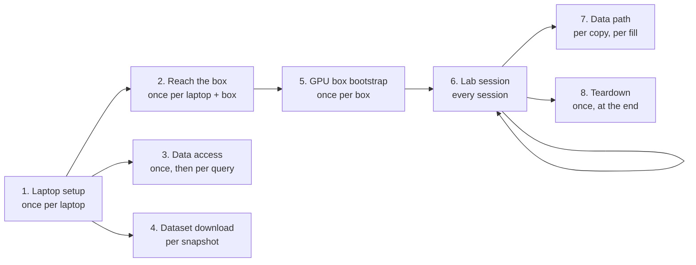
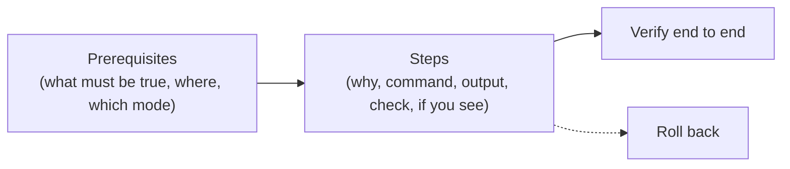

# Runbooks: the lab's journey, step by step

How to do every lab operation **now**, from a fresh laptop to a running GPU lab and back to a clean box.
Read this page first: it is the map, and each stage links to one runbook. What happened while doing a
step goes to the lab's journal (not published); a failure met becomes a row in
[known-failure-modes](../known-failure-modes.md) **and** an "If you see" line in the step where it happens
([the rule](../../AGENTS.md#living-docs-and-the-journal-never-mixed-owner-2026-10-25)). Why each stage is
built the way it is, phase by phase: the [phase reviews](../README.md#phase-reviews).

## The journey

| # | Stage | How often | Where you must be | Claude Code mode ([which](../../AGENTS.md#which-mode-a-session-runs-in-owner-2026-10-25)) | Runbook | Last verified |
|---|---|---|---|---|---|---|
| 1 | Laptop setup: WSL, repo, toolchain, GitHub | Once per laptop | Anywhere; VPN **off** from home | Auto | [laptop-setup](laptop-setup.md) | 2026-10-30 |
| 2 | Reach the box: SSH key, relay, sudo | Once per laptop and box | Office, or home with the VPN **on** | Auto (the owner types the passwords) | [reach-the-box](reach-the-box.md) | 2026-10-30 |
| 3 | Data access: az, Postgres, Blob | Once, then per query | Where the client's access rule allows (the lab's private data access runbook) | Auto | data-access (the lab's private runbook) | 2026-10-30 |
| 4 | Dataset download from Ultralytics | Per snapshot | Anywhere; VPN **off** from home | Auto | [ultralytics-dataset-download](ultralytics-dataset-download.md) | 2026-10-30 (verify step) |
| 5 | GPU box bootstrap: k3s, GPU Operator, Argo CD | Once per box | As stage 2 | Auto to preview, **Manual** to change | [gpu-box-bootstrap](gpu-box-bootstrap.md) | 2026-10-30 |
| 6 | Lab session: start, work, stop | Every session | As stage 2 | **Manual** for start and stop | [lab-session](lab-session.md) | 2026-10-30 |
| 7 | Data path: snapshot, load, replay, CDC, Iceberg, gold sets | Snapshot per copy; fill per need | Office, or home with the VPN **on** (the box); the client's databases per their access rule | Auto for the snapshot, **Manual** for the box | [data-path](data-path.md) | 2026-11-01 (step 1) |
| 8 | Teardown: the box as if the lab never existed | Once, at the end | As stage 2 | Auto to scan and preview, **Manual** to remove | [gpu-box-teardown](gpu-box-teardown.md) | 2026-10-30 (scan and preview) |
| 10 | AWS track: Terraform checks, LocalStack, kind with the platform, the drills | Per change, per drill | Anywhere; VPN **off** from home (downloads) | Auto (all local) | [aws-track](aws-track.md) | 2026-11-03 (toolchain) |

**Where you are decides what works** (the reasons: [the VPN and WSL](../notes/wsl-and-a-full-tunnel-vpn.md)):

| You are | The box | GitHub push, `pip`, downloads |
|---|---|---|
| Office | `gpu-box`, no VPN | Works |
| Home, VPN off | Unreachable | Works |
| Home, VPN on | `gpu-box-relay` only | Flaky: push with the VPN off |

## What every runbook holds

- **A complete flow.** It starts from its prerequisites and ends with a check that proves the result,
  then how to undo it. A page is revised as a whole when a step changes, never appended to.
- **Command, then output.** Each command is copy-pasteable from the repo root, with the login isolation of
  [AGENTS.md](../../AGENTS.md#sessions-and-logins), followed by its real output (trimmed, dated, through
  `tools/mask.py`: internal addresses kept, then masked in this public copy, the hostname and public addresses hidden) and a `Check:` line. A step that cannot be re-run shows the command and the real output of its
  check.
- **If you see.** A failure met in real use is a line under its step: what you see, what to do, and its
  [known-failure-modes](../known-failure-modes.md) row.
- **Calls the code, never copies it.** An automated step is one command and a link to its file
  ([spec and code](../../AGENTS.md#spec-and-code-never-duplicate-each-other)). Concepts are linked to the design notes, never repeated.
- **Changes outside the repo** (the box, cloud, GitHub, Windows) are marked "shown to the owner first"
  ([safety](../../AGENTS.md#safety-and-approvals)).

## Template

The page template stays in the lab's private repo; every page follows the rules above and those of
[AGENTS.md](../../AGENTS.md#living-docs-and-the-journal-never-mixed-owner-2026-10-25).
