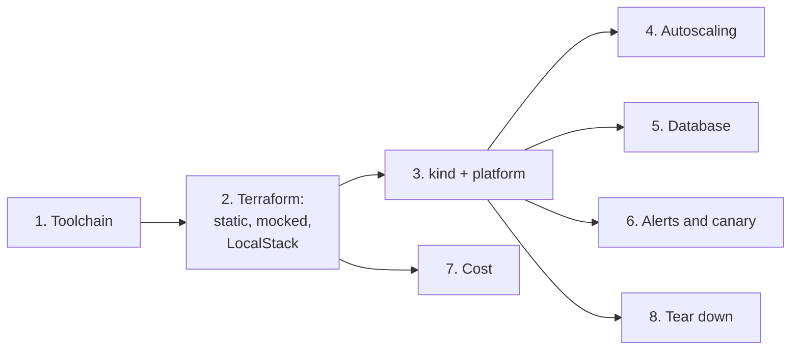

# Runbook: the AWS track on the laptop

How to run the [AWS track](../specs/aws-track.md) from the laptop, with no AWS account: the Terraform checks, the
LocalStack apply, the kind cluster with its platform, and each drill with the output it gave. Every command runs from
the repo root. Sections are written as each step first runs.

## The journey



| Prerequisite | Check |
|---|---|
| Docker (Docker Desktop with WSL integration on this laptop) | `docker info --format '{{.ServerVersion}}'` prints a version (29.9.2 on 2026-11-03) |
| Internet for downloads (VPN off at home) | `curl -sI https://releases.hashicorp.com \| head -1` |
| Free memory for kind | `free -g`: about 4 GB available is enough for the base set plus one drill ([decision 23](../specs/aws-track.md#decisions)) |

## 1. Toolchain

The binaries go to the gitignored `.toolchain/bin/`, each checked against its release's checksum file, as for `gh`
and `helm` in [laptop setup](laptop-setup.md). Versions, chosen as the latest releases on 2026-11-03:

| Tool | Version | Checksum source |
|---|---|---|
| terraform | 1.17.1 | `terraform_1.17.1_SHA256SUMS` |
| tflint | 0.65.0 | `checksums.txt` |
| trivy | 0.76.1 | `trivy_0.76.1_checksums.txt` |
| kind | 0.33.0 | `kind-linux-amd64.sha256sum` |
| kwok, kwokctl | 0.8.0 | none published for the binaries |
| kubeconform | 0.8.0 | `CHECKSUMS` |
| k6 | 2.3.0 | `k6-v2.3.0-checksums.txt` |
| LocalStack | image `localstack/localstack:4.14.0` | Docker digest |

The pattern for one tool (the others differ only in names):

```bash
V=1.17.1; cd "$(mktemp -d)"
curl -fsSLO https://releases.hashicorp.com/terraform/$V/terraform_${V}_linux_amd64.zip
curl -fsSLO https://releases.hashicorp.com/terraform/$V/terraform_${V}_SHA256SUMS
grep linux_amd64.zip terraform_${V}_SHA256SUMS | sha256sum -c
python3 -c "import zipfile;zipfile.ZipFile('terraform_${V}_linux_amd64.zip').extract('terraform','$OLDPWD/.toolchain/bin')"
chmod +x "$OLDPWD/.toolchain/bin/terraform"; cd -
```

```text
terraform_1.17.1_linux_amd64.zip: OK
```

The laptop has no `unzip`, so Python's `zipfile` extracts.

Check, 2026-11-03:

```text
terraform    Terraform v1.17.1
tflint       TFLint version 0.65.0
trivy        Version: 0.76.1
kind         kind v0.33.0 go1.26.7 linux/amd64
kwok         kwok version v0.8.0 go1.26.0 (linux/amd64)
kubeconform  v0.8.0
k6           k6 v2.3.0 (commit/e088784614, go1.26.8, linux/amd64)
```

LocalStack, started once to read what it offers:

```bash
docker run -d --rm --name ls-probe -p 4566:4566 localstack/localstack:4.14.0
sleep 20; curl -s localhost:4566/_localstack/health; docker stop ls-probe
```

```text
{"services": {"acm": "available", ..., "ec2": "available", ..., "events": "available", "iam": "available",
"kms": "available", ..., "s3": "available", ..., "secretsmanager": "available", ..., "sqs": "available",
"ssm": "available", ..., "sts": "available", ...}, "edition": "community", ...}
LocalStack version: 4.14.0
```

Check: no `rds` or `eks` in the list, which is why those two modules are covered by the mocked apply only.

## 2. Terraform: static checks, mocked apply, LocalStack

The modules and envs are in [infra/aws/terraform](../../infra/aws/terraform); what each decides is in the
[spec](../specs/aws-track.md#decisions).

### 2.1 Every check that needs no account

```bash
tools/check-terraform.sh
```

It runs `fmt -check`, then `init -backend=false`, `validate` and `terraform test` in every module and env, then
tflint (AWS ruleset 0.50.0) and Trivy (HIGH and CRITICAL fail the run). Output, 2026-11-03, trimmed:

```text
== fmt
== infra/aws/terraform/envs/dev: init, validate, test
Success! The configuration is valid.
Success! 2 passed, 0 failed.
...
== infra/aws/terraform/modules/network: init, validate, test
Success! The configuration is valid.
Success! 5 passed, 0 failed.
...
== tflint
== trivy
all Terraform checks passed
```

Check: 21 tests across 7 modules and `envs/dev`, all passed; tflint and Trivy print no finding.

- If you see `is an invalid ARN` or `expected an object type ... found tuple` from a test: the mock needs realistic
  defaults ([known failure](../known-failure-modes.md)).
- If you see `Invalid for_each argument` on a set of IDs: key the `for_each` by names known at plan time. The test of
  `envs/dev` found this in the database's ingress rules, where the cluster's security group ID does not exist yet;
  a real plan would have failed the same way.
- Trivy found the EKS API open to an address range (AWS-0040, AWS-0041): dev now keeps the API private by default,
  reached over the VPN, and an address range is an explicit choice (`api_allowed_cidrs`).

### 2.2 Apply to LocalStack

```bash
infra/kind/localstack.sh up
cd infra/aws/terraform/envs/localstack
../../../../../.toolchain/bin/terraform init && ../../../../../.toolchain/bin/terraform apply
../../../../../.toolchain/bin/terraform plan -detailed-exitcode
```

```text
ec2=available events=available iam=available kms=available lambda=available logs=available s3=available s3control=available secretsmanager=available sqs=available sts=available
Apply complete! Resources: 71 added, 0 changed, 0 destroyed.
apply wall 79.16 s
No changes. Your infrastructure matches the configuration.
```

The outputs of the first apply (65 resources, before the backup bucket became a module instance; the module adds its
own versioning, encryption, public-access block, ownership, lifecycle and policy, six resources):

```text
karpenter_queue = "ocr-platform-ls-karpenter-interruption"
lake_bucket = "ocr-platform-ls-lake"
pg_backup_bucket = "ocr-platform-ls-pg-backups"
secret_name = "ocr-platform/localstack/podinfo"
work_queue_url = "http://sqs.ap-southeast-1.localhost.localstack.cloud:4566/000000000000/ocr-platform-ls-work"
```

Check: the second plan exits 0 with `No changes` (the apply is idempotent).

- If you see `S3 Control: ListTagsForResource, StatusCode: 403`: a service the provider calls has no LocalStack
  endpoint, so the call left for real AWS ([known failure](../known-failure-modes.md)).

Roll back, and the last part of C4: `terraform destroy` in the same folder, then `infra/kind/localstack.sh down`
(LocalStack keeps nothing on disk). Output, 2026-11-04 (the current code applied, replanned and destroyed in one run):

```text
Destroy complete! Resources: 71 destroyed.
destroy wall 89.04 s
ec2 describe-vpcs        0
s3api list-buckets       0
iam list-roles           0
secretsmanager list-secrets 0
events list-rules        0
kms list-aliases         0
```

Check: `terraform state list` is empty and LocalStack lists none of the track's resources (SQS returns no queue list
at all).

## 3. kind with the platform

[infra/kind/up.sh](../../infra/kind/up.sh) creates the cluster `ocr-lab` (one node), a LoadBalancer controller
(cloud-provider-kind), the local Git server Argo CD reads, LocalStack on the kind network, Argo CD, and the root app
[root.yaml](../../infra/argocd/clusters/kind/root.yaml). Argo CD then installs the always-on add-ons from
[platform.yaml](../../infra/argocd/clusters/kind/apps/platform.yaml), the cluster-wide objects
([manifests/kind](../../infra/platform/manifests/kind)) and podinfo ([workloads/podinfo](../../infra/workloads/podinfo)).
Every later change reaches the cluster by commit, then `infra/kind/git-sync.sh`.

```bash
infra/kind/up.sh
source infra/kind/lab.env    # bash: KUBECONFIG, helm folders, the toolchain on PATH
kubectl -n argocd get applications
```

```text
kind cluster ocr-lab up; Argo CD syncing infra/argocd/clusters/kind
up.sh wall 68.60 s
NAME                    SYNC     HEALTH
alloy                   Synced   Healthy
cert-manager            Synced   Healthy
envoy-gateway           Synced   Healthy
external-secrets        Synced   Healthy
kube-prometheus-stack   Synced   Healthy
loki                    Synced   Healthy
metrics-server          Synced   Healthy
platform-config         Synced   Healthy
podinfo                 Synced   Healthy
root-kind               Synced   Healthy
```

Check: every Application `Synced` and `Healthy` (C6).

- If you see `failed to list refs: timeout exceeded` on the root app: the local Git server is not serving
  ([known failure](../known-failure-modes.md)).
- If you see the Argo CD controller or Grafana `OOMKilled`: the laptop is short of memory; Kyverno, KEDA and Argo
  Rollouts are therefore applied per drill from [optional/](../../infra/argocd/clusters/kind/optional), and their
  CRDs deleted after (the API server keeps every CRD in memory: 1.9 GiB with 99 CRDs, 2026-11-03).
- If an Application stays `OutOfSync` on an old commit while a fix is pushed: its retrying sync is pinned to the old
  revision; end it with
  `kubectl -n argocd patch application <name> --type json -p '[{"op":"replace","path":"/status/operationState/phase","value":"Terminating"}]'`.

### 3.1 HTTPS through the Gateway (C7)

WSL runs Docker Desktop with mirrored networking, so the kind network's addresses are not routable from WSL;
cloud-provider-kind publishes each load balancer port on localhost instead.

```bash
kubectl -n cert-manager get secret lab-ca -o jsonpath='{.data.ca\.crt}' | base64 -d > /tmp/lab-ca.crt
P=$(docker port "$(docker ps -q --filter name=kindccm | head -1)" 443/tcp | head -1 | cut -d: -f2)
curl -s --cacert /tmp/lab-ca.crt --connect-to podinfo.lab.internal:443:127.0.0.1:$P https://podinfo.lab.internal/
```

```text
{
  "hostname": "podinfo-5ff5644f88-7t8xm",
  "version": "6.17.0",
  "message": "hello from AWS Secrets Manager, version 1",
  ...
}
http=200 ssl_verify=0
issuer=CN = ocr-platform lab CA
X509v3 Subject Alternative Name: critical
    DNS:*.lab.internal
```

Check: HTTP 200 and `ssl_verify=0` (the certificate chains to the lab CA). If several `kindccm` containers run,
pick the one that publishes 443.

### 3.2 A secret from Secrets Manager (C8)

```bash
docker exec lab-localstack awslocal --region ap-southeast-1 secretsmanager put-secret-value \
  --secret-id ocr-platform/localstack/podinfo --secret-string '{"message":"hello from AWS Secrets Manager, version 2"}'
kubectl -n apps get secret podinfo-config -o jsonpath='{.data.message}' | base64 -d
```

```text
changed in Secrets Manager at 15:40:12
in the Kubernetes Secret at 15:40:26: hello from AWS Secrets Manager, version 2
```

Check: the new value is in the Secret within the `ExternalSecret`'s 15 s refresh. The pods read it as an
environment variable, so they see it at their next restart; restarting on change is a job for a reloader
(not installed here).

### 3.3 Policy (C9)

```bash
infra/drills/optional.sh add kyverno       # with the ValidatingPolicies in infra/platform/manifests/policies
kubectl -n apps run bad-latest --image=nginx:latest ...     # requests and limits set
kubectl -n apps run no-limits --image=nginx:1.29
kubectl -n default run root-pod --image=nginx:1.29          # default is not enforced: audit only
kubectl -n default get policyreports -o json                # the audit result
infra/drills/optional.sh remove kyverno
```

```text
Error from server: admission webhook "vpol.validate.kyverno.svc-fail-7bc05f4d" denied the request: Policy disallow-latest-tag failed: Use a version tag, not ':latest' or no tag.
Error from server: admission webhook "vpol.validate.kyverno.svc-fail-7bc05f4d" denied the request: Policy require-requests-limits failed: Set CPU and memory requests and a memory limit.
pod/root-pod created
require-run-as-non-root fail Run as a non-root user (securityContext.runAsNonRoot: true).
```

Check: both pods denied in `apps`; the root pod admitted in `default` and reported `fail` by the audit policy.

## 4. Autoscaling drills

Each drill is one script; an optional add-on is applied first and removed after with
[optional.sh](../../infra/drills/optional.sh), which also deletes its CRDs.

### 4.1 HPA under load (C10)

```bash
infra/drills/hpa/run.sh     # k6 (infra/drills/hpa/load.js) through the Gateway; HPA logged every 5 s
```

```text
load starts 15:50:25
    checks_succeeded...: 100.00% 211658 out of 211658
    http_req_duration..: avg=39.99ms p(95)=105.79ms p(99)=187.44ms max=1.66s
    http_req_failed....: 0.00%  0 out of 211658
    http_reqs..........: 211658 898.961246/s
load ends 15:54:22; waiting for scale-down
back to 1 replica 15:56:16
```

The events give the exact moments (`kubectl -n apps get events --sort-by=.lastTimestamp`):

| Time (UTC) | Event | After load start |
|---|---|---|
| 15:50:25 | k6 starts, ramping to 40 users | 0 s |
| 15:50:58 | `New size: 5; reason: cpu resource utilization above target` (CPU at 1,308% of the 50m request) | 33 s |
| 15:51:05 | The four new pods started | 40 s |
| 15:52:21 | Sixth pod, the maximum (CPU still 426% with six) | 116 s |
| 15:55:55 | `New size: 1; reason: All metrics below target`, 93 s after the load ended (60 s window plus metric lag) | |

Check: 1 to at least 4 replicas under load, back to 1 after it, no failed request.

### 4.2 KEDA on an SQS queue (C11)

```bash
infra/drills/optional.sh add keda
infra/drills/keda/run.sh    # applies infra/drills/keda/worker.yaml, sends 200 messages, logs depth and workers
infra/drills/optional.sh remove keda
```

```text
send 200 messages at 15:58:24
15:58:33  KEDAScaleTargetActivated  Scaled apps/v1.Deployment apps/sqs-worker from 0 to 1
15:58:38  SuccessfulRescale         New size: 3; reason: external metric s0-aws-sqs-ocr-platform-ls-work above target
15:58:55  SuccessfulRescale         New size: 5
16:00:03 depth=115+35 workers=5
16:01:19 depth=24+35 workers=5
16:02:39 depth=0+0 workers=5
16:03:06  KEDAScaleTargetDeactivated  Deactivated apps/v1.Deployment apps/sqs-worker from 5 to 0
```

Check: from zero to five workers, the queue drained, back to zero after the 30 s cooldown. `depth` is visible plus
in flight; the sending itself took about a minute (one `docker exec` per batch of 10).

### 4.3 Karpenter on KWOK: spot first, a reclaim, consolidation (C12)

[install.sh](../../infra/drills/karpenter/install.sh) builds Karpenter's KWOK provider from the v1.15.1 source (no
image is published; the build took 265 s and about 1 GB of memory), loads it into kind, installs KWOK and the chart,
then the [NodePools](../../infra/drills/karpenter/nodepools.yaml), which copy the EKS ones with a low spot limit.

```bash
git clone --depth 1 --branch v1.15.1 https://github.com/kubernetes-sigs/karpenter.git .scratch_lab/src/karpenter
infra/drills/karpenter/install.sh
infra/drills/karpenter/run.sh
infra/drills/karpenter/install.sh remove
```

```text
== 16:23:47 6 pods of 1 CPU: the spot pool (weight 100, limit 8 CPU) takes them
16:23:51 6 ready
spot-jwz8w        spot        spot        c-8x-amd64-linux   6030m   True
== 16:23:52 12 pods: spot is at its limit, the on-demand pool takes the rest
16:23:56 12 ready
on-demand-d2t2h   on-demand   on-demand   c-8x-amd64-linux   5030m   True
spot-jwz8w        spot        spot        c-8x-amd64-linux   6030m   True
== 16:23:58 simulated spot reclaim: delete NodeClaim spot-jwz8w (7 inflate pods)
16:23:59  Launched  spot-zmwrq            (the replacement, 1 s later)
16:24:10  Drained   spot-jwz8w
16:24:11 12 ready again
lowest ready count during the drain: 11 (PDB maxUnavailable 1, so never below 11)
== 16:24:11 scale to 0: consolidation removes the empty nodes (consolidateAfter 1m)
16:25:38  DisruptionTerminating  on-demand-d2t2h  Disrupting NodeClaim: Empty
16:25:50 nodeclaims left: 0
```

Check: spot chosen first, on-demand only past spot's limit, never fewer than 11 of 12 ready during the drain, no
node left after consolidation.

What this does not show: a real interruption message. On EKS the two-minute warning arrives through the SQS queue
and EventBridge rules in the [karpenter module](../../infra/aws/terraform/modules/karpenter); Karpenter then takes the
same path as here (cordon, drain under the PDB, replace). Deleting the NodeClaim starts that path directly.

- If you see `exec /karpenter: no such file or directory`: the binary was linked dynamically; build with
  `CGO_ENABLED=0` for the distroless image.
- If you see `panic: parsing feature gates, invalid value of StaticCapacity`: the v1.15.1 KWOK chart reads two
  feature gates it does not default; `install.sh` sets them.

## 5. Database drills: restore, failover, major upgrade

[run.sh](../../infra/drills/postgres/run.sh) works on CloudNativePG with the Barman Cloud plugin, both applied for
the drill ([optional/](../../infra/argocd/clusters/kind/optional)). The database: PostgreSQL 16.13, a primary and a
replica ([pg16.yaml](../../infra/drills/postgres/pg16.yaml)), WAL archived to the LocalStack bucket
([store.yaml](../../infra/drills/postgres/store.yaml)), 200,000 seeded rows. The application: a
[writer](../../infra/drills/postgres/writer.yaml) inserting through a PgBouncer pooler, a new connection per insert
(about 4 a second), logging each success and failure; the longest gap between two successes is the downtime a user
sees.

```bash
infra/drills/postgres/run.sh setup        # operators, store, pg16, seed, writer
infra/drills/postgres/run.sh pitr         # base backup, an accidental DELETE, a restore to the second before it
infra/drills/postgres/run.sh failover crash
infra/drills/postgres/run.sh upgrade      # pg17 by logical replication, cutover through the poolers
infra/drills/postgres/run.sh teardown
```

### 5.1 Point-in-time restore (C15)

```text
16:33:18 base backup
2026-11-03T16:33:23Z to 2026-11-03T16:33:31Z, begin LSN 0/3000028
16:34:05 the accident: DELETE FROM orders WHERE id <= 1000
live database now: 0 rows with id <= 1000; restore target 2026-11-03 16:34:02+00
16:36:50 restored cluster ready after 79 s
restored copy: 1000 rows with id <= 1000, 200309 rows in all, newest 2026-11-03 16:34:02+00
```

Check: the 1,000 deleted rows are back in the restored cluster, restored to 16:34:02, 3 s before the `DELETE`; its newest row is from that second. The restore
replays the base backup plus every WAL file archived after it; `archive_timeout: 60s` bounds how far behind the
archive can be. Compare a backup that is only a periodic dump: anything written after the last dump is lost.

### 5.2 Failover (C14)

```text
16:42:01 crash: delete the primary pod pg16-2
16:42:30 new primary pg16-1
writes ok=99 failed=131; longest gap between two writes 30.5 s (16:42:04.561 to 16:42:35.057)
```

The graceful mode (`failover graceful`, a normal pod delete) behaved differently, and the difference matters:

```text
16:37:16 graceful: delete the primary pod pg16-1
16:40:43 new primary pg16-2
writes ok=967 failed=53; longest gap between two writes 16.8 s (16:40:34.231 to 16:40:51.017)
```

The old primary kept serving for over 3 minutes: a graceful stop starts with PostgreSQL's smart shutdown, which waits
for clients to disconnect, and the pooler's server connections never do, so it ran until CloudNativePG's smart
shutdown timeout (180 s by default) before the fast shutdown and the switch. A node drain therefore holds a primary
for 3 minutes unless `smartShutdownTimeout` is lowered or a switchover is done first.

Check: a new primary, the cluster healthy with 2 of 2 instances, the write gap recorded.

### 5.3 Major upgrade by logical replication (C13)

[pg17.yaml](../../infra/drills/postgres/pg17.yaml): PostgreSQL 17.10 with pg16's schema imported (no rows), the same
app role and password, a `Publication` on pg16 and a `Subscription` on pg17, and a pooler of its own. Clients use the
Service `app-db`; cutover moves its selector from pg16's pooler to pg17's.

```text
16:44:08 pg17 ready with the schema; rows: 0
16:44:41 caught up: pg16 max id 203008, pg17 max id 203016; the writer keeps writing to pg16
pg17 server 17.10 (Debian 17.10-1.pgdg13+1)
...
16:46:52 cutover: pause pg16's pooler (new queries wait, nothing is refused)
16:46:57 zero lag: both at max id 203454; rows pg16 202415, pg17 202415
checksum pg16 c44be9ea8c7864224ad62253f899f89e, pg17 c44be9ea8c7864224ad62253f899f89e: equal
16:47:03 app-db points at pg17's pooler
new writes land on: pg17, 202553 rows, max id 203592
writes ok=150 failed=5; longest gap between two writes 9.5 s (16:46:54.524 to 16:47:04.050)
```

Check: equal row counts and checksums at the pause, new writes on pg17, a write gap under the 10 s target. The
initial copy of 200,000 rows took 33 s while pg16 kept serving. Most of the 9.5 s is the script's `kubectl exec`
round trips (each lag check and the checksum); one SQL session doing the same steps would be shorter. The writes
that failed hit the writer's 2 s connect timeout while the pooler was paused.

- If you see `spec.cluster: Invalid value: cluster reference is immutable after creation`: a Pooler cannot be moved
  to another cluster; give each cluster its own and move a Service between them. Resume the paused pooler first, so
  writes go on ([known failure](../known-failure-modes.md)).
- Sequences are not replicated: the cutover sets pg17's sequence past the highest id before writes resume.

Compare a dump-and-restore move: dump, copy, replay into a new empty database, repoint the app, with writes stopped
for the whole copy.

## 6. Alerts and releases

### 6.1 An alert finds a bad release (C16)

podinfo carries three alert rules ([alerts.yaml](../../infra/workloads/podinfo/base/alerts.yaml)) and a
[synthetic client](../../infra/workloads/podinfo/base/synthetic-traffic.yaml) that sends five requests a second and
logs each failure. Alertmanager posts to the in-cluster [alert sink](../../infra/platform/manifests/base/alert-sink.yaml),
which logs each notification with its arrival time. [run.sh](../../infra/drills/alert/run.sh) ships the bad release
the way a real one arrives, as a commit Argo CD syncs ([bad-release.yaml](../../infra/drills/alert/bad-release.yaml):
podinfo's `--random-error`), and the fix as its revert.

```bash
infra/drills/alert/run.sh inject
infra/drills/promql.sh --alerts          # every 10 s until it fires
infra/drills/alert/run.sh fix
infra/drills/alert/run.sh report 16:53:00
```

```text
16:54:18 bad release committed and synced
16:55:20 PodinfoHighErrorRate pending active since 16:55:10
16:56:34 PodinfoHighErrorRate firing active since 16:55:10
{'status': '500'} 0.46   {'status': '200'} 2.76   {'status': '400'} 0.58   {'status': '409'} 0.34
16:56:46 revert committed and synced
16:57:39 no alert (resolved)
== Alertmanager notifications (alert-sink)
16:56:21 firing   PodinfoHighErrorRate - since=16:56:10 podinfo: 7.282% of requests fail
16:57:26 resolved PodinfoHighErrorRate - since=16:56:10 podinfo: 11.72% of requests fail
== Loki: the failing requests, per minute
status 400 16:55=8 16:56=31 16:57=25
status 409 16:55=6 16:56=25 16:57=16
status 500 16:55=10 16:56=23 16:57=21
16:54:39 level=error status=500 body=
```

| Time (UTC) | What | Since the bad pod started |
|---|---|---|
| 16:54:23 | The bad pod starts (event `Started`) | 0 |
| 16:54:39 | The first failed request, in Loki | 16 s |
| 16:55:10 | Alert pending (the 1-minute rate crossed 5% 5xx) | 47 s |
| 16:56:21 | Alert firing, notification received | 1 min 58 s |
| 16:56:46 | Revert committed | |
| 16:57:26 | Resolved notification | |

Check: the alert fires within about two minutes, the logs name the failing status codes and times, the alert
resolves after the revert. Most of the two minutes is the rule's own `for: 1m`, which keeps one bad scrape from paging.
The rule counts server errors (5xx) only, so it read 7% to 12% while a third of all requests failed (the 400 and 409
answers are podinfo's random client errors); an error budget would count both.

### 6.2 Canary with analysis (C17)

[rollout.yaml](../../infra/drills/canary/rollout.yaml): podinfo as an Argo Rollout of 5 replicas, steps of 20%, an
analysis, 50%, an analysis, 100%. The analysis asks Prometheus for the new pods' 5xx share alone (the ServiceMonitor
keeps each pod's template hash as a label) and fails above 1%.

```bash
infra/drills/canary/run.sh setup      # Argo Rollouts, the rollout at 6.16.0, a client at 20 requests a second
infra/drills/canary/run.sh good       # 6.17.0
infra/drills/canary/run.sh bad        # 6.17.0 with --random-error
infra/drills/canary/run.sh teardown
```

```text
17:01:16 release 6.17.0
17:01:22 Progressing step=1 stable=84949cbd57 canary=76747fcc4
17:02:31 Progressing step=3 stable=84949cbd57 canary=76747fcc4
17:03:35 Healthy step=5 stable=76747fcc4 canary=76747fcc4
podinfo-rollout-76747fcc4-2-1   Successful   [0],[0],[0]
podinfo-rollout-76747fcc4-2-3   Successful   [0],[0],[0]

17:04:04 release 6.17.0 with --random-error (a bad build)
17:04:41 Degraded step=0 ... RolloutAborted: Rollout aborted update to revision 3: Step-based analysis phase
         error/failed: Metric "canary-5xx-share" assessed Failed due to failed (1) > failureLimit (0)
podinfo-rollout-7476d7cd98-3-1   Failed       [0.03395220380034675]
17:05:25 RS podinfo-rollout-7476d7cd98 desired 0; podinfo-rollout-76747fcc4 desired 5, ready 5
```

Check: the good version promoted after two passing analyses (2 min 19 s); the bad one aborted at the first, 37 s
after the release, with one pod of six ever serving it, and scaled away 30 s later. In a blue-green release a person
decides after an observation window; here the metric decides, and a bad build meets about a sixth of the traffic
(one pod of six), not all of it.

## 7. Cost estimate (C18)

```bash
python3 infra/aws/cost/estimate.py      # downloads the dated price files into .scratch_lab/pricing once
```

The output, its assumptions and what it says are in the cost estimate: 958 USD a month
all on-demand, 654 with workers on spot, 576 with a Savings Plan on the system nodes and an RDS reservation
(2026-11-04). Check: every unit price names the price file version it came from.

## 8. The EKS overlay and CI (C5)

```bash
tools/check-manifests.sh eks kind
```

```text
== kubeconform eks
Summary: 441 resources found in 16 files - Valid: 340, Invalid: 0, Errors: 0, Skipped: 101
no schema found for: CustomResourceDefinition x101
== kubeconform kind
Summary: 293 resources found in 12 files - Valid: 230, Invalid: 0, Errors: 0, Skipped: 63
no schema found for: CustomResourceDefinition x63
```

Check: no invalid resource. The only kind skipped is `CustomResourceDefinition` (the definitions themselves); every
custom resource (NodePool, EC2NodeClass, ValidatingPolicy, ClusterSecretStore, Gateway, ...) was checked against its
schema from the CRDs catalog. CI ([ci.yml](../../.github/workflows/ci.yml)) runs this, `tools/check-terraform.sh`,
the docs check and gitleaks; its first runs on GitHub are C19. On a pull request and on a push, this job and the
Terraform one first ask [tools/ci-paths.sh](../../tools/ci-paths.sh) whether the change touches a path their checks
read, and skip those checks when it does not; the Monday run and a manual run check everything
([decision 21](../specs/aws-track.md#decisions)). The same question, run on the laptop before a push or a pull
request:

```bash
tools/ci-paths.sh terraform origin/main..HEAD; tools/ci-paths.sh manifests origin/main..HEAD
```

Output in CI (REAL, 2026-11-11), on the lab's push that changed the workflow (`be66abb`), then on a docs-only push:

```text
terraform: 5 files changed, 2 checked by this job: run=true
manifests: 5 files changed, 2 checked by this job: run=true

terraform: 1 files changed, 0 checked by this job: run=false        # a54c16d: the job 10 s instead of 150 s
manifests: 1 files changed, 0 checked by this job: run=false        # 5 s instead of 27 s
```

Check: a job that says `run=false` reports success with its checks skipped; a change the script cannot read fails the
job. A failed run reaches the owner by email: GitHub's Actions notification, failed workflows only, set once on the
owner's account (Settings, Notifications, Actions); a run on a push or a schedule blocks nothing, so this is how a red
`main` is seen.

## 9. Tear down

```bash
infra/kind/down.sh
```

```text
Deleted nodes: ["ocr-lab-control-plane"]
stopped
down wall 17.27 s
no lab containers left
```

Check: `docker ps` lists no `lab-`, `kindccm` or `ocr-lab` container. The Git mirror and the downloaded price files
stay in `.scratch_lab/` (gitignored); delete the folder to reclaim the space.
