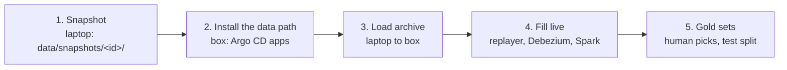

# Data path: from the client's tables to the gold sets

Stage 7 of the [journey](README.md): copy the client's OCR tables once, load them into the lab's Postgres, replay their
history through Debezium and Kafka into Iceberg, and cut the gold sets. The design and its contracts:
[the 2a spec](../specs/data-path.md).
Last verified: 2026-11-01 (steps 1 to 5, acceptance B1 to B16).
Times in the output captions are the laptop's local time; the jobs on the box print UTC.

## Overview



Each step was written as it first ran, on 2026-11-01.

## Prerequisites

| Needs | Check | If not |
|---|---|---|
| Where and mode: where the client's access rule allows; Auto for step 1 (read only at the client, writes only on the laptop) | | |
| The four reader services in `.scratch_pg/` | `psql service=stg-odoo-reader -X -c 'select 1'` (with the isolation variables below) prints `1` | data access, step 2 (the lab's private runbook) |
| `psql` and Python 3 on the laptop | `psql --version; python3 --version` | [laptop setup](laptop-setup.md) |
| About 1 GB free under `data/` | `df -h data` | Remove an older copy (roll back, below) |
| From step 2: the box bootstrapped and the lab started | `lab-up` passes; the tunnel open ([lab session, steps 1 to 3](lab-session.md#1-where-you-are)) | [GPU box bootstrap](gpu-box-bootstrap.md) |

## Steps

### 1. Take the snapshot (laptop)

Why: the one read of the client. Each source is read in one consistent transaction through its reader role; only the
columns and rows the [snapshot contract](../specs/data-path.md#snapshot) allows are selected, so no person and no
non-OCR row leaves the client. The code: [pipelines/snapshot/snapshot.py](../../pipelines/snapshot/snapshot.py).

```bash
PGSERVICEFILE=$PWD/.scratch_pg/pg_service.conf PGPASSFILE=$PWD/.scratch_pg/pgpass \
  python3 -I pipelines/snapshot/snapshot.py
```

Output (REAL, 2026-11-01; 4 min 21 s; the middle rows trimmed):

```text
dev_svc.document: 947 rows, 231,844 bytes
dev_svc.document_run: 1009 rows, 7,602,636 bytes
...
dev_svc: done in 27 s
...
stg_svc: done in 13 s
dev_odoo.ocr_document_template: 79 rows, 256,918,828 bytes
...
dev_odoo: done in 144 s
...
stg_odoo.request_ticket_result: 12 rows, 13,942,596 bytes
stg_odoo: done in 51 s
copy 2026-11-01-ffcc03c52aea: 28 files, 239,880 rows, 815,111,191 bytes -> data/snapshots/2026-11-01-ffcc03c52aea
verify 2026-11-01-ffcc03c52aea: 28 files, 0 problem(s)
```

The copy stops, keeping nothing, if a CSV's row count differs from the source's, or if any copied row of an Odoo
source holds a string equal to a user's name (the people count). It then verifies itself.

Check (acceptance B1): the verify line says `0 problem(s)`, and the manifest's people counts are all 0 (`None`
for the service sources, which hold no names):

```bash
python3 -I -c "import json,sys; m=json.load(open(sys.argv[1])); print(sorted({str(f['people']) for f in m['files']}))" \
  data/snapshots/2026-11-01-ffcc03c52aea/manifest.json
```

```text
['0', 'None']
```

Recheck a copy at any time (the same check the copy ends with):

```bash
python3 -I pipelines/snapshot/snapshot.py --verify data/snapshots/2026-11-01-ffcc03c52aea
```

```text
verify 2026-11-01-ffcc03c52aea: 28 files, 0 problem(s)
```

What the manifest says about size (REAL, 2026-11-01): the largest **event**, a row as `live` will hold it, is
709,490 bytes (a stg template's `settings`); the largest **row** is 72 MB, all of it a template's
`settings_history`, which never becomes one event ([spec row 25](../specs/data-path.md#decisions)).

### 2. Install the data path (box)

Why: Argo CD installs everything that runs for the whole session from this repo
([layout](../specs/data-path.md#layout)): the four operators and SeaweedFS
([infra/argocd/apps/](../../infra/argocd/apps/)), then the data objects
([infra/argocd/lab-data/](../../infra/argocd/lab-data/)): the namespace and its memory quota, the Postgres
`Cluster` with its databases and publication, Kafka and its 30 topics. A change on the shared box: shown to the
owner first. Once installed, every later `lab-up` starts it all again.

**2.1 Start the lab** with the 10 GiB floor ([lab session, step 2](lab-session.md#2-start-the-lab)), preview
first:

```bash
export BOX=gpu-box-relay ANSIBLE_CONFIG=$PWD/infra/ansible/ansible.cfg ANSIBLE_HOME=$PWD/.scratch_ansible
.venv/bin/ansible-playbook infra/ansible/lab-up.yml --check --diff | python3 tools/mask.py
.venv/bin/ansible-playbook infra/ansible/lab-up.yml | python3 tools/mask.py
```

Output (REAL, 2026-11-01 19:58, home with the VPN on, the first start after the push; 23 s; trimmed):

```text
TASK [Pass only when the box has room and nothing would clash]   "mem_available_mib=24187", ...
TASK [Start k3s (systemd mounts /var/lib/kubelet first)]                      changed
TASK [The data path's pods]                                                   "no lab-data namespace"
TASK [Summary]   "memory available: 23362 MiB; swap used: 9155 MiB", "docker: 6 running, 2 healthy, 0 unhealthy"
PLAY RECAP       box : ok=16   changed=1    unreachable=0    failed=0
```

On this first start Argo CD had not synced yet, so there was no `lab-data` to wait for. From then on `lab-up`
waits up to 10 minutes for the data path's long-running pods and lists them.

**2.2 Create the credentials** (laptop, through the tunnel): the managed roles' passwords and the S3 key, never
printed ([lab-credentials.py](../../infra/scripts/lab-credentials.py)). Run it as soon as the cluster answers:
the SeaweedFS pod and the Postgres roles wait for these Secrets.

```bash
ssh -F .scratch_ssh/config -f -N -o ExitOnForwardFailure=yes -L 16443:127.0.0.1:6443 $BOX
export KUBECONFIG=$PWD/.scratch_kube/config
python3 -I infra/scripts/lab-credentials.py
```

```text
lab-pg-archive: missing
...
namespace lab-data: created (Argo CD's lab-data app adopts it)
lab-pg-archive: created
lab-pg-debezium: created
lab-pg-spark: created
seaweedfs-s3-config: created
lab-s3: created
```

Check: `python3 -I infra/scripts/lab-credentials.py --check` lists all five as `exists`. A rerun changes nothing.

**2.3 Let Argo CD sync** (it reads the repo every 3 minutes; this asks it now), then watch the apps:

```bash
.toolchain/bin/kubectl annotate application root -n argocd argocd.argoproj.io/refresh=normal --overwrite
.toolchain/bin/kubectl get applications -n argocd
```

What happened, from the refresh at 19:59:46 (REAL, 2026-11-01, one line per change, trimmed):

```text
20:00:04  six new apps appear; seaweedfs-all-in-one Pending (its volume)
20:00:35  lab-kafka-dual-role-0 Pending
20:01:07  cloudnative-pg Healthy;  20:01:18 seaweedfs Healthy, its bucket hook runs (Completed 20:01:28)
20:01:39  lab-pg-1-initdb Pending;  20:01:50 debezium-operator Healthy
20:02:11  spark-operator Healthy;  20:02:32 the Kafka broker 1/1, the topic operator starting
20:02:53  lab-pg-1 1/1;  20:03:03 every pod 1/1, every app Healthy
```

Check: every app `Synced` and `Healthy`.
If you see `lab-data` `OutOfSync` on the `Cluster` only, with nothing different in its fields: the operator adds
default fields to each managed role and the role list is compared whole; the repo writes those defaults out
([postgres.yaml](../../infra/argocd/lab-data/postgres.yaml)) ([row](../known-failure-modes.md), 2026-11-01).

**2.4 Check what was installed:**

```bash
K=.toolchain/bin/kubectl
$K get clusters,databases,publications -n lab-data
$K exec -n lab-data lab-pg-1 -c postgres -- psql -X -q -A -F' | ' \
  -c "select datname, pg_get_userbyid(datdba) from pg_database where datname in ('live','archive','catalog') order by 1" \
  -c "select name, setting from pg_settings where name in ('wal_level','max_slot_wal_keep_size','shared_preload_libraries','server_version')"
$K exec -n lab-data lab-pg-1 -c postgres -- psql -X -q -A -d live -c "select pubname, puballtables from pg_publication"
$K get kafka -n lab-data; $K get kafkatopics -n lab-data --no-headers | wc -l
echo "s3.bucket.list" | $K exec -i -n lab-data deploy/seaweedfs-all-in-one -- weed shell
$K top pods -n lab-data
```

Output (REAL, 2026-11-01 20:03, trimmed):

```text
cluster.postgresql.cnpg.io/lab-pg   1   1   Cluster in healthy state   lab-pg-1
database.postgresql.cnpg.io/archive   lab-pg   archive   true     (catalog, live: the same)
publication.postgresql.cnpg.io/lab-debezium   lab-pg   lab_debezium   true
archive | archive        catalog | spark        live | replayer
max_slot_wal_keep_size | 4096    server_version | 17.11    shared_preload_libraries | pg_stat_statements    wal_level | logical
lab_debezium|t
kafka.kafka.strimzi.io/lab-kafka   True   4.3.1   4.3-IV0
30
  lab-lake	size:0	logical:0	chunk:0
lab-kafka-dual-role-0  617Mi   lab-kafka-entity-operator  172Mi   lab-pg-1  72Mi   seaweedfs-all-in-one  38Mi
```

Check: the three databases with their owners, `wal_level` `logical`, the publication for all tables, Kafka
`True` with 30 topics (all `Ready`), the bucket `lab-lake`. The data path used about 0.9 GiB in `lab-data`
and 0.5 GiB for the operators; the quota had 4 of 8 GiB of limits reserved; the box still had 20,191 MiB
available.

### 3. Load `archive` (laptop to box)

Why: the lab's own copy of the client's tables, the source of every replay ([snapshot, the load](../specs/data-path.md#snapshot)).
[load.py](../../pipelines/snapshot/load.py) checks the copy against its manifest, refuses an `archive` that
already holds one, then sends `schema.sql` and the 28 CSVs in one transaction as the role `archive`, records the
copy id in `archive.lab_meta.copy`, grants the `replayer` role read access, and compares every table's row count
with the manifest. The password goes from its Secret into `.scratch_lab/pgpass` (mode 600), never printed; each
connection goes through its own `kubectl port-forward` to `lab-pg-rw`. Writes to the box's Postgres: shown to the
owner first.

```bash
export KUBECONFIG=$PWD/.scratch_kube/config      # the tunnel open (step 2.2)
python3 -I pipelines/snapshot/load.py --check     # archive holds: nothing
python3 -I pipelines/snapshot/load.py data/snapshots/2026-11-01-ffcc03c52aea
```

Output (REAL, 2026-11-01 20:16 to 20:22, home with the VPN on; trimmed):

```text
dev_svc.document: 947 rows (ok)
...
stg_odoo.request_ticket_result: 12 rows (ok)
loaded copy 2026-11-01-ffcc03c52aea: 239,880 rows in 335 s; 28 of 28 tables match the manifest
real 6:09
```

The time is the transfer: 815 MB from home through the VPN relay, about 3 MB/s (`archive` grew from 65 MB at
20:16:56 to 558 MB at 20:22:00). The same load into a local PostgreSQL 17 took 32 s. From the office it should be
faster; measure it there.

Check (acceptance B2): `28 of 28 tables match the manifest`; then the copy's record and the replayer's access:

```bash
python3 -I pipelines/snapshot/load.py --check
.toolchain/bin/kubectl exec -n lab-data lab-pg-1 -c postgres -- psql -X -q -A -d archive \
  -c "set role replayer" -c "select copy_id from lab_meta.copy" -c "select count(*) from stg_odoo.request_ticket_result"
```

```text
archive holds: 2026-11-01-ffcc03c52aea
2026-11-01-ffcc03c52aea
12
```

`archive` takes 567 MB, the WAL 576 MB, on the box's `/mnt/data` (340 GB free).
If you see `server closed the connection unexpectedly` on the second connection, with `error: lost connection to
pod` from kubectl: kubectl 1.36 ends a port-forward when a forwarded connection is reset, as Postgres's side is
when psql disconnects; one port-forward per connection, as `load.py` does ([row](../known-failure-modes.md),
2026-11-01).

### 4. Fill `live` and the lake (box)

Why: the replay writes the client's history into `live` in time order; Debezium turns every write into a Kafka event; the
streaming job keeps every event in bronze and each row's newest state in silver
([replay](../specs/data-path.md#replay), [Spark and the catalog](../specs/data-path.md#spark-and-the-catalog)).
Each sub-step below is a change on the box: shown to the owner first. The code:
[replay.py](../../pipelines/replay/replay.py) and its [launcher](../../pipelines/replay/launch.py); the lake jobs in
[pipelines/lake/jobs/](../../pipelines/lake/jobs/) and their [launcher](../../pipelines/lake/launch.py), which
refuses to start a Spark job while one runs or when the box has less memory than the job's limits plus 2 GiB.

Every run carries [the commit stamp](../specs/data-path.md#layout): two labels, `lab/git-commit` and `lab/git-dirty`
(whether the launcher's folder had uncommitted changes), on the Job or `SparkApplication` and on its pods. The
launcher prints it when it creates the run (REAL, 2026-11-02, the launchers run offline with kubectl stubbed; on the
box the line is the same):

```text
job/replay-fill-1102-061426 created (code at b509183178d8, with uncommitted changes)
sparkapplication/lake-smoke-1102-061426 created (code at b509183178d8, with uncommitted changes, schema from STUB)
```

Which code each run on the box ran: `.toolchain/bin/kubectl get jobs,sparkapplications -n lab-data -L lab/git-commit,lab/git-dirty`
(its output is added here at the first run that carries the stamp). Commit before a run you will want to trace: a run
labelled `true` ran code that Git may never hold.

**4.1 `live`'s tables** (once per fill): the 28 tables of `archive` without their history columns,
`lab_meta.heartbeat`, Debezium's read and heartbeat grants.

```bash
export KUBECONFIG=$PWD/.scratch_kube/config
python3 -I pipelines/replay/launch.py init --follow
```

```text
14:07:05 live: 28 tables and lab_meta.heartbeat ready, debezium granted read access
job/replay-init-1101-210647: succeeded
```

**4.2 Debezium** (once; Argo CD then owns [debezium.yaml](../../infra/argocd/lab-data/debezium.yaml)). Its heartbeat
needs the table of 4.1, so it is applied by hand the first time:

```bash
.toolchain/bin/kubectl apply --server-side -f infra/argocd/lab-data/debezium.yaml
.toolchain/bin/kubectl exec -n lab-data lab-pg-1 -c postgres -- psql -X -q -A -d live \
  -c "select slot_name, active, confirmed_flush_lsn, pg_size_pretty(pg_wal_lsn_diff(pg_current_wal_lsn(), restart_lsn)) from pg_replication_slots" \
  -c "select ts from lab_meta.heartbeat"
```

Output (REAL, 2026-11-01 21:10, `live` idle, read twice 25 s apart):

```text
lab_debezium|t|0/4802A760|248 bytes      ts 14:09:54
lab_debezium|t|0/4802A918|688 bytes      ts 14:10:14
```

Check: the slot active, its confirmed position moving while `live` is idle (the heartbeat), the heartbeat row
rewritten every 10 s, `offsets.dat` on Debezium's volume (`kubectl exec ... ls /debezium/data`).
If you see `Flush of the offsets failed` every 500 ms with `AccessDeniedException: offsets.dat`: the offset file name
must be absolute (`/debezium/data/offsets.dat`); a bare name lands in `/debezium`, which the server cannot write
([row](../known-failure-modes.md), 2026-11-01).

**4.3 Spark's jars, then acceptance B3.** The jars of [jars.txt](../../pipelines/lake/jars.txt) are fetched once onto
`spark-data` and put on the classpath (the operator runs `spark-submit` in its own pod, where `--packages` fails):

```bash
python3 -I pipelines/lake/launch.py jars --follow
python3 -I pipelines/lake/launch.py smoke --follow
```

```text
iceberg-spark-runtime-4.1_2.13-1.12.0.jar: fetched, 48,309,426 bytes, sha1 ok
...
scala-parallel-collections_2.13: in the image (scala-parallel-collections_2.13-1.2.0.jar), skipped
7 jars on the volume: ...
B3: Spark 4.1.4, lab.smoke.b3 holds 1 rows, latest snapshot 3421333104048504388 at 2026-11-01 14:14:15.926000,
    a data file s3://lab-lake/warehouse/smoke/b3/data/00000-0-a1a12cc4-...-00001.parquet
sparkapplication/lake-smoke-1101-211348: COMPLETED          (32 s)
```

Check (B3): `COMPLETED`, and the catalog's row in Postgres: `lab | smoke | b3 | s3://lab-lake/warehouse/smoke/b3/metadata/00001-....metadata.json`.
If you see `SUBMISSION_FAILED` with `FileNotFoundException: /data/ivy/cache/resolved-...`: a job asked for
`--packages`; the jars come from the volume instead ([row](../known-failure-modes.md), 2026-11-01).

**4.4 Stream, fill, verify.** Start the stream, then the replay; the stream catches up from Kafka at its own pace:

```bash
python3 -I pipelines/lake/launch.py stream
python3 -I pipelines/replay/launch.py fill --follow
python3 -I pipelines/replay/launch.py verify --follow
```

Output (REAL, 2026-11-01; the fill 21:15 to 21:26, the stream caught up at 21:45; trimmed):

```text
47715 writes: 0 baseline before 2026-08-04 15:25:40, 47715 paced over 86.8 days; speed-up 12,492 (about 10.0 min)
fill done: 245221 rows in 601 s (408 rows/s, speed-up kept 12,478, at most 144.4 s behind schedule)
verify: 28 of 28 tables equal
batch 26: 4988 events, 27 topics
batch 27: 488 events, 27 topics            (caught up)
```

Then stop the stream (Spark runs only while needed) and read the acceptance numbers from the lake:

```bash
python3 -I pipelines/lake/launch.py stop stream
python3 -I pipelines/lake/launch.py checks --follow
```

```text
B5 silver.pdf rows: 232 (distinct content_hash in silver.document: 232)
B4 Debezium lag over 245221 change events: p50 0.6 s, p99 1.19 s, max 2.67 s, 0 events over 10 s
B9 bronze duplicates (same topic, partition, offset): 0
```

Check: `verify` 28 of 28; silver's rows per table and environment equal the manifest's (28 of 28 pairs, 239,880
rows); B4's lag under 10 s; B5 232; no bronze duplicate. A restarted stream adds no silver row.
If you see executors or the driver `OOMKilled`: the pod's limit is heap plus overhead, and the overhead holds the
JVM's own memory (and the driver's Python); the template is sized from the first fill
([why](../notes/spark-pod-memory.md),
[row](../known-failure-modes.md), 2026-11-01).
If you see `[TABLE_OR_VIEW_NOT_FOUND] The table or view updates cannot be found`: a `foreachBatch` view and its
SQL must use the batch's own session; or `names reserved for Iceberg metadata columns: [_deleted]`: that column
name is taken ([rows](../known-failure-modes.md), 2026-11-01).

**4.5 The CDC checks: T4 (B6), the slot's WAL (B7), the heartbeat (B8).** With the stream running, a slice
replays one result's saves into the filled `live`; then the stream is stopped and [t4.py](../../pipelines/lake/jobs/t4.py)
times each save from its commit in `live` to the first silver snapshot holding it:

```bash
python3 -I pipelines/lake/launch.py stream
python3 -I pipelines/replay/launch.py slice stg:17 --gap 30 --follow
python3 -I pipelines/lake/launch.py stop stream
python3 -I pipelines/lake/launch.py t4 stg:17 <epoch ms just before the slice> --follow
```

Output (REAL, 2026-11-01 22:13 to 22:19; trimmed):

```text
15:13:07 save 1/10 of stg:17 committed (version)  ...  15:17:39 save 10/10 of stg:17 committed (row)
save 1: committed in live at 1793545986970, in silver 31.7 s later
...
save 10: committed in live at 1793546259411, in silver 22.3 s later
T4 stg:17: 10 saves, the slowest 31.7 s to silver (within 60 s); 10 silver snapshots in the window
```

Each save was its own micro-batch (`batch 28: 1 events, 1 topics` to `batch 37`); an idle stream logs nothing,
since Spark runs a batch only when new data arrives. No polling: `pg_stat_statements` reset, a short slice
(`stg:1`, 3 saves), then every role's statements in `live`:

```text
debezium | 5 statements | BEGIN || INSERT INTO lab_meta.heartbeat (id, ts) VALUES ($1, now()) ON CONFLICT ... || SELECT * FROM (SELECT current_database() ...
postgres | 1 statement  | select 'reset at ' || pg_stat_statements_reset()
replayer | 4 statements | BEGIN || COMMIT || INSERT INTO "stg_odoo"."request_ticket_result" ...
```

The slot, with `live` idle and 58 MB written in another database (the `postgres` database here; an `archive`
reload or the catalog's commits act the same), Debezium running (B8), then stopped and restarted (B7):

```text
B8  before 272 bytes | right after the write 74 MB | 35 s later 562 kB              (the heartbeat confirms)
B7  Debezium stopped: 248 bytes | after the write 74 MB | 35 s later 74 MB (cap 4GB, wal_status reserved)
    Debezium applied again: 74 MB, then 7152 bytes at its first heartbeat (15:24:17), then 248 bytes
```

Check: every save under 60 s; no role but the replayer touches the copied tables; with Debezium running the slot
releases WAL written elsewhere within a heartbeat or two; stopped, it holds it (far under the cap), and releases it
after a restart from the same offsets file (no new snapshot).
If you see `error dialing backend: proxy error ... 502 Bad Gateway` on `kubectl exec`: the API's path to the
kubelet flaked on the relay; run it again.

### 5. The gold sets (box, then laptop)

Why: the datasets later phases train and test on ([gold sets](../specs/data-path.md#gold-sets)).
[gold.py](../../pipelines/lake/jobs/gold.py) joins each person-chosen crop to the service unit it was cut from (the
V6 rule) and writes `gold.human_picks` and `gold.human_picks_excluded`, reading silver at fixed snapshots, recording
them and the copy id with the build, and tagging it. [split_upload.py](../../pipelines/dataset/split_upload.py) cuts
the detector test split from the dataset copy and uploads the copy and the split to the bucket.

```bash
python3 -I pipelines/lake/launch.py gold 2026-11-01-ffcc03c52aea --follow
python3 -I pipelines/dataset/split_upload.py data/ultralytics/labelled-pages/2026-09-24-4a208a33d4ca
```

Output (REAL, 2026-11-01 22:57 and 22:58 to 23:10; trimmed):

```text
gold.human_picks: 200 rows, snapshot 4822107291937725850, tag build_20261101_155739; read twice by snapshot id: the same rows
gold.human_picks_excluded: 50 rows, snapshot 6552705690199854166, tag build_20261101_155739; read twice by snapshot id: the same rows
B10: 200 picks {'dev': 90, 'stg': 110}, 50 excluded {'page image gone': 50}; the person kept the service's first pick
     in 172 of 200; copy 2026-11-01-ffcc03c52aea, silver snapshots {...}
B11 split of 2026-09-24-4a208a33d4ca: 26 of 132 garment specs (341 pages) test, 1699 pages train and validation, no
     garment spec in both; seed 20261101; test.txt sha256 dad44960e5cc607479f0c9b8caf0a0a646181a99df0b2b9491ac1908203edc1c
uploaded: 4082 dataset files (502,427,146 bytes sent, 0 already there); s3://lab-lake/splits/2026-09-24-4a208a33d4ca/test.txt and split.json
```

Check (B10, B11): 200 picks and 50 excluded with reasons, read twice the same; 26 test garment specs, none in both,
the list's sha256 as above (`--dry-run` recomputes it without uploading). The upload took 11 min 47 s from home:
about 4,100 requests through the relay; a rerun skips what is already there.
If you see `Time travel option snapshot-id is no longer supported`: read a snapshot with `versionAsOf`
(Iceberg 1.12 on Spark 4).

## Verify end to end

Acceptance of the [spec](../specs/data-path.md#acceptance), all run on 2026-11-01 (REAL):

| # | Result | Where |
|---|---|---|
| B1 | The copy matches its manifest; no person column, no author field; people counts 0 | Step 1 |
| B2 | `archive`: 28 of 28 tables match the manifest, 239,880 rows | Step 3 |
| B3 | Spark 4.1.4 under the Kubeflow operator wrote and read `lab.smoke.b3` | Step 4.3 |
| B4 | A full fill: silver equals the copy (28 of 28 table and environment pairs); Debezium's lag p99 1.19 s, max 2.67 s | Step 4.4 |
| B5 | `silver.pdf` 232 | Step 4.4 |
| B6 | Each replayed save in silver within 31.7 s; no polling | Step 4.5 |
| B7 | The slot holds WAL only while Debezium is stopped; released after its restart | Step 4.5 |
| B8 | With `live` idle, the heartbeat releases WAL written elsewhere (74 MB to 562 kB) | Step 4.5 |
| B9 | Bronze holds each event once (0 duplicates over 245,234, through five stream failures) | Step 4.4 |
| B10 | `gold.human_picks` 200, excluded 50 with reasons, read twice the same | Step 5 |
| B11 | 26 test garment specs, none in both, sha256 recorded | Step 5 |
| B12 | After `lab-down` (all counts 0) and `lab-up`: `archive` and `live` 239,880, Kafka 245,234, silver 239,880; the resumed stream took the 3 waiting events and added no row | Below |
| B13 | `lab-data` within its quota: 4,864 MiB of limits for the resident pods, exactly 8 GiB with Spark and the replayer at once | |
| B14 | The largest event, 709,926 bytes, crossed Debezium, Kafka and Spark | Step 4.4 checks |
| B15 | The AI team's Docker unchanged: 6 running, 2 healthy, at every `lab-up` and `lab-down` box check | [Lab session](lab-session.md) |
| B16 | `teardown.yml --check --diff` runs every step check mode runs (1, 2 and 8 are skipped in it); `footprint.yml` finds nothing of the data path outside k3s's folders | [Teardown](gpu-box-teardown.md) |

B12, the commands: the "before" values (row counts in `archive` and `live`, Kafka's offsets, the slot), then
[lab session steps 4 and 2](lab-session.md#2-start-the-lab), the same values again, then
`launch.py stream` until its first batch, `launch.py stop stream`, `launch.py checks --follow`:

```text
before   archive 239880 | live 239880 | kafka 245234 | silver 239880 | slot active, 6008 bytes
lab-down 25 s: k3s processes 0, lab containers 0, mounts 0, pod network spaces 0, links 0, iptables rules 0
lab-up   3 min 16 s: the five data path pods Ready (Debezium restarted 3 times while Postgres and Kafka came up)
after    archive 239880 | live 239880 | kafka 245234 | slot active, 37 kB
stream   batch 38: 3 events, 1 topics          silver after: 239880
```

## Roll back

- Step 5: `gold.human_picks` keeps every build (tags `build_<time>`); a build is never undone, a new one replaces
  the current version. The bucket's `datasets/` and `splits/` prefixes go with SeaweedFS's volume.
- Step 4: the full new fill of the [spec](../specs/data-path.md#replay); bronze and silver are dropped with
  `python3 -I pipelines/lake/launch.py reset --follow` (gold never).
- Step 3: `archive` holds one copy at a time; emptying it is part of the full new fill
  ([replay](../specs/data-path.md#replay)): drop its four schemas and `lab_meta` as the `archive` role.
- Step 2: remove the six apps from `infra/argocd/apps/` and push; Argo CD prunes what they installed (the data
  objects' volumes go with them). The box itself keeps nothing outside k3s's data dir
  ([teardown](gpu-box-teardown.md)).
- Step 1: delete the copy, `rm -rf data/snapshots/<id>`. Nothing was written at the client (read-only sessions).
