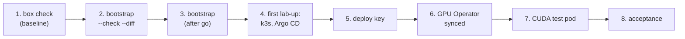

# GPU box bootstrap

Stage 5 of the [journey](README.md): once per box, the lab's single-node k3s, the NVIDIA GPU Operator and
Argo CD go onto the shared GPU box beside the AI team's Docker, without editing it. The design and its
acceptance checks: [spec](../specs/gpu-box-platform.md); the concepts: [k3s](../notes/kubernetes-on-a-shared-machine.md),
[GPUs on Kubernetes](../notes/gpus-on-the-hosts-driver.md), [Argo CD](../notes/ansible-and-argo-cd.md),
[Ansible](../notes/ansible-and-argo-cd.md). Steps 1 to 8 are verified. Last verified: 2026-10-30.

## Overview



## Prerequisites

| Needs | Check | If not |
|---|---|---|
| Where and mode: office (`BOX=gpu-box`), or home with the VPN on (`BOX=gpu-box-relay`). Steps 1 and 2 only read: Auto mode. **Step 3 onwards changes the box: Manual mode** | | [Which mode](../../AGENTS.md#which-mode-a-session-runs-in-owner-2026-10-25) |
| The spec approved, and the AI team told what will run, when, and how it is removed | Owner, 2026-10-30 | [Sharing the box](../specs/gpu-box-platform.md#sharing-the-box) |
| [Reach the box](reach-the-box.md) done: login by key, passwordless sudo | `ssh -o BatchMode=yes -F .scratch_ssh/config $BOX 'sudo -n true && echo ok'` | Stage 2 |
| [Laptop setup](laptop-setup.md) done, Ansible's collection installed | `.venv/bin/ansible-galaxy collection list community.general` shows 13.5.0 | Step 6 of laptop setup, then `.venv/bin/ansible-galaxy collection install -r infra/ansible/requirements.yml` |
| The box not tight: the pre-checks need 6 GiB of memory available, 5 GB free on `/`, 50 GB on `/mnt/data` | Step 1's summary | Wait, and ask the AI team |

Every command below runs from the repo root after:

```bash
export ANSIBLE_CONFIG=$PWD/infra/ansible/ansible.cfg ANSIBLE_HOME=$PWD/.scratch_ansible
export BOX=gpu-box        # or gpu-box-relay from home
```

## Steps

### 1. Box check: the baseline

Why: record the box's state before the lab touches it; acceptance A5 and the teardown compare against
this file ([what it reads](../specs/gpu-box-platform.md#box-check-and-masked-output)). Reads only.

```bash
.venv/bin/ansible-playbook infra/ansible/check.yml -e label=baseline | python3 tools/mask.py
```

Output (REAL, 2026-10-30, office; summary only, the details are in the saved file):

```text
TASK [Summary (the details stay in the saved file)]
ok: [box] => {
    "msg": [
        "time: 2026-10-30 10:28:19 +0700",
        "load: 43.94 78.28 80.17",
        "memory available: 3081 MiB; swap used: 27520 MiB",
        "gpu 0, 7544 MiB, 12288 MiB, 34 %",
        "gpu 1, 76 MiB, 12288 MiB, 0 %",
        "docker: 31 running, 8 healthy, 1 unhealthy",
        "k3s: unit inactive, at boot not-found, processes 0",
        "ufw: Status: active",
        "disk /: 34G free",
        "disk /mnt/data: 358G free",
        "saved: .scratch_box/checks/2026-10-30-1028-first.txt"
    ]
}
PLAY RECAP
box : ok=4    changed=0    unreachable=0    failed=0
```

Check: `changed=0`, and a file in `.scratch_box/checks/`. Two checks compare with
`diff .scratch_box/checks/<before>.txt .scratch_box/checks/<after>.txt`.
If you see the AI team's container names in the session: the playbook printed more than its summary; the
details belong in the file only ([row](../known-failure-modes.md), 2026-10-30).

### 2. Preview the bootstrap

Why: see every change before it is made ([D4](../design.md#decisions)). In check mode Ansible runs the
reads and reports the changes without making them. Shown to the owner.

```bash
.venv/bin/ansible-playbook infra/ansible/bootstrap.yml --check --diff | python3 tools/mask.py
```

Output (REAL, 2026-10-30 10:32, office; trimmed to the task results):

```text
TASK [Pass only when the box has room and nothing would clash]
    "mem_available_mib=10008", "root_free_gb=34", "data_free_gb=358", "ports_in_use=0", "tailscale_routes=0",
    "gpu 0, 7544 MiB, 12288 MiB, 6 %", "gpu 1, 46 MiB, 12288 MiB, 0 %"
TASK [The account's passwordless sudo rule, adopted as it is (D13)]           ok
TASK [k3s's folders on /mnt/data, and the kubelet's mount point]              changed: 5 folders, absent → directory
TASK [The bind mount of the kubelet's folder, and k3s's need for it]          changed: 2 new files
TASK [k3s's settings]                                                         changed: data-dir /mnt/data/k3s; traefik, servicelb off
TASK [First in ufw (IPv4), the lab's pods and Services may reach the box]     changed: 10.42.0.0/16, 10.43.0.0/16
TASK [Then k3s's ports are closed to everyone else (IPv4), ahead of ...]      changed: 6443/tcp, 10250/tcp, 8472/udp
TASK [And to everyone over IPv6]                                              changed: the same three
TASK [Read the installed k3s version]                                         ok (none)
TASK [Download the installer, checked against its pinned sha256]              changed
TASK [Run the installer]                                                      skipping (check mode)
TASK [k3s's auto-deploy folder]                                               changed
TASK [Argo CD's HelmChart and the root Application, applied by k3s ...]       changed: 2 new files
PLAY RECAP
box : ok=14   changed=7    unreachable=0    failed=0    skipped=1
```

Check: the sudoers rule is `ok` (unchanged), nothing touches Docker, its containerd or the driver, and
every new path is one of the spec's. Check mode cannot run the installer; what it writes, read in the
v1.36.5 installer: `/usr/local/bin/k3s`, `k3s-killall.sh`, `k3s-uninstall.sh` and the `k3s.service` unit,
with no `kubectl`, `crictl` or `ctr` links (`INSTALL_K3S_SYMLINK=skip`).
If you see the pre-check fail on `mem_available_mib`: the box is busy; wait and run it again.

### 3. Bootstrap (after the owner's go)

Why: make the changes step 2 showed. Manual mode; take a fresh step 1 baseline right before
(`-e label=baseline`), since the AI team's side changes during the day (31 containers in the morning, 6
at 14:54 on 2026-10-30).

```bash
.venv/bin/ansible-playbook infra/ansible/bootstrap.yml | python3 tools/mask.py
```

Output (REAL, 2026-10-30 14:54 to 14:55, office; trimmed):

```text
TASK [The account's passwordless sudo rule, adopted as it is (D13)]           ok
TASK [k3s's folders on /mnt/data, and the kubelet's mount point]              changed (5)
TASK [The bind mount of the kubelet's folder, and k3s's need for it]          changed (2)
TASK [k3s's settings]                                                         changed
TASK [First in ufw (IPv4), the lab's pods and Services may reach the box]     changed (2)
TASK [Then k3s's ports are closed to everyone else (IPv4), ahead of ...]      changed (3)
TASK [And to everyone over IPv6]                                              changed (3)
TASK [Download the installer, checked against its pinned sha256]              changed
TASK [Run the installer]                                                      changed
TASK [Remove the installer]                                                   changed
TASK [k3s's auto-deploy folder]                                               changed
TASK [Argo CD's HelmChart and the root Application, applied by k3s ...]       changed (2)
PLAY RECAP
box : ok=15   changed=9    unreachable=0    failed=0    skipped=0
```

Check: compare with the baseline, and read what the installer left.

```bash
.venv/bin/ansible-playbook infra/ansible/check.yml -e label=after-bootstrap | python3 tools/mask.py
diff .scratch_box/checks/<time>-baseline.txt .scratch_box/checks/<time>-after-bootstrap.txt
ssh -F .scratch_ssh/config $BOX 'k3s --version | head -1; systemctl is-enabled k3s; systemctl is-active k3s; ls /usr/local/bin | grep -E "k3s|kubectl|crictl|ctr"' 2>&1 | python3 tools/mask.py
```

Output (REAL, 2026-10-30 14:56; the `diff` trimmed to its changed lines, the moving numbers left out):

```text
< k3s: unit inactive, at boot not-found, processes 0
> k3s: unit inactive, at boot disabled, processes 0
> [..] Anywhere                   ALLOW IN    10.42.0.0/16               # ml-lab k3s
> [..] Anywhere                   ALLOW IN    10.43.0.0/16               # ml-lab k3s
< absent:  /usr/local/bin/k3s          > present: /usr/local/bin/k3s
< absent:  /etc/rancher/k3s            > present: /etc/rancher/k3s
< absent:  /mnt/data/k3s               > present: /mnt/data/k3s
< absent:  /mnt/data/k3s-kubelet       > present: /mnt/data/k3s-kubelet
< absent:  /var/lib/kubelet            > present: /var/lib/kubelet

k3s version v1.36.5+k3s1 (3dd98cc5)
disabled
inactive
k3s
k3s-killall.sh
k3s-uninstall.sh
```

Check: only these lines differ. At 14:56 the playbook of that day placed the lab's two allows last and had no denies, which left k3s's ports open to the VPN through a rule
already on the box, higher in the list
([why they must stay closed](../notes/kubernetes-on-a-shared-machine.md#the-firewall-takes-the-first-match)). Today's
playbook puts the lab's rules **first**: on a fresh box it inserts them at the top directly; on this box it
moved them once, with the same command (REAL, 2026-10-30 22:10, home with the VPN on, after the owner's go):

```text
TASK [Take the lab's allows out where they sit below the AI team's rules, ...]  changed: 10.42.0.0/16, 10.43.0.0/16
TASK [First in ufw (IPv4), the lab's pods and Services may reach the box]       changed: 10.42.0.0/16, 10.43.0.0/16
TASK [Then k3s's ports are closed to everyone else (IPv4), ...]                 changed: 6443/tcp, 10250/tcp, 8472/udp
TASK [And to everyone over IPv6]                                                changed: the same three
PLAY RECAP    box : ok=16   changed=4    unreachable=0    failed=0
PLAY RECAP    box : ok=15   changed=0    unreachable=0    failed=0      (run again)
[ 1] Anywhere                   ALLOW IN    10.42.0.0/16               # ml-lab k3s
[ 2] Anywhere                   ALLOW IN    10.43.0.0/16               # ml-lab k3s
[ 3] 6443/tcp                   DENY IN     Anywhere                   # ml-lab k3s
[ 4] 10250/tcp                  DENY IN     Anywhere                   # ml-lab k3s
[ 5] 8472/udp                   DENY IN     Anywhere                   # ml-lab k3s
[ 6] ...                                                                (the AI team's rules follow, unchanged)
[..] 6443/tcp (v6)              DENY IN     Anywhere (v6)              # ml-lab k3s   (first IPv6 rules)
```

Check: the lab's five rules first, the three IPv6 denies first in their list, and the AI team's rules identical in content and order (the box check's ufw section compared with the baseline, 22:13). Its
preview had shown the inserts as `ok`: in check mode the delete is only simulated, so the rules still
"exist" when the insert is checked. Docker's containers, the sha256 of `daemon.json` and `config.toml`,
and Docker's and Tailscale's iptables chains are unchanged; k3s is installed, **disabled and stopped**;
`/usr/local/bin` gains only k3s's own three files.

Run it again: nothing changes (acceptance A9).

```bash
.venv/bin/ansible-playbook infra/ansible/bootstrap.yml | python3 tools/mask.py | tail -2
```

Output (REAL, 2026-10-30 14:57): `box : ok=11   changed=0    unreachable=0    failed=0    skipped=3`.

### 4. The first lab-up

Why: k3s's first start also installs Argo CD from the HelmChart in its auto-deploy folder, and applies the
root Application once Argo CD's types exist (k3s retries a failed manifest every 15 s).

Run [lab session, steps 1 to 3](lab-session.md#2-start-the-lab): `lab-up`, the tunnel, `kubectl`. Its real
output of 2026-10-30 is there (acceptance A1: one node `Ready`, v1.36.5+k3s1). Then read the root
Application:

```bash
.toolchain/bin/kubectl -n argocd get applications
.toolchain/bin/kubectl -n argocd get application root -o jsonpath='{.status.conditions[*].message}'
```

Output (REAL, 2026-10-30 15:22, before the deploy key):

```text
NAME   SYNC STATUS   HEALTH STATUS
root   Unknown       Healthy
Failed to load target state: ... failed to list refs: error creating SSH agent: "SSH agent requested but SSH_AUTH_SOCK not-specified"
```

Check: Argo CD's five pods `Running` (lab session, step 3), the HelmChart's `helm-install-argo-cd` job
`Completed`, and the root Application present. Its error is expected here: Argo CD has no credentials for
the private repo until step 5.

### 5. Argo CD's deploy key

Why: Argo CD reads the lab's private repo over SSH with a key of its own, read-only, that never leaves the box
([spec, row 15](../specs/gpu-box-platform.md#decisions), deploy keys).
[deploy-key.yml](../../infra/ansible/deploy-key.yml) makes the pair once in `/etc/ml-lab/` (root only),
puts the private half into Argo CD's repository Secret on the box (never printed, never in the repo) and
prints the public half. Needs k3s running (lab session, step 2). Preview it with `--check --diff` first,
like step 2.

```bash
.venv/bin/ansible-playbook infra/ansible/deploy-key.yml | python3 tools/mask.py
```

Output (REAL, 2026-10-30 19:39, home with the VPN on, `BOX=gpu-box-relay`):

```text
TASK [A root-only folder for the key]                                                     changed
TASK [The key pair, made once]                                                            changed
TASK [Argo CD's repository Secret, from the private half (never written as a file ...)]  changed
TASK [Add this on GitHub, repo Settings > Deploy keys, "Allow write access" left off]
    "msg": "ssh-ed25519 AAAAC3NzaC1lZDI1NTE5AAAAILGmnXqaUFfb9yLCaQCqx86036RFoIclO9Uwzd4M8gqO ml-lab argocd read-only"
PLAY RECAP
box : ok=5    changed=3    unreachable=0    failed=0
```

Then the owner, on GitHub: the repo's Settings → Deploy keys → Add deploy key, title
`ml-lab argocd read-only`, the printed key, **"Allow write access" off**.

Check: a second run reports `changed=0` (REAL, 2026-10-30 19:41: `ok=5 changed=0`), and Argo CD can read the repo once the owner has added the key (step 6).
If you see `connect to host ... port 22: Connection timed out`: `BOX` names the office road while you are at
home; `export BOX=gpu-box-relay` ([reach the box](reach-the-box.md#when-the-box-cannot-be-reached)).

### 6. Argo CD syncs the GPU Operator

Why: once the key is on GitHub, the root Application reads `infra/argocd/apps/` and creates the GPU
Operator's Application ([gpu-operator.yaml](../../infra/argocd/apps/gpu-operator.yaml): the box's own
driver and toolkit, so neither is installed). Nothing to run: Argo CD does it within about a minute.
Watch it through the tunnel ([lab session, step 3](lab-session.md#3-reach-the-cluster-the-tunnel-and-kubectl)):

```bash
.toolchain/bin/kubectl -n argocd get applications
.toolchain/bin/kubectl -n gpu-operator get pods
```

Output (REAL, 2026-10-30 19:44 and 19:45, home with the VPN on; acceptance A4):

```text
NAME           SYNC STATUS   HEALTH STATUS
gpu-operator   OutOfSync     Missing          (19:44, the key just added)
root           Synced        Healthy

NAME           SYNC STATUS   HEALTH STATUS
gpu-operator   Synced        Healthy          (19:45)
root           Synced        Healthy

NAME                                                          READY   STATUS      RESTARTS   AGE
gpu-feature-discovery-ccglr                                   1/1     Running     0          43s
gpu-operator-8469d9bdd-2lbpv                                  1/1     Running     0          54s
gpu-operator-node-feature-discovery-gc-7d4b864d68-jztgl       1/1     Running     0          54s
gpu-operator-node-feature-discovery-master-8649684bd6-pfxpp   1/1     Running     0          54s
gpu-operator-node-feature-discovery-worker-czwff              1/1     Running     0          54s
nvidia-cuda-validator-fm22w                                   0/1     Completed   0          35s
nvidia-dcgm-exporter-n58rz                                    0/1     Running     0          43s
nvidia-device-plugin-daemonset-k49r6                          1/1     Running     0          43s
nvidia-operator-validator-ghh22                               1/1     Running     0          43s
```

Then the node's GPUs, as the scheduler sees them (A2) and as GPU feature discovery labels them:

```bash
.toolchain/bin/kubectl get nodes -o jsonpath='{.items[0].status.capacity.nvidia\.com/gpu}{" capacity, "}{.items[0].status.allocatable.nvidia\.com/gpu}{" allocatable\n"}'
.toolchain/bin/kubectl get nodes -o json | python3 -c "import json,sys; l=json.load(sys.stdin)['items'][0]['metadata']['labels']; [print(f'{k}: {v}') for k,v in sorted(l.items()) if k.startswith('nvidia.com/gpu.') or k.startswith('nvidia.com/cuda.')]" | grep -E 'count|product|memory|family|compute|version.full'
```

Output (REAL, 2026-10-30 19:45; acceptance A2):

```text
2 capacity, 2 allocatable
nvidia.com/cuda.driver-version.full: 610.43.02
nvidia.com/cuda.runtime-version.full: 13.3
nvidia.com/gpu.compute.major: 8
nvidia.com/gpu.compute.minor: 6
nvidia.com/gpu.count: 2
nvidia.com/gpu.family: ampere
nvidia.com/gpu.memory: 12288
nvidia.com/gpu.product: NVIDIA-GeForce-RTX-3060
```

Check: both Applications `Synced` and `Healthy`; the CUDA validator `Completed` (the Operator's own test
that a container can use a GPU); `nvidia.com/gpu` allocatable `2`; no driver or toolkit pod (they are off).
The DCGM exporter takes a minute or two to be ready. The Operator adds the runtime classes `nvidia-cdi` and
`nvidia-legacy` next to k3s's `nvidia` (`kubectl get runtimeclass`).
If you see the root Application `Unknown` with `SSH agent requested but SSH_AUTH_SOCK not-specified`: the
deploy key is not on GitHub yet (step 5).

### 7. The CUDA test pod

Why: prove a pod gets one GPU end to end: the scheduler counts it, the device plugin hands it over, k3s's
NVIDIA runtime adds the driver's files, and CUDA runs on the card ([how one GPU is handed out](../notes/gpus-on-the-hosts-driver.md#following-one-gpu-request)).
[cuda-nbody.yaml](../../infra/tests/cuda-nbody.yaml) asks for one GPU and 1 GiB, nothing more. Manual
mode (it runs on the shared GPUs).

```bash
.toolchain/bin/kubectl apply --dry-run=server -f infra/tests/cuda-nbody.yaml
.toolchain/bin/kubectl apply -f infra/tests/cuda-nbody.yaml
.toolchain/bin/kubectl get pod cuda-nbody -o wide | python3 tools/mask.py     # until STATUS is Completed
.toolchain/bin/kubectl logs cuda-nbody | tail -8
.toolchain/bin/kubectl delete -f infra/tests/cuda-nbody.yaml
```

Output (REAL, 2026-10-30 20:00, home with the VPN on; acceptance A3):

```text
pod/cuda-nbody created (server dry run)
pod/cuda-nbody created
NAME         READY   STATUS      RESTARTS   AGE   IP           NODE    NOMINATED NODE   READINESS GATES
cuda-nbody   0/1     Completed   0          17s   10.42.x.x   <box>   <none>           <none>
> 1 Devices used for simulation
GPU Device 0: "Ampere" with compute capability 8.6

> Compute 8.6 CUDA device: [NVIDIA GeForce RTX 3060]
28672 bodies, total time for 10 iterations: 22.859 ms
= 359.636 billion interactions per second
= 7192.725 single-precision GFLOP/s at 20 flops per interaction
pod "cuda-nbody" deleted from default namespace
```

After a lab-down and lab-up (REAL, 2026-10-30 20:16): `Completed` in 4 s (the image is cached),
`1 Devices used`, RTX 3060, 7,193.0 GFLOP/s.

Check: `Completed` (16 s from apply to done), **one** device visible inside the pod (the box has two), an
RTX 3060, and a benchmark result. The image holds no NVIDIA driver: the driver's files came from the box
through the CDI file. The pod's address is in k3s's pod range (`10.42.0.0/16`).
If you see the pod `Pending` with `Insufficient nvidia.com/gpu`: the GPU Operator is not ready (step 6) or
another pod holds the GPUs ([how one GPU is handed out](../notes/gpus-on-the-hosts-driver.md#following-one-gpu-request)).

### 8. Acceptance

The [spec's checks](../specs/gpu-box-platform.md#acceptance), each with where its real output is:

| # | Check | Status (2026-10-30) | Where |
|---|---|---|---|
| A1 | One node `Ready`, v1.36.5+k3s1, through the tunnel | Holds, also after a restart | [Lab session, step 3](lab-session.md#3-reach-the-cluster-the-tunnel-and-kubectl) |
| A2 | `nvidia.com/gpu` allocatable 2 | Holds, also after a restart | Step 6 |
| A3 | CUDA test pod on one RTX 3060 | Holds, also after a restart | Step 7 |
| A4 | Root and GPU Operator apps `Synced`, `Healthy` | Holds, also after a restart (21 s from start) | Step 6, [lab session, step 2](lab-session.md#2-start-the-lab) |
| A5 | The AI team's Docker unchanged | Holds after one full cycle (baseline vs lab-down) | [Lab session, step 4](lab-session.md#4-stop-the-lab) |
| A6 | `/` loses less than 1 GB | Holds: the lab's paths on `/` take 76 MB; its data, 3.7 GB, is on `/mnt/data` | the lab's machine notes (private) |
| A7 | lab-down leaves nothing running; lab-up again brings Argo CD back synced (time measured) | Holds: nothing of the lab left, firewall rules included; lab-up again in 19 s, both apps synced 21 s from start | [Lab session, steps 2 and 4](lab-session.md#4-stop-the-lab) |
| A8 | Idle footprint of k3s, Argo CD, the GPU Operator | Measured: about 2.2 GiB (k3s 917 MiB; pods 1,353 MiB by the kernel's count, 896 MiB working set) | the lab's machine notes (private) |
| A9 | Second run changes nothing | Holds for bootstrap, deploy-key, lab-up and lab-down | Steps 3, 5; lab session, steps 2 and 4 |
| A10 | `teardown.yml --check --diff` shows the full removal | Holds for every step check mode runs (3 to 7, 10, 11), nothing of the AI team's; steps 1, 2 and 8 are skipped in check mode (2026-10-30 22:27) | [Teardown, step 2](gpu-box-teardown.md#2-preview-the-teardown-acceptance-a10) |
| A11 | The firewall's three trips | Holds (since the lab's ufw rules went first, 2026-10-30 22:10): pods reach the API and Argo CD reaches GitHub (a forced refresh reconciled at 22:13, both apps `Synced`); from a VPN laptop 6443 and 10250 are closed, 22 open | Below |

Trip 3, run from WSL with the lab up (REAL, 2026-10-30 22:11, home with the VPN on):

```bash
/mnt/c/Windows/System32/WindowsPowerShell/v1.0/powershell.exe -NoProfile -Command 'foreach ($p in 6443,10250,22) { $r=Test-NetConnection 192.168.x.x -Port $p -WarningAction SilentlyContinue; "port $p TcpTestSucceeded: " + $r.TcpTestSucceeded }'
.toolchain/bin/kubectl get nodes | python3 tools/mask.py
```

```text
port 6443 TcpTestSucceeded: False
port 10250 TcpTestSucceeded: False
port 22 TcpTestSucceeded: True
NAME    STATUS   ROLES           AGE     VERSION
<box>   Ready    control-plane   7h10m   v1.36.5+k3s1
```

Check: k3s's two TCP ports closed to the VPN, the AI team's SSH open, and `kubectl` answering through the
tunnel. If you see `True` for 6443: the lab's ufw rules are not first; rerun `bootstrap.yml` (2026-10-30, before
the fix: a rule already on the box let it in, [row](../known-failure-modes.md)).

## Roll back

Before step 3: nothing to undo. After it: [teardown](../specs/gpu-box-platform.md#teardown), run with the
[teardown runbook](gpu-box-teardown.md).
