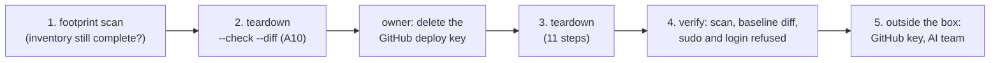

# GPU box teardown

Stage 8 of the [journey](README.md): when the lab ends, the shared GPU box goes back to its state before the
lab, as if the lab never existed (owner, 2026-10-30). What is removed, by which step and how each removal is
checked is the [spec's teardown inventory](../specs/gpu-box-platform.md#teardown), the single list; this page
runs it. Previewed and verified on 2026-10-30 (steps 1 and 2); steps 3 to 5 run only when the lab ends.
Last verified: 2026-10-30 (steps 1 and 2).

## Overview



## Prerequisites

| Needs | Check | If not |
|---|---|---|
| Where and mode: office (`BOX=gpu-box`), or home with the VPN on (`BOX=gpu-box-relay`). Steps 1 and 2 only read; step 3 is a **Manual** mode step, shown first | | [Which mode](../../AGENTS.md#which-mode-a-session-runs-in-owner-2026-10-25) |
| The lab's work saved: nothing on the box is kept (the cluster, its images and every Secret go) | The owner decides | |
| The baseline box check, taken before bootstrap | `ls .scratch_box/checks/*-baseline.txt` | It is the reference of step 4; without it, compare with the machine's facts in the lab's private notes |
| Login by key and passwordless sudo still in place (the teardown removes both, last) | `ssh -o BatchMode=yes -F .scratch_ssh/config $BOX 'sudo -n true && echo ok'` | [Reach the box](reach-the-box.md) |

```bash
export ANSIBLE_CONFIG=$PWD/infra/ansible/ansible.cfg ANSIBLE_HOME=$PWD/.scratch_ansible
export BOX=gpu-box        # or gpu-box-relay from home
```

## Steps

### 1. Footprint scan: is the inventory still complete?

Why: the inventory was built from evidence; anything the lab wrote since must be in it before teardown runs.
[footprint.yml](../../infra/ansible/footprint.yml) reads, at the lowest CPU and disk priority, what changed
on the box since the baseline (root disk, `/run`, `/tmp`, the top of `/mnt/data`), what acts at boot, and
the kernel state k3s changes. The full result stays in `.scratch_box/` (it names the AI team's paths).

```bash
.venv/bin/ansible-playbook infra/ansible/footprint.yml -e "since='2026-10-30 14:54'" -e label=before-teardown | python3 tools/mask.py
grep -vE '\((the system|log|the user)\)$' .scratch_box/checks/<time>-footprint-before-teardown.txt
```

Output (REAL, 2026-10-30 22:25, after `lab-down`, 14 s; the lab's lines, trimmed):

```text
## k3s's sockets outside 127.0.0.1
none (k3s stopped)
## changed since 2026-10-30 14:54 on the root disk
/etc/kubernetes/node-feature-discovery/features.d     /etc/ml-lab/argocd_deploy_ed25519{,.pub}
/etc/rancher/k3s/{config.yaml,k3s.yaml}               /etc/rancher/node/password
/etc/systemd/system/k3s.service{,.env,.d/}            /etc/systemd/system/var-lib-kubelet.mount
/etc/ufw/user.rules  /etc/ufw/user6.rules             /usr/libexec/kubernetes/kubelet-plugins/volume/exec
/usr/local/bin/{k3s,k3s-killall.sh,k3s-uninstall.sh}  /root/.ansible/...  /root/.kube/...  /home/<user>/.ansible/...
## changed since 2026-10-30 14:54 in memory filesystems (/run, /tmp, /dev/shm)
/run/cdi/k8s.device-plugin.nvidia.com-gpu.json  /run/flannel/...  /run/k3s/...  /run/nri/nri.sock  /run/nvidia/...
other users' files in /tmp and /dev/shm, not listed: 50
## /mnt/data, top two levels, changed since 2026-10-30 14:54
/mnt/data/k3s  /mnt/data/k3s-kubelet
## what acts at boot, changed since 2026-10-30 14:54
/etc/systemd/system/k3s.service{,.env,.d/}  /etc/systemd/system/var-lib-kubelet.mount
enabled at boot, k3s or lab: 0
## kernel state k3s changes
modules: br_netfilter ip6_udp_tunnel ip_set iptable_filter iptable_nat nf_conntrack overlay udp_tunnel vxlan xt_set
net.ipv4.conf.all.forwarding = 1 ... nf_conntrack_max = 917504 ... tcp_timeout_established = 86400
ipsets KUBE-*: 12
apparmor cri-containerd profile: 1
```

Check: every path listed is a row of the [inventory](../specs/gpu-box-platform.md#teardown). A path that is
not: find out when it was created (`stat -c %w`) and what uses it; if the lab made it, add its row (and a
teardown step) before going on. On 2026-10-30 that is how `/usr/libexec/kubernetes`, `/run/nri` and
`/root/.kube` joined the inventory, and how `/run/netns` (created at 10:44, before the lab) was left out.
If you see other users' file names in the session: the scan listed more than the lab's paths
([row](../known-failure-modes.md), 2026-10-30, container names).

### 2. Preview the teardown (acceptance A10)

Why: see every removal, and that nothing of the AI team's is touched. [teardown.yml](../../infra/ansible/teardown.yml)
runs the spec's 11 steps; in check mode the pause, the ipset cleanup, the module unloading and the final checks are
skipped (commands cannot run in a preview; the uninstall, guarded by `removes:`, is predicted from that
file), and every removal is only reported.

```bash
.venv/bin/ansible-playbook infra/ansible/teardown.yml --check --diff | python3 tools/mask.py
```

Output (REAL, 2026-10-30 22:27, home with the VPN on; trimmed to the task results):

```text
TASK [Step 1, revoke at the server first, delete Argo CD's deploy key on GitHub ...]   skipping (check mode)
TASK [Step 2, destroy kube-router's KUBE-* ipsets (with k3s's own ipset tool, ...)]    skipping (check mode)
TASK [Step 3, k3s's own uninstall (binary, scripts, unit, /etc/rancher/k3s, ...)]      changed
TASK [Step 4, what k3s's scripts leave ...]   changed: /etc/rancher, /var/log/pods, /var/log/containers,
                                                       /var/run/cdi/k8s.device-plugin.nvidia.com-gpu.json
TASK [Step 4, remove the GPU Operator's host folders, the kubelet's empty plugin folders and the NRI socket ...]
                                              changed: /etc/kubernetes, /run/nvidia, /usr/libexec/kubernetes, /run/nri
TASK [Step 5, the lab's systemd files and the kubelet's folder on /mnt/data]
                                              changed: var-lib-kubelet.mount, k3s.service.d, /mnt/data/k3s-kubelet
TASK [Step 6, the lab's ufw allows]           changed: 10.42.0.0/16, 10.43.0.0/16
TASK [Step 6, the lab's ufw denies (IPv4 and IPv6)]   changed: 6443/tcp, 10250/tcp, 8472/udp, for 0.0.0.0/0 and ::/0
TASK [Step 7, Argo CD's key pair, Ansible's and kubectl's caches in root's home]
                                              changed: /etc/ml-lab, /root/.ansible, /root/.kube
TASK [Step 8, unload the kernel modules the lab loaded, ...]   skipping (check mode)
PLAY [Box check (read-only)]                  (step 9)
TASK [Step 10, passwordless sudo (D13)]       changed: /etc/sudoers.d/<user>  "state": "file" → "absent"
TASK [Step 11, Ansible's folder in the account's home]   changed
TASK [Step 11, the laptop's login, last (owner, 2026-10-30), the whole ~/.ssh if it holds only the lab's key]
                                              changed (~/.ssh holds only authorized_keys, with only
                                              "ml-lab laptop to gpu-box")
PLAY RECAP
box : ok=28   changed=10   unreachable=0    failed=0    skipped=9
```

Check: `failed=0`; every removal is an inventory row; no Docker, containerd, driver, toolkit or AI team path
or ufw rule appears. `~/.ssh` goes whole because `ssh-copy-id` created it for the lab (2026-10-23 15:52:31)
and it holds nothing else; if anything else appears there by then, only the lab's key line goes.

### 3. Teardown (when the lab ends)

Why: the box back to its pre-lab state. Shown to the owner first (step 2's output), then run in Manual mode.
The play stops after `lab-down` and waits:

1. **The owner deletes the deploy key** on GitHub: the repo's Settings → Deploy keys → "ml-lab argocd
   read-only" → Delete; then presses Enter. Revoking at the server comes first.
2. The playbook goes on through steps 2 to 11, and lists what the kernel keeps until the next reboot.

```bash
.venv/bin/ansible-playbook infra/ansible/teardown.yml | python3 tools/mask.py
```

Its real output lands here when it runs. The login ends with it: after step 11 the laptop can no longer log
in by key, so step 4 below runs the last checks from the laptop and with the owner's password.

### 4. Verify: the lab never existed

| Check | How | Expected |
|---|---|---|
| Nothing of the lab on disk, in `/run`, at boot | Step 3's own box check (step 9 of the playbook), diffed with the baseline | Only the kernel lines differ |
| Sudo and key login gone | The playbook's last two checks | `sudo -n true` fails; `ssh -o BatchMode=yes ... true` refused |
| Kernel leftovers | The playbook's "What the kernel keeps until the next reboot" | Modules still in use and the kernel settings k3s raised; the box's next reboot, whenever it comes, clears them (nothing re-applies them at boot) |
| GitHub | The repo's Deploy keys page | No `ml-lab argocd read-only` |

### 5. Outside the box: what the box's lab left with others

Teardown is scoped to the box (owner, 2026-10-30). Two things the box's lab left outside it:

| Where | What | Remove | Check |
|---|---|---|---|
| GitHub | Argo CD's deploy key (the box's access to the repo) | Step 3, first | The repo's Deploy keys page has no `ml-lab argocd read-only` |
| The AI team | The account's `sudo` group membership, granted for the lab (2026-10-23); their knowledge that the lab ran | Tell them the lab is removed; ask whether the group membership should go | Their answer |

The laptop's own setup (logins, tools, data) is not part of teardown; each stage's runbook has its roll back.

## Roll back

None: teardown is the lab's final step. To start again, run the journey from
[stage 2](reach-the-box.md) (the login key) and [stage 5](gpu-box-bootstrap.md).
