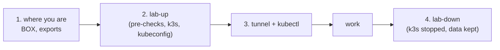

# Lab session

Stage 6 of the [journey](README.md): every working session on the GPU box starts the lab, reaches the
cluster from the laptop, and stops the lab again, so between sessions the box is the AI team's alone
([why](../notes/kubernetes-on-a-shared-machine.md), [spec, row 11](../specs/gpu-box-platform.md#decisions)).
Needs a [bootstrapped box](gpu-box-bootstrap.md). Last verified: 2026-10-30 (steps 1 to 4).

## Overview



## Prerequisites

| Needs | Check | If not |
|---|---|---|
| Where and mode: office or home with the VPN on. **Manual mode** for steps 2 and 4 (they start and stop k3s on the shared box); Auto for step 3 | | [Which mode](../../AGENTS.md#which-mode-a-session-runs-in-owner-2026-10-25) |
| [GPU box bootstrap](gpu-box-bootstrap.md) done | `ssh -F .scratch_ssh/config $BOX 'k3s --version \| head -1'` prints v1.36.5+k3s1 | Stage 5 |
| The box's name masked in output | `wc -l < .scratch_box/mask-words` prints 1 | [Reach the box, step 6](reach-the-box.md#6-a-private-list-of-names-to-mask) |

## Steps

### 1. Where you are

Why: the box is reached by a different name from the office and from home; the playbooks read `BOX`.

```bash
export BOX=gpu-box        # office; from home with the VPN on: gpu-box-relay
export ANSIBLE_CONFIG=$PWD/infra/ansible/ansible.cfg ANSIBLE_HOME=$PWD/.scratch_ansible
export KUBECONFIG=$PWD/.scratch_kube/config
```

Check: none needed; step 2 fails at once if the box cannot be reached
([reach the box](reach-the-box.md#when-the-box-cannot-be-reached)).

### 2. Start the lab

Why: start k3s only when the box has room. [lab-up.yml](../../infra/ansible/lab-up.yml) runs the
pre-checks, starts k3s (systemd mounts `/var/lib/kubelet` from `/mnt/data` first), waits for the node,
writes the kubeconfig to `.scratch_kube/config` (mode 600, never printed: it holds the cluster's admin
keys) pointing at the tunnel, and ends with a [box check](../specs/gpu-box-platform.md#box-check-and-masked-output).

```bash
.venv/bin/ansible-playbook infra/ansible/lab-up.yml | python3 tools/mask.py
```

Output (REAL, 2026-10-30 15:02, office, the first start; trimmed):

```text
TASK [Pass only when the box has room and nothing would clash]
    "mem_available_mib=16701", ..., "ports_in_use=0", "tailscale_routes=0",
    "gpu 0, 2909 MiB, 12288 MiB, 4 %", "gpu 1, 15 MiB, 12288 MiB, 0 %"
TASK [Start k3s (systemd mounts /var/lib/kubelet first)]                       changed
TASK [Wait for the node to be Ready]                                           ok
TASK [The kubelet's folder is the bind mount from /mnt/data]                   ok
TASK [Write it on the laptop, pointing at the tunnel's end (127.0.0.1:16443)]  changed
TASK [Node]
    "msg": "<box>   Ready   <none>   0s    v1.36.5+k3s1"
TASK [Summary (the details stay in the saved file)]
    "memory available: 16314 MiB; swap used: 3540 MiB",
    "docker: 6 running, 2 healthy, 0 unhealthy",
    "k3s: unit active, at boot disabled, processes 1",
    "saved: .scratch_box/checks/2026-10-30-1503-lab-up.txt"
PLAY RECAP
box : ok=14   changed=3    unreachable=0    failed=0
```

Since the data path is installed (2026-11-01), the pre-check needs 10 GiB available, and `lab-up` then waits
for the data path's long-running pods and lists them ([data path, step 2](data-path.md#2-install-the-data-path-box)).

Check: the node is `Ready` (17 s from start on 2026-10-30), `k3s: unit active, at boot disabled`, and the
Docker line equals the last box check's.

**A later start** (the cluster's data kept on `/mnt/data` by the last lab-down) is faster, and a second run
changes nothing (acceptance A7 and A9). Output (REAL, 2026-10-30 20:13, home with the VPN on, after the
20:03 lab-down; then `lab-up` once more):

```text
TASK [Pass only when the box has room ...]   "mem_available_mib=26021", ...
TASK [Start k3s (systemd mounts /var/lib/kubelet first)]                       changed
TASK [Node]   "msg": "<box>   Ready   control-plane   5h10m   v1.36.5+k3s1"
PLAY RECAP    box : ok=14   changed=1    unreachable=0    failed=0      (19 s)
...
PLAY RECAP    box : ok=14   changed=0    unreachable=0    failed=0      (the second run)
```

Check: 19 s for the playbook; Argo CD's two Applications `Synced` and `Healthy` 21 s after the start; every
pod restarted (`RESTARTS ... (50s ago)`) and `Running`, the GPU Operator's CUDA validator `Completed` again
(step 3 lists them). The second run reports `changed=0`.
If you see the pre-check fail on `mem_available_mib`: the box is busy (it swung from 3 to 26 GiB within a
day); do not start, try later.
If you see the box's real name instead of `<box>`: `.scratch_box/mask-words` is missing; the node's name is
the box's hostname ([row](../known-failure-modes.md), 2026-10-30, names).

### 3. Reach the cluster: the tunnel and kubectl

Why: port 6443 is never opened on the box; kubectl reaches the API through SSH, at `127.0.0.1:16443` on
the laptop ([why](../notes/kubernetes-on-a-shared-machine.md#the-api-through-a-tunnel-never-an-open-port)).

```bash
ssh -F .scratch_ssh/config -f -N -o ExitOnForwardFailure=yes -o ServerAliveInterval=15 -L 16443:127.0.0.1:6443 $BOX 2>&1 | python3 tools/mask.py
stat -c '%a %n' .scratch_kube/config
.toolchain/bin/kubectl get nodes -o wide | python3 tools/mask.py
.toolchain/bin/kubectl get pods -A
```

Output (REAL, 2026-10-30; the node at 15:03, the office; the pods at 20:14, home with the VPN on, a later
session with the GPU Operator installed; acceptance A1):

```text
600 .scratch_kube/config
NAME    STATUS   ROLES           AGE   VERSION        INTERNAL-IP       EXTERNAL-IP   OS-IMAGE             KERNEL-VERSION             CONTAINER-RUNTIME
<box>   Ready    control-plane   54s   v1.36.5+k3s1   192.168.x.x   <none>        Ubuntu 24.04.4 LTS   7.0.0-31-generic (amd64)   containerd://2.3.4-k3s1.36
NAMESPACE      NAME                                                          READY   STATUS      RESTARTS      AGE
argocd         argo-cd-argocd-application-controller-0                       1/1     Running     3 (50s ago)   5h10m
argocd         argo-cd-argocd-applicationset-controller-9b84589bd-jpx97      1/1     Running     3 (50s ago)   5h10m
argocd         argo-cd-argocd-redis-5b7d5865b4-ch66s                         1/1     Running     3 (50s ago)   5h10m
argocd         argo-cd-argocd-repo-server-79c4dd4bdc-8gms7                   1/1     Running     3 (50s ago)   5h10m
argocd         argo-cd-argocd-server-695544595f-rcqfj                        1/1     Running     3 (50s ago)   5h10m
gpu-operator   gpu-feature-discovery-ccglr                                   1/1     Running     1 (50s ago)   29m
gpu-operator   gpu-operator-8469d9bdd-2lbpv                                  1/1     Running     1 (50s ago)   30m
gpu-operator   gpu-operator-node-feature-discovery-gc-7d4b864d68-jztgl       1/1     Running     1 (50s ago)   30m
gpu-operator   gpu-operator-node-feature-discovery-master-8649684bd6-pfxpp   1/1     Running     1 (50s ago)   30m
gpu-operator   gpu-operator-node-feature-discovery-worker-czwff              1/1     Running     1 (50s ago)   30m
gpu-operator   nvidia-cuda-validator-xs2hj                                   0/1     Completed   0             31s
gpu-operator   nvidia-dcgm-exporter-n58rz                                    0/1     Running     1 (50s ago)   29m
gpu-operator   nvidia-device-plugin-daemonset-k49r6                          1/1     Running     1 (50s ago)   29m
gpu-operator   nvidia-operator-validator-ghh22                               1/1     Running     1 (50s ago)   29m
kube-system    coredns-7cfb7bc9c7-bfwz6                                      1/1     Running     3 (50s ago)   5h11m
kube-system    helm-install-argo-cd-bcpf4                                    0/1     Completed   0             5h11m
kube-system    local-path-provisioner-77b9867795-2w6qx                       1/1     Running     3 (50s ago)   5h11m
kube-system    metrics-server-6dc596dfb8-nlwn9                               1/1     Running     3 (50s ago)   5h11m
```

What each pod is:

| Namespace | Pods | Role | Installed by |
|---|---|---|---|
| `kube-system` | `coredns`, `local-path-provisioner`, `metrics-server`; `helm-install-argo-cd` (a one-off job) | DNS inside the cluster; pod volumes on `/mnt/data/k3s/storage`; `kubectl top`; Argo CD's install | k3s itself |
| `argocd` | `application-controller`, `applicationset-controller`, `repo-server`, `server`, `redis` | Argo CD: reads this repo, compares it with the cluster, syncs | k3s's Helm controller, from [argo-cd.yaml](../../infra/argocd/bootstrap/argo-cd.yaml) |
| `gpu-operator` | `gpu-operator`; `node-feature-discovery` master, worker, gc; `gpu-feature-discovery`; `nvidia-device-plugin-daemonset`; `nvidia-dcgm-exporter`; `nvidia-operator-validator`; `nvidia-cuda-validator` (a one-off check) | The node's hardware and GPU labels; `nvidia.com/gpu: 2`; GPU metrics on port 9400; the Operator's own GPU test | Argo CD, from [gpu-operator.yaml](../../infra/argocd/apps/gpu-operator.yaml) |

Check: one node, `Ready`, `v1.36.5+k3s1`, k3s's own containerd (not Docker's); 18 pods in three
namespaces, every one `Running` or `Completed` (the DCGM exporter reaches `1/1` a minute or two after a
start). `RESTARTS ... (50s ago)` after a `lab-up` is normal: each lab-down stops every pod. The tunnel stays open in the background until `pkill -f '^ssh .*-L 16443:127.0.0.1:6443'` (the `^ssh` keeps
`pkill` from matching the shell that runs it) or a reboot. When the road changes (office to home), close it
and open it again with the new `BOX`.
If you see `bind [127.0.0.1]:16443: Address already in use`: a tunnel is already open; use it.
If you see `kubectl`: `read: connection reset by peer` on `127.0.0.1:16443` while SSH to the box still works: the
tunnel's forwarding broke; kill it and open a new one ([known failure modes](../known-failure-modes.md)).
If you see `connection refused` from kubectl: no tunnel; run the `ssh` line again.

### 4. Stop the lab

Why: between sessions the box is the AI team's alone. [lab-down.yml](../../infra/ansible/lab-down.yml)
stops if Tailscale advertises routes (its stop script would clear them), stops k3s, runs `k3s-killall.sh`
with `K3S_DATA_DIR` (without it the script finds none of the lab's containers) when anything of the lab is
left, unmounts `/var/lib/kubelet`, checks that nothing of the lab runs, and ends with a box check. The
cluster's data stays on `/mnt/data` for the next `lab-up`. Manual mode; preview it with `--check` first.

```bash
.venv/bin/ansible-playbook infra/ansible/lab-down.yml | python3 tools/mask.py
pkill -f '^ssh .*-L 16443:127.0.0.1:6443'
```

Output (REAL, 2026-10-30 20:03, home with the VPN on, after 5 hours of k3s; trimmed):

```text
TASK [Stop if the box advertises Tailscale routes]                                ok
TASK [Stop k3s]                                                                   changed
TASK [Kill the lab's containers and clean k3s's network (only if something is left)]   changed
TASK [Unmount the kubelet's folder]                                               changed
TASK [Nothing of the lab runs]
    "k3s processes: 0", "lab containers: 0", "/var/lib/kubelet: not mounted"
TASK [Summary (the details stay in the saved file)]
    "memory available: 26127 MiB; swap used: 8524 MiB",
    "docker: 6 running, 2 healthy, 0 unhealthy",
    "k3s: unit inactive, at boot disabled, processes 0",
    "saved: .scratch_box/checks/2026-10-30-2003-lab-down.txt"
PLAY RECAP
box : ok=12   changed=3    unreachable=0    failed=0
```

Check: 13 s; nothing of the lab runs; the AI team's Docker line equals the session's start. Then compare
with the box's baseline (acceptance A5): the AI team's containers, Docker's config files and Docker's and
Tailscale's iptables chains must be identical.

```bash
cd .scratch_box/checks && diff <baseline>.txt <this lab-down>.txt
```

Output (REAL, 2026-10-30, baseline 14:54 vs lab-down 20:03; time, load, memory and GPU lines left out):

```text
< k3s: unit inactive, at boot not-found, processes 0
> k3s: unit inactive, at boot disabled, processes 0
< disk /mnt/data: 357G free
> disk /mnt/data: 342G free
> [..] Anywhere                   ALLOW IN    10.42.0.0/16               # ml-lab k3s
> [..] Anywhere                   ALLOW IN    10.43.0.0/16               # ml-lab k3s
< absent:  /usr/local/bin/k3s     ...  > present: /usr/local/bin/k3s  (and k3s's other folders)
< module br_netfilter: not loaded
> module br_netfilter: loaded
```

Check: only these lines differ, all planned: k3s installed and disabled, the two ufw rules, k3s's folders
(3.7 GB on `/mnt/data`, 76 MB on `/`; the drop in free space shown also holds the AI team's writes), and `br_netfilter`, which stays loaded until the next reboot
([spec, row 9](../specs/gpu-box-platform.md#decisions)). `/run/k3s` stays as an empty state
folder; lab-down counts what is really left (container shims, mounts, pod network spaces, `cni0` and
`flannel.1`), so a second run changes nothing. Its last check proves k3s's whole footprint is gone,
firewall rules included. Output of that check and of a second run (REAL, 2026-10-30 20:17, after the
second session):

```text
TASK [Nothing of the lab runs]
    "k3s processes: 0", "lab containers: 0", "/var/lib/kubelet: not mounted", "lab mounts: 0",
    "pod network spaces: 0", "lab network links: 0", "lab iptables rules: 0"
PLAY RECAP    box : ok=12   changed=3    unreachable=0    failed=0      (12 s)
PLAY RECAP    box : ok=11   changed=0    unreachable=0    failed=0      (the second run)
```
If you see the play stop at the Tailscale check: the box advertises Tailscale routes, which `k3s-killall.sh`
would clear; ask the AI team before stopping k3s by hand ([spec, row 13](../specs/gpu-box-platform.md#decisions)).

## Roll back

Step 2 is undone by step 4. Nothing else in a session changes the box.
