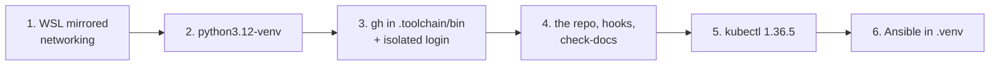

# Laptop setup

Stage 1 of the [journey](README.md): a Windows laptop with WSL becomes the lab's workstation, with this
repo, its checks, its own pinned tools and an isolated GitHub login. Everything the lab installs here
stays inside the repo folder (gitignored) or in WSL's apt packages; the machine's own logins are never
used ([AGENTS.md](../../AGENTS.md#sessions-and-logins)).
Last verified: 2026-10-30.

## Overview



## Prerequisites

| Needs | Check | If not |
|---|---|---|
| Where and mode: anywhere, VPN **off** if at home; Auto mode | | Steps 3 to 6 download from GitHub and PyPI, flaky with the VPN on ([why](../notes/wsl-and-a-full-tunnel-vpn.md)) |
| Windows with WSL2 and Ubuntu 24.04 | `wsl.exe --version` (in WSL) shows WSL 2.x | Install WSL from the Microsoft Store |
| A GitHub fine-grained token for `caokgit/ocr-platform` in a file the owner keeps | | The owner creates it on GitHub |

## Steps

### 1. WSL mirrored networking

Why: with the office VPN on, WSL's own traffic is mostly lost; mirrored mode lets Claude Code and IPv6
sites keep working ([what goes wrong and why this fixes it](../notes/wsl-and-a-full-tunnel-vpn.md)).
Shown to the owner first: it changes Windows' WSL settings.

On Windows, create `C:\Users\<you>\.wslconfig` holding:

```ini
[wsl2]
networkingMode=mirrored
```

Then in PowerShell `wsl --shutdown`, and open WSL again. Check from WSL:

```bash
wslinfo --networking-mode
grep -v '^#' "$(wslpath "$(cmd.exe /c 'echo %USERPROFILE%' 2>/dev/null | tr -d '\r')")/.wslconfig"
```

Output (REAL, 2026-10-30):

```text
mirrored
[wsl2]
networkingMode=mirrored
```

Check: `mirrored`.
If you see Claude Code stop answering when the VPN is turned on: this step is missing or WSL was not
restarted ([row](../known-failure-modes.md), 2026-10-25, VPN).

### 2. Python virtual environments

Why: Ubuntu's Python refuses `pip install` into itself; the lab installs Python tools (Ansible) into a
`.venv` instead, and `python3 -m venv` needs this package.
The owner runs it (it asks for the sudo password):

```bash
sudo apt install python3.12-venv
dpkg-query -W -f='${Package} ${Version}\n' python3.12-venv python3-pip-whl
```

Output of the check (REAL, 2026-10-30; installed 2026-10-25):

```text
python3-pip-whl 24.0+dfsg-1ubuntu1.3
python3.12-venv 3.12.3-1ubuntu0.17
```

Check: both packages listed.

### 3. gh, and an isolated GitHub login

Why: the repo is private; git and `gh` use one login kept in the repo's `.scratch_gh/`, never Windows'
credential manager. `gh` is pinned in the gitignored `.toolchain/bin/`, checksum-verified. Run this from
the folder that will hold the repo (for example `~`); every later command runs inside `ml-init/`, the
repo root.

```bash
mkdir -p ml-init/.toolchain/bin && cd ml-init
V=2.102.0
curl -fsSLO "https://github.com/cli/cli/releases/download/v$V/gh_${V}_linux_amd64.tar.gz"
curl -fsSLO "https://github.com/cli/cli/releases/download/v$V/gh_${V}_checksums.txt"
grep "gh_${V}_linux_amd64.tar.gz" "gh_${V}_checksums.txt" | sha256sum --check
tar -xzf "gh_${V}_linux_amd64.tar.gz" --strip-components=2 -C .toolchain/bin "gh_${V}_linux_amd64/bin/gh"
rm "gh_${V}_linux_amd64.tar.gz" "gh_${V}_checksums.txt"
.toolchain/bin/gh --version
```

Output (REAL, 2026-10-30, run in a scratch folder):

```text
gh_2.102.0_linux_amd64.tar.gz: OK
gh version 2.102.0 (2026-09-30)
```

Log in with the token file, feeding only the token line (the owner runs it; the token never shows):

```bash
tr -d '\r' < <token file> | grep '^github_pat_' | GH_CONFIG_DIR=$PWD/.scratch_gh .toolchain/bin/gh auth login --with-token
GH_CONFIG_DIR=$PWD/.scratch_gh .toolchain/bin/gh auth status 2>&1 | grep -iv token
```

Output of the check (REAL, 2026-10-30):

```text
github.com
  ✓ Logged in to github.com account <owner> (.../ml-init/.scratch_gh/hosts.yml)
  - Active account: true
  - Git operations protocol: https
```

Check: `Logged in ... <owner>`.
If you see `invalid header field value for "Authorization"`: the file had Windows line endings or a label
line; use the command above as written ([row](../known-failure-modes.md), 2026-10-18).

### 4. The repo, its hook and its checks

Why: get the code with git using only the isolated login, and make every commit pass the repo's rules
(the `Spec:` trailer, no AI attribution) and every doc pass the checker.

```bash
git init -q -b main
git remote add origin https://github.com/caokgit/ocr-platform.git
git config --local credential.https://github.com.helper ''
git config --local --add credential.https://github.com.helper "!GH_CONFIG_DIR=$PWD/.scratch_gh $PWD/.toolchain/bin/gh auth git-credential"
git config --local user.name '<your name>'
git config --local user.email '<your GitHub email>'
git fetch -q origin && git checkout -q main
git config core.hooksPath tools/hooks
python3 tools/check-docs.py | tail -1
```

Output (REAL, 2026-10-30, a fresh copy in a scratch folder):

```text
46 files checked, 0 problem(s)
```

Check: `0 problem(s)`, and `git log --oneline -1` shows the latest commit. The empty first helper line
switches off any global credential helper for GitHub, so Windows' accounts are never asked.
If you see `gnutls_handshake() failed` on `git fetch` or `git push` from home: the VPN is on; turn it off
and run it again ([row](../known-failure-modes.md), 2026-10-25, push).
If you see `Invalid username or token` on `git push`: the token behind the login expired or was revoked; make a
new one and log in again ([step 3](#3-gh-and-an-isolated-github-login), [row](../known-failure-modes.md), 2026-11-01).

### 5. kubectl, pinned to the cluster's version

Why: kubectl must stay within one minor version of the cluster ("`kubectl` is supported within one minor
version (older or newer) of `kube-apiserver`", the cluster's API server, [version skew policy](https://kubernetes.io/releases/version-skew-policy/),
2026-10-30). The lab pins 1.36.5, the version of its cluster, [k3s](../notes/kubernetes-on-a-shared-machine.md); the laptop's `/usr/local/bin/kubectl` belongs to Docker
Desktop, which updates it on its own.

```bash
V=v1.36.5
curl -fsSLo .toolchain/bin/kubectl "https://dl.k8s.io/release/$V/bin/linux/amd64/kubectl"
curl -fsSLo kubectl.sha256 "https://dl.k8s.io/release/$V/bin/linux/amd64/kubectl.sha256"
echo "$(cat kubectl.sha256)  .toolchain/bin/kubectl" | sha256sum --check && rm kubectl.sha256
chmod +x .toolchain/bin/kubectl && .toolchain/bin/kubectl version --client
```

Output (REAL, 2026-10-30):

```text
.toolchain/bin/kubectl: OK
Client Version: v1.36.5
Kustomize Version: v5.8.1
```

Check: `Client Version: v1.36.5`. Always call it as `.toolchain/bin/kubectl`, so Docker Desktop's copy is
never used by mistake.

Then helm, only to render charts on the laptop before Argo CD installs them (Argo CD renders them itself, with
Helm 3, so the laptop pins a Helm 3 release). Its cache and settings stay in `.scratch_helm/`:

```bash
V=v3.22.1
curl -fsSLO "https://get.helm.sh/helm-$V-linux-amd64.tar.gz"
curl -fsSLO "https://get.helm.sh/helm-$V-linux-amd64.tar.gz.sha256sum"
sha256sum --check "helm-$V-linux-amd64.tar.gz.sha256sum"
tar -xzf "helm-$V-linux-amd64.tar.gz" --strip-components=1 -C .toolchain/bin linux-amd64/helm
rm "helm-$V-linux-amd64.tar.gz" "helm-$V-linux-amd64.tar.gz.sha256sum"
.toolchain/bin/helm version --short
```

Output (REAL, 2026-11-01):

```text
helm-v3.22.1-linux-amd64.tar.gz: OK
v3.22.1+gd6c1a0e
```

Check: `v3.22.1`. Every call sets `HELM_CACHE_HOME`, `HELM_CONFIG_HOME` and `HELM_DATA_HOME` under
`$PWD/.scratch_helm/` ([isolation](../../AGENTS.md#which-mode-a-session-runs-in-owner-2026-10-25)).

### 6. Ansible in `.venv`

Why: Ansible makes the box's changes ([role](../notes/ansible-and-argo-cd.md)). It is pinned in
[infra/ansible/requirements.txt](../../infra/ansible/requirements.txt) and installed into the gitignored
`.venv/`; its own files go to `.scratch_ansible/` instead of `~/.ansible`, and its settings are
[infra/ansible/ansible.cfg](../../infra/ansible/ansible.cfg).

```bash
python3 -m venv .venv
.venv/bin/pip install -q --disable-pip-version-check -r infra/ansible/requirements.txt
export ANSIBLE_CONFIG=$PWD/infra/ansible/ansible.cfg ANSIBLE_HOME=$PWD/.scratch_ansible
.venv/bin/ansible-galaxy collection install -r infra/ansible/requirements.yml
.venv/bin/ansible --version | head -2
.venv/bin/ansible-inventory --graph
.venv/bin/ansible-galaxy collection list community.general
```

Output (REAL, 2026-10-30):

```text
ansible [core 2.21.5]
  config file = <repo>/infra/ansible/ansible.cfg
@all:
  |--@ungrouped:
  |  |--box

# <repo>/.scratch_ansible/collections/ansible_collections
Collection        Version
----------------- -------
community.general 13.5.0
```

Check: `core 2.21.5`, the repo's config file, and the pinned collection
([infra/ansible/requirements.yml](../../infra/ansible/requirements.yml); its `ufw` module previews firewall
changes in check mode). The two `export`s go with every Ansible command
([AGENTS.md](../../AGENTS.md#sessions-and-logins)). The host `box` is reached as `$BOX` (`gpu-box` when
unset), set up in [reach the box](reach-the-box.md).

## Verify end to end

```bash
wslinfo --networking-mode && .toolchain/bin/gh --version | head -1 && .toolchain/bin/kubectl version --client | head -1 && .venv/bin/ansible --version | head -1 && git config core.hooksPath && python3 tools/check-docs.py | tail -1
```

Output (REAL, 2026-10-30):

```text
mirrored
gh version 2.102.0 (2026-09-30)
Client Version: v1.36.5
ansible [core 2.21.5]
tools/hooks
49 files checked, 0 problem(s)
```

## Roll back

| Step | Undo |
|---|---|
| 6, 5, 3 | `rm -rf .venv .scratch_ansible .toolchain .scratch_gh` (the login token stays valid on GitHub until the owner revokes it there) |
| 4 | Delete the folder |
| 2 | `sudo apt remove python3.12-venv` |
| 1 | Delete `.wslconfig`, then `wsl --shutdown` |
