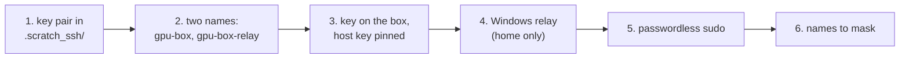

# Reach the box

Stage 2 of the [journey](README.md): the laptop logs in to the shared GPU box by key, from the office
directly or from home through a relay on Windows, and the owner's account runs `sudo` without a password
during the lab ([D10](../design.md#decisions), [D13](../design.md#decisions)).
Last verified: 2026-10-30.

## Overview



Which name to use:

| You are | Name | Road |
|---|---|---|
| Office | `gpu-box` | WSL → office network → box:22 |
| Home, VPN on | `gpu-box-relay` | WSL → `127.0.0.1:2222` → Windows' relay → VPN → box:22 ([why](../notes/wsl-and-a-full-tunnel-vpn.md)) |

**Steps 1 to 3 are done at the office**: the first login records the box's host key, and the relay
refuses a box whose key is not recorded yet. Step 4 is for home. Later commands use `$BOX`, set to the
name for where you are (`export BOX=gpu-box` or `export BOX=gpu-box-relay`); the lab's Ansible reads the
same variable.

## Prerequisites

| Needs | Check | If not |
|---|---|---|
| Where and mode: the office for steps 1 to 3; home with the office VPN on for step 4; Auto mode. **Ask the owner where they are before any box access** ([safety](../../AGENTS.md#safety-and-approvals)) | | |
| [Laptop setup](laptop-setup.md) done | `wslinfo --networking-mode` prints `mirrored` | Stage 1 |
| The box's address on the office network, from the owner: in this lab `192.168.x.x` | | Ask the owner |
| An account on the box with its password, from the AI team's box admin; below, `<user>` is its name | | Ask the AI team |
| That account in the box's `sudo` group (step 5 only) | After step 3: `ssh -F .scratch_ssh/config gpu-box 'id -nG'` lists `sudo` | Ask the AI team's box admin |

Commands that reach the box end in `| python3 tools/mask.py`, which leaves internal addresses as they are
and hides the box's hostname and any public address (the VPN server's, the home connection's) that
`ssh` errors or route listings can print ([row](../known-failure-modes.md), 2026-10-25, address).

## Steps

### 1. A key pair for the box

Why: the laptop logs in by key, never by password; the key lives only in the gitignored `.scratch_ssh/`.

```bash
mkdir -m 700 -p .scratch_ssh
ssh-keygen -t ed25519 -N '' -C 'ml-lab laptop to gpu-box' -f .scratch_ssh/gpu_box_ed25519
ssh-keygen -lf .scratch_ssh/gpu_box_ed25519.pub
stat -c '%a %n' .scratch_ssh .scratch_ssh/gpu_box_ed25519*
```

Output of the checks (REAL, 2026-10-30; the key was made 2026-10-23, its output not kept):

```text
256 SHA256:4H5OxjFtSXBTkTE+xgo2pZ0N0q2uFjECUqV0LL2r1pU ml-lab laptop to gpu-box (ED25519)
700 .scratch_ssh
600 .scratch_ssh/gpu_box_ed25519
600 .scratch_ssh/gpu_box_ed25519.pub
```

Check: an ED25519 key, folder 700, files 600. No passphrase, so the agent can use it unattended.

### 2. The two names in `.scratch_ssh/config`

Why: one file holds both roads, the key, and a known-hosts file of the lab's own. Create
`.scratch_ssh/config` with this content, replacing `<repo>` with the output of `pwd` (ssh needs absolute
paths), `<box address>` with the address and `<user>` with the account:

```text
Host gpu-box
  HostName <box address>
  User <user>
  IdentityFile <repo>/.scratch_ssh/gpu_box_ed25519
  IdentitiesOnly yes
  UserKnownHostsFile <repo>/.scratch_ssh/known_hosts
  StrictHostKeyChecking accept-new
  ConnectTimeout 8

Host gpu-box-relay
  HostName 127.0.0.1
  Port 2222
  HostKeyAlias <box address>
  User <user>
  IdentityFile <repo>/.scratch_ssh/gpu_box_ed25519
  IdentitiesOnly yes
  UserKnownHostsFile <repo>/.scratch_ssh/known_hosts
  StrictHostKeyChecking yes
  ConnectTimeout 8
```

`HostKeyAlias` makes the relay check the box's own pinned key, and `StrictHostKeyChecking yes` refuses
any other.

```bash
chmod 600 .scratch_ssh/config
ssh -F .scratch_ssh/config -G gpu-box-relay | grep -E '^(hostname|port|hostkeyalias|stricthostkeychecking) ' | python3 tools/mask.py
```

Output (REAL, 2026-10-30):

```text
hostname 127.0.0.1
port 2222
stricthostkeychecking true
hostkeyalias 192.168.x.x
```

Check: the relay entry points at `127.0.0.1:2222` and checks the box's address as its host key name.

### 3. The key on the box, and the box's host key pinned

Why: the box must know the laptop's key (`authorized_keys`), and the laptop must know the box's
(`known_hosts`), so neither side can be faked. The owner runs it in
their own terminal, at the office, and types the box password once:

```bash
ssh-copy-id -F .scratch_ssh/config -i .scratch_ssh/gpu_box_ed25519.pub gpu-box 2>&1 | python3 tools/mask.py
```

The first connection pins the box's host key (`accept-new`). Compare it with the box's own, read on the
box:

```bash
ssh-keygen -lf .scratch_ssh/known_hosts | awk '{print $2}' > /tmp/pinned
ssh -F .scratch_ssh/config gpu-box 'ssh-keygen -lf /etc/ssh/ssh_host_ed25519_key.pub' 2>&1 | python3 tools/mask.py | awk '{print $2}' | diff -q - /tmp/pinned && echo "host key matches the box's"
ssh -F .scratch_ssh/config gpu-box 'grep -c "ml-lab laptop to gpu-box" ~/.ssh/authorized_keys' 2>&1 | python3 tools/mask.py
```

Output (REAL, 2026-10-30; `ssh-copy-id` ran 2026-10-23, its output not kept):

```text
host key matches the box's
1
```

Check: the host key matches, and the laptop key is installed once.

### 4. The Windows relay (home only)

Why: with the VPN on, WSL's own packets to the box are mostly lost; Windows' are not, so Windows carries
the connection ([measured](../notes/wsl-and-a-full-tunnel-vpn.md)).
Shown to the owner first; the owner runs it in an **admin** PowerShell:

```powershell
netsh interface portproxy add v4tov4 listenaddress=127.0.0.1 listenport=2222 connectaddress=<box address> connectport=22
```

Check from WSL (works with the VPN on or off):

```bash
/mnt/c/Windows/System32/netsh.exe interface portproxy show all | tr -d '\r' | python3 tools/mask.py
```

Output (REAL, 2026-10-30):

```text
Listen on ipv4:             Connect to ipv4:

Address         Port        Address         Port
--------------- ----------  --------------- ----------
127.0.0.1       2222        192.168.x.x 22
```

Then, with the VPN on, log in through it (an unknown host key is refused here, which is why step 3 comes
first, at the office):

```bash
ssh -o BatchMode=yes -F .scratch_ssh/config gpu-box-relay 'echo reachable; uptime; nproc; free -h | head -2' 2>&1 | python3 tools/mask.py
```

Output (REAL, 2026-10-25, the relay's first login, home with the VPN on):

```text
reachable
 12:04:02 up 21:08, 10 users,  load average: 3.05, 3.55, 4.67
28
               total        used        free      shared  buff/cache   available
Mem:            31Gi        15Gi       5.2Gi       1.6Gi        12Gi        15Gi
```

Check: `reachable`. The relay listens only on `127.0.0.1`, so nothing else on the home network can use it.
If you see `Connection timed out` with the VPN on: you used `gpu-box`; from home use `gpu-box-relay`. With
`Connection refused` on `127.0.0.1:2222`: the relay is missing (`show all` is empty); add it again.

### 5. Passwordless sudo

Why: the lab's Ansible runs `sudo` unattended; the rule lives in its own file, removed at teardown
([D13](../design.md#decisions)). The owner runs it **on the box**, in
their own terminal (it asks for the password once). The file is named after the account, with no dot:

```bash
U=$(whoami)
echo "$U ALL=(ALL) NOPASSWD:ALL" > /tmp/$U
sudo visudo -cf /tmp/$U
sudo install -m 0440 -o root -g root /tmp/$U /etc/sudoers.d/$U && rm /tmp/$U
```

Check from the laptop:

```bash
ssh -F .scratch_ssh/config $BOX 'U=$(whoami); sudo -n true && echo "sudo: no password asked"; sudo -n stat -c "%a %U %n" /etc/sudoers.d/$U; sudo -n cat /etc/sudoers.d/$U; sudo -n visudo -c' 2>&1 | python3 tools/mask.py
```

Output (REAL, 2026-10-30, `BOX=gpu-box`, account `<user>`; the rule was installed 2026-10-23):

```text
sudo: no password asked
440 root /etc/sudoers.d/<user>
<user> ALL=(ALL) NOPASSWD:ALL
/etc/sudoers: parsed OK
/etc/sudoers.d/README: parsed OK
/etc/sudoers.d/<user>: parsed OK
```

Check: `no password asked`, the file is `440 root`, and `visudo -c` parses every file OK.

### 6. A private list of names to mask

Why: the box's hostname is also its Kubernetes node name, so `kubectl` and the playbooks print it;
[tools/mask.py](../../tools/mask.py) replaces each word in the gitignored `.scratch_box/mask-words` with
`<box>`. The name is read from the box straight into the file, never printed.

```bash
mkdir -m 700 -p .scratch_box
ssh -o BatchMode=yes -F .scratch_ssh/config $BOX hostname > .scratch_box/mask-words 2>/dev/null
chmod 600 .scratch_box/mask-words && wc -l < .scratch_box/mask-words
ssh -o BatchMode=yes -F .scratch_ssh/config $BOX hostname | python3 tools/mask.py
```

Output (REAL, 2026-10-30, `BOX=gpu-box`):

```text
1
<box>
```

Check: one word in the file, and the box's name comes back as `<box>`.
If you see the box's real name in any output: this file is missing or the command skipped the mask
([row](../known-failure-modes.md), 2026-10-30, names).

## Verify end to end

```bash
ssh -o BatchMode=yes -F .scratch_ssh/config $BOX 'sudo -n true && echo "login and sudo ok"' 2>&1 | python3 tools/mask.py
```

Output (REAL, 2026-10-30, `BOX=gpu-box`): `login and sudo ok`.

## When the box cannot be reached

| You see | Cause | Do |
|---|---|---|
| Claude Code stops answering when the VPN goes on | WSL not in mirrored mode | [Laptop setup, step 1](laptop-setup.md#1-wsl-mirrored-networking) |
| `gpu-box`: timeout, from home | The office network is reachable only through the VPN, and from WSL only through the relay | VPN on, use `gpu-box-relay` |
| `gpu-box-relay`: timeout | The VPN is off | Turn the office VPN on |
| `git push`: `gnutls_handshake() failed` | The VPN is on; GitHub is IPv4 only | Push with the VPN off |
| A public address or the box's hostname in output | `ssh` and route listings print them | Always end with `| python3 tools/mask.py` |

The measurements behind these rows, with the test that told them apart:
[what went wrong with the office VPN](../notes/wsl-and-a-full-tunnel-vpn.md).

## Roll back

| Step | Undo |
|---|---|
| 6 | `rm .scratch_box/mask-words` |
| 5 | On the box: `sudo rm /etc/sudoers.d/$(whoami)` (the lab's teardown does it last) |
| 4 | Admin PowerShell: `netsh interface portproxy delete v4tov4 listenaddress=127.0.0.1 listenport=2222` |
| 3 | On the box: remove the `ml-lab laptop to gpu-box` line from `~/.ssh/authorized_keys` |
| 1, 2 | `rm -r .scratch_ssh` |
