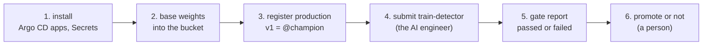

# Training platform: install, register production, train, gate, promote

Stage 7b of the [map](README.md): the AI team's training layer on the GPU box: Argo Workflows, Kueue and MLflow
installed by Argo CD; the production weights registered as `@champion`; one command trains the detector from a
dataset id, queues for GPU 1, registers a version and gates it; a person promotes
([spec](../specs/training-platform.md)). Last verified: 2026-11-15.

## Overview



## Prerequisites

| Needs | Check | If not |
|---|---|---|
| Where and mode: the office, or home with the VPN **on** for the box; the VPN **off** from home for a push (Argo CD deploys from GitHub) | `ssh -F $PWD/.scratch_ssh/config $BOX true` exits 0 | [reach the box](reach-the-box.md) |
| The lab up, the data path healthy | `lab-up` ends with `failed=0` and lists the data path's and the training platform's pods | [lab session](lab-session.md) |
| The dataset copy and its test split in the bucket | `datasets/ultralytics/2026-09-24-4a208a33d4ca/` and `splits/2026-09-24-4a208a33d4ca/test.txt` (uploaded 2026-11-01, B11) | [data path, step 5](data-path.md#5-the-gold-sets-box-then-laptop) |
| The base weights on the laptop | `sha256sum data/weights/base/yolo26n.pt` prints `9b09cc8b...` (the value in [values.yaml](../../pipelines/detector/values.yaml)) | Download with the VPN off: `curl -sSfL -o data/weights/base/yolo26n.pt https://github.com/ultralytics/assets/releases/download/v8.4.0/yolo26n.pt` |
| The production weights on the laptop | `data/weights/production/production.pt`, MD5 starting `eb9f4b532b7f` | Copied from the service's Azure Blob storage |

```bash
export BOX=gpu-box        # office; from home with the VPN on: gpu-box-relay
export ANSIBLE_CONFIG=$PWD/infra/ansible/ansible.cfg ANSIBLE_HOME=$PWD/.scratch_ansible
export KUBECONFIG=$PWD/.scratch_kube/config
```

## Steps

### 1. Install: push, start the lab, make the Secrets

Why: Argo CD installs everything from Git ([the apps](../../infra/argocd/apps/), [lab-ml](../../infra/argocd/lab-ml/),
[the detector chart](../../pipelines/detector/)); only the credentials are made by hand, straight into the cluster.

With the VPN **off** (from home), push; then with it **on**, start the lab:

```bash
git push
.venv/bin/ansible-playbook infra/ansible/lab-up.yml --check --diff | python3 tools/mask.py
.venv/bin/ansible-playbook infra/ansible/lab-up.yml | python3 tools/mask.py
```

On the first install, `lab-up` stops at its last wait: MLflow cannot start before its Secrets exist. Make them while it
waits, or after it, and restart SeaweedFS so it loads the two new S3 identities:

```bash
ssh -F .scratch_ssh/config -f -N -o ExitOnForwardFailure=yes -o ServerAliveInterval=15 -L 16443:127.0.0.1:6443 $BOX
python3 -I infra/scripts/lab-credentials.py
.toolchain/bin/kubectl rollout restart deployment/seaweedfs-all-in-one -n lab-data
```

Output (REAL, 2026-11-15 09:43, home with the VPN on):

```text
lab-pg-mlflow: missing; mlflow/mlflow-db: missing
S3 identity mlflow: missing; mlflow/mlflow-s3: missing
S3 identity train: missing; ai-team/train-s3: missing
lab-data/lab-pg-mlflow: created
mlflow/mlflow-db: created
mlflow/mlflow-s3: created
ai-team/train-s3: created
seaweedfs-s3-config: identities added; restart SeaweedFS to load them
```

Then `lab-up` again; it places the GPU 0 reservation and waits for every service (REAL, 10:31):

```text
TASK [GPU reservation]
    "ai-team-docker-gpu0 holds /dev/nvidia0 (nvidia0 ), try 2"
TASK [The training platform's pods]
    "argo  argo-workflows-server-...               1/1   Running   0     58m",
    "argo  argo-workflows-workflow-controller-...  1/1   Running   0     58m",
    "kueue-system  kueue-controller-manager-...    1/1   Running   0     60m",
    "mlflow  mlflow-...                            1/1   Running   0     5m14s"
box : ok=20   changed=1    unreachable=0    failed=0
```

Check: `kubectl get applications -n argocd` lists `argo-workflows`, `kueue`, `mlflow`, `lab-ml`, `detector` `Synced`
and `Healthy`; the reservation holds `/dev/nvidia0`, device minor 0, which is GPU 0
(`grep -E "Device Minor|GPU UUID" /proc/driver/nvidia/gpus/*/information` on the box).
If you see MLflow `OOMKilled` or idling near 2 GiB: its GenAI job runner is on ([row](../known-failure-modes.md)).
If you see the root Application's sync `Running` for many minutes: [row](../known-failure-modes.md).
If you see `nvidia.com/gpu` allocatable 2 and wonder why GPU 1 is not pinned: the device plugin's
`NVIDIA_VISIBLE_DEVICES` does not restrict it (it allocates by CDI), hence the reservation
([spec, decision 5](../specs/training-platform.md#decisions)).

### 2. The base weights into the bucket (platform engineer, once)

Why: a run reads its base weights from the bucket by sha256, never from the internet (decision 7).

```bash
~/.local/bin/uv run --no-project -q --python 3.12 --with boto3 \
  python -I pipelines/detector/put_object.py data/weights/base/yolo26n.pt models/base/yolo26n.pt
```

Output (REAL, 10:31):

```text
s3://lab-lake/models/base/yolo26n.pt: 5,544,453 bytes, sha256 9b09cc8bf347f0fc8a5f7657480587f25db09b34bf33b0652110fb03a8ad4fef
```

Check: the sha256 equals `baseWeights.sha256` in [values.yaml](../../pipelines/detector/values.yaml) and GitHub's own
asset digest of `ultralytics/assets` v8.4.0 (read 2026-11-15).

### 3. Register production as version 1 and `@champion` (platform engineer, once)

Why: the gate needs something to beat (decision 11). MLflow answers only to the host names it allows, so forward to
local port **5000** (`localhost:5000` is allowed, another port gets 403 "Invalid Host header").

```bash
.toolchain/bin/kubectl port-forward -n mlflow svc/mlflow 5000:5000 &
MLFLOW_TRACKING_URI=http://localhost:5000 ~/.local/bin/uv run --no-project -q --python 3.12 \
  --with mlflow-skinny==3.18.0 --with pyyaml \
  python -I pipelines/detector/register_production.py data/weights/production/production.pt
```

Output (REAL, 10:32):

```text
registered region-detector version 1 (MD5 eb9f4b532b7f..., sha256 8aa69a75a344...); alias champion -> 1
```

Check: the MLflow UI (`http://localhost:5000`) shows `region-detector`, version 1, alias `champion`.

### 4. Score a version alone: the gate on the box (E2)

Why: the gate's code must reproduce T1's baseline on the box before it judges anything
([the gate](../specs/training-platform.md#the-gate)). The template `gate-detector` runs alone with a version number;
against itself, the difference is zero.

```bash
export KUBECONFIG=$PWD/.scratch_kube/ai-engineer
.toolchain/bin/argo submit -n ai-team --from workflowtemplate/gate-detector -p candidate=1
```

Output (REAL, 2026-11-15 10:33 to 10:41, the box's CPU, submitted as the equivalent `Workflow`; 4.5 min of it the
first pull of the 4.65 GB Ultralytics image):

```text
test split dad44960..., 26 documents, 341 pages, 585 boxes; interval: 2000 resamples of the documents, seed 0
                                      champion                 candidate                difference
mAP50_95                  0.957 [0.941, 0.971]      0.957 [0.941, 0.971]   +0.000 [+0.000, +0.000]
mAP50                     0.990 [0.984, 0.994]      0.990 [0.984, 0.994]   +0.000 [+0.000, +0.000]
recall_service            0.947 [0.925, 0.968]      0.947 [0.925, 0.968]   +0.000 [+0.000, +0.000]
precision_service         0.962 [0.936, 0.983]      0.962 [0.936, 0.983]   +0.000 [+0.000, +0.000]
rule: lower ends >= -0.02 (mAP50_95), -0.02 (recall_service): PASSED
{"version": "1", "champion": "1", "gate": "passed", "better": false}
```

Check: 0.957 and 0.990 are T1's baseline ([measured on the laptop](../specs/ml-platform.md#t1s-baseline-measured-ahead-of-2b));
the run is in MLflow's experiment `region-detector-gate`, and version 1 carries the tags `gate`, `gate_run_id`.

### 5. Train: the AI engineer's one command (T8)

Why: the template holds the recipe; the engineer gives the dataset id and the recipe's name
([the job](../specs/training-platform.md#the-job)). Make the AI engineer's kubeconfig once, from its ServiceAccount's
token (written mode 600, never printed), then submit:

```bash
export KUBECONFIG=$PWD/.scratch_kube/ai-engineer
.toolchain/bin/argo submit -n ai-team --from workflowtemplate/train-detector \
  -p dataset=2026-09-24-4a208a33d4ca -p recipe=production
```

What that identity may do (REAL, 10:40, `kubectl auth can-i`, E3):

```text
create workflows                         yes
get workflowtemplates                    yes
list pods                                yes
get pods/log                             yes
list workloads.kueue.x-k8s.io            yes
create pods                              no
get secrets                              no
delete workflows                         no
create workflows -n lab-data             no
get pods -n mlflow                       no
```

The train pod's first lines (REAL, 11:18):

```text
{"gpu_name": "NVIDIA GeForce RTX 3060", "gpu_uuid": "1366f1b8-...", "gpu_free_mib_at_start": 11634, ...}
copy 2026-09-24-4a208a33d4ca: 4080 files; train 1608 pages, validation 91 pages (11 documents), test 341 pages left out
      8/200       1.6G     0.7531      0.372    0.01421         29        640: 100% 201/201 16.4it/s 12.3s
```

Check: the pod got GPU 1 (`1366f1b8...`), never the reserved GPU 0; about 12 s an epoch.
If you see `Permission denied: '/ultralytics/weights'`: Ultralytics' folders are not set to `/work` before training
(`train.py` sets them, and `WEIGHTS_DIR`, which its AMP check reads; [row](../known-failure-modes.md)).
If you see the old error after a fix: the detector app has not synced the commit yet; check the ConfigMap
`detector-code` (its label `lab/git-commit`) before submitting.

### 6. A second job waits in the queue (T8)

Why: one lab GPU job at a time; a second one must wait in order, not start on a busy card or fail.

```bash
.toolchain/bin/argo submit -n ai-team --from workflowtemplate/train-detector \
  -p dataset=2026-09-24-4a208a33d4ca -p recipe=production -p epochs=5
.toolchain/bin/kubectl get workloads -n ai-team
```

Output (REAL, 11:21, while the first trained):

```text
NAME                                              QUEUE     RESERVED IN   ADMITTED   FINISHED   AGE
pod-train-detector-mpf74-train-2445730264-1fe5a   ai-team   lab-gpu       True                  3m37s
pod-train-detector-rppt2-train-2655053554-c03a7   ai-team                 False                 28s
train-detector-rppt2-train-2655053554   0/2   SchedulingGated   <none>
schedulingGates: [{"name":"kueue.x-k8s.io/admission"},{"name":"kueue.x-k8s.io/topology"}]
```

Check: the second Workload is `Admitted False`, its pod `SchedulingGated` with no node (E7).
If you see the second pod `Pending` on the node instead: it lacks the label `kueue.x-k8s.io/queue-name`.
If you see the second pod rejected by a quota: the namespace's `ResourceQuota` has a GPU line; a quota counts gated
pods too ([spec, box budget](../specs/training-platform.md#box-budget), [row](../known-failure-modes.md)).

### 7. The gate's report on a new version (T7)

Why: after `train` registers version N, `gate` scores it against `@champion` on the frozen test split by the rule
fixed in the spec, and tags the version ([the gate](../specs/training-platform.md#the-gate)). Read it in the gate
pod's log, in MLflow's experiment `region-detector-gate`, or on the version's tags.

```bash
.toolchain/bin/argo logs -n ai-team <workflow> | grep -A8 'test split'
```

Output (REAL, 2026-11-15 11:55 to 11:58, `train-detector-mpf74`: the production recipe, 164 epochs, early stop, best
epoch 114, 0.596 h on GPU 1, registered as version 2):

```text
test split dad44960..., 26 documents, 341 pages, 585 boxes; interval: 2000 resamples of the documents, seed 0
mAP50_95                  0.957 [0.941, 0.971]      0.846 [0.789, 0.895]   -0.110 [-0.167, -0.066]
mAP50                     0.990 [0.984, 0.994]      0.924 [0.881, 0.960]   -0.066 [-0.107, -0.031]
recall_service            0.947 [0.925, 0.968]      0.841 [0.746, 0.912]   -0.106 [-0.205, -0.034]
precision_service         0.962 [0.936, 0.983]      0.894 [0.848, 0.930]   -0.067 [-0.110, -0.033]
rule: lower ends >= -0.02 (mAP50_95), -0.02 (recall_service): FAILED
{"version": "2", "champion": "1", "gate": "failed", "better": false}
```

And the deliberately worse model (`-p epochs=5`, version 3, which had waited in the queue behind version 2):

```text
mAP50_95                  0.957 [0.941, 0.971]      0.787 [0.744, 0.838]   -0.169 [-0.212, -0.120]
recall_service            0.947 [0.925, 0.968]      0.779 [0.711, 0.845]   -0.168 [-0.234, -0.108]
rule: lower ends >= -0.02 (mAP50_95), -0.02 (recall_service): FAILED
```

Check: the version carries `gate`, `gate_champion_version`, `gate_run_id`, `gate_mAP50_95`; the gate never moves an
alias. Version 2 shows that T1 is not met as written: why, and the diagnostic run that tells data from platform, are
in the [spec, decision 16](../specs/training-platform.md#decisions).

### 8. Promote, or not (a person)

Why: only a person moves `@champion`, and only to a version that passed against the current champion
([decision 12](../specs/training-platform.md#decisions)).

```bash
MLFLOW_TRACKING_URI=http://localhost:5000 ~/.local/bin/uv run --no-project -q --python 3.12 \
  --with mlflow-skinny==3.18.0 python -I pipelines/detector/promote.py <version>
# back to a version that was champion before:  ... promote.py --rollback <version>
```

Output (REAL, 12:08):

```text
refused: version 3's gate is failed
refused: version 2's gate is failed
```

Check: `@champion` unchanged (`get_model_version_by_alias('region-detector', 'champion')` gives 1). A diagnostic
version (`split=as-copy`) is refused whatever its gate says. The MLflow UI can still move an alias by hand: the
command is the guard, not MLflow.

### 9. Stop a training (a person, or `lab-down`)

Why: a stopped training must end its MLflow run as `KILLED`, never leave it `RUNNING` ([the job](../specs/training-platform.md#the-job)).
`lab-down` stops running workflows the same way before it stops k3s.

```bash
.toolchain/bin/argo stop -n ai-team <workflow>
```

Output (REAL, 2026-11-15 14:53, a 30-epoch run stopped in its epochs): the workflow `Failed`, "Stopped with
strategy 'Stop'"; its MLflow run `KILLED`.

Check: the run's status in MLflow is `KILLED`.
If you see the run still `RUNNING` after a stop: the signal reaches the whole process group, the DataLoader workers
die first and PyTorch raises in the main process; `train.py` (since `7db9860`) ends the run itself in both paths ([row](../known-failure-modes.md)).
A run left `RUNNING` by an older version is closed by hand with `MlflowClient().set_terminated(run_id, "KILLED")` and
a tag saying so (done for `train-detector-tdvv5`, 2026-11-15).

## Verify end to end

Acceptance of the [spec](../specs/training-platform.md#acceptance), all REAL, 2026-11-15:

| # | Check | Result |
|---|---|---|
| E1 | Install | Every Application `Synced`, `Healthy`; `lab-gpu` with 1 GPU; MLflow on `lab-pg`, artifacts in `s3://lab-lake/mlflow/` (step 1) |
| E2 | Version 1 | Production's weights, MD5 `eb9f4b532b7f...`, `@champion`; the gate's code on the box's CPU: 0.957 and 0.990, T1's baseline exactly (steps 3, 4) |
| E3 | One command | `argo submit` as `ai-engineer`; cannot create a pod or read a Secret (step 5) |
| E4 | Lineage | Version 2's run: the dataset as an input, commit, image digest, base weights, both split lists' sha256, the card |
| E5 | T1 | **Not met**: 0.846 on mAP@50-95 against 0.957 (gate failed). On production's own split, 0.955 (diagnostic, version 5); production scores as high on the copy's "unseen" pages as on its training pages, so its scores here are near training scores ([spec, decision 16](../specs/training-platform.md#decisions)) |
| E6 | T1, the rerun | Version 4 equal to version 2 to four decimals on every metric |
| E7 | The queue | The second job `Admitted False`, `SchedulingGated`, until the first ended (step 6) |
| E8 | A worse model | Version 3 (5 epochs), 0.787: gate failed; `promote.py` refused (steps 7, 8) |
| E9 | Promotion and rollback | **In part**: refused for versions 2, 3 (failed) and 5 (diagnostic); no promotable version passed, so no move is shown |
| E10 | The scoreboard | `region-detector-gate`: v1 0.9566, v2 and v4 0.8463, v3 0.7872, v5 0.9546 on the test split |
| E11 | The AI team first | Floor raised to 999,999 MiB: "card busy", exit 75, run once, no gate; Docker unchanged (7 running, `daemon.json` and containerd's config by sha256) |
| E12 | Memory | `ai-team` within its 32 GiB of limits; the lab 6.8 GiB idle and 13.2 GiB training; `lab-up`'s floor 12 GiB |
| E13 | `lab-down` mid-training | 39 s, every count 0, the registry unchanged after `lab-up`; the run marked `KILLED` after a fix (step 9) |
| E14 | Teardown | Preview: 33 ok, 12 to change, 0 failed; footprint: nothing of 2b outside k3s's folders, `~/.local` found and added to the inventory |

## Roll back

| Step | Undo |
|---|---|
| 9 to 4 | Nothing to undo: workflows and their pods stay as history in `ai-team`; `argo delete -n ai-team <workflow>` removes one |
| 8 | `promote.py --rollback <previous version>` |
| 3 | Delete the registered model in MLflow's UI (its versions and runs go with it) |
| 2 | Delete `s3://lab-lake/models/base/yolo26n.pt` |
| 1 | Remove the 2b Applications (`argo-workflows`, `kueue`, `mlflow`, `lab-ml`, `detector`) from `infra/argocd/apps/` and push: Argo CD prunes them; the `mlflow` database and role from `postgres.yaml`; the Secrets with `kubectl delete secret` (names in the [teardown inventory](../specs/gpu-box-platform.md#teardown)); `rm .scratch_kube/ai-engineer` on the laptop. Everything 2b left on the box goes with the lab's teardown |
