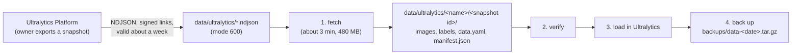

# Download the Ultralytics dataset

Stage 4 of the [journey](README.md): turns an NDJSON snapshot of the AI team's detector dataset into a verified local YOLO copy in the
gitignored `data/`, keeping the original file names. What it must produce and why our own fetch:
[spec](../specs/dataset-intake.md).
Last verified: 2026-10-25.

## Overview



## Prerequisites

| Needs | Check | If not |
|---|---|---|
| An NDJSON snapshot in `data/ultralytics/`, links not expired | `python3 -I -c "import json,urllib.parse,datetime as d; r=json.loads(open('<file>').readlines()[1]); print(d.datetime.fromtimestamp(int(urllib.parse.parse_qs(urllib.parse.urlparse(r['url']).query)['Expires'][0]), d.UTC))"` prints a future date (prints the expiry only, never the link) | The owner exports a fresh one: dataset page, download icon in the header, or a numbered snapshot in the Versions tab |
| The file is private | `stat -c '%a' data/ultralytics/*.ndjson` prints `600` | `chmod 600 data/ultralytics/*.ndjson` |
| About 1 GB free disk | `df -h .` | |
| Where and mode: anywhere, VPN off from home (downloads); Auto mode | | |
| [Laptop setup](laptop-setup.md) done; `uv` for step 3 | `~/.local/bin/uv --version` prints `uv 0.12.24` (REAL, 2026-10-30) | [Install uv](https://docs.astral.sh/uv/getting-started/installation/) |

## Steps

### 1. Fetch

Why: download every image once, before the links expire, and write labels, `data.yaml` and the manifest.

```bash
python3 -I pipelines/dataset/fetch_ultralytics_ndjson.py "data/ultralytics/<file>.ndjson"
```

Output (REAL, 2026-10-25, 2 min 47 s on the laptop; the script now also prints `recorded missing: N` in its first
count line):

```text
snapshot: data/ultralytics/labelled-pages/2026-09-24-4a208a33d4ca
images: 2041, already present: 0, to fetch: 2041
  250/2041 done, 0 failed, 18 s
  ...
  2041/2041 done, 1 failed, 166 s
1 image(s) not fetched: {'HTTP 404': 1}
   <page>.jpg HTTP 404
images per split: {'train': 1894, 'val': 146} (expected: NDJSON minus recorded missing {'train': 1894, 'val': 146})
label lines: 3492, empty label files: 51
WARNING: <page>.jpg missing at the source (HTTP 404), recorded in manifest.json
0 problem(s)
```

Check: exit code 0. Exit 1 means a transient failure (timeout, HTTP 5xx): **run the same command again**;
it fetches only what is missing. An HTTP 404 means the source does not have that image: it is recorded in
`manifest.json` under `missing` and the copy is still complete for everything else.
If you see one image `HTTP 404`: it is missing at the source; nothing to fix, ask the AI team if that page
matters ([row](../known-failure-modes.md), 2026-10-25, 404).

### 2. Verify

Why: prove the copy on its own, from local files only (also after copying it elsewhere).

```bash
python3 -I pipelines/dataset/fetch_ultralytics_ndjson.py "data/ultralytics/<file>.ndjson" --verify
```

Output (REAL, 2026-10-30, 3 s):

```text
snapshot: data/ultralytics/labelled-pages/2026-09-24-4a208a33d4ca
images per split: {'train': 1894, 'val': 146} (expected: NDJSON minus recorded missing {'train': 1894, 'val': 146})
label lines: 3492, empty label files: 51
total bytes: 501855571
WARNING: <page>.jpg missing at the source (HTTP 404), recorded in manifest.json
0 problem(s)
```

Check: `0 problem(s)` and exit code 0: every image is a JPEG of the size the NDJSON states, its sha256
equals the manifest's, and its label has one line per box.

### 3. Load in Ultralytics

Why: confirm the copy trains as it is. Run with the settings isolated and analytics off
([AGENTS.md](../../AGENTS.md#sessions-and-logins)); the CPU build of PyTorch keeps the throwaway
environment small.

```bash
export YOLO_CONFIG_DIR=$PWD/.scratch_ultralytics YOLO_OFFLINE=1
~/.local/bin/uv run --no-project -q --python 3.12 --with ultralytics==8.4.142 --with torch --with torchvision \
  --index https://download.pytorch.org/whl/cpu --index-strategy unsafe-best-match python -I -c "
from ultralytics.utils import SETTINGS; SETTINGS.update(sync=False)
from ultralytics.data.utils import check_det_dataset
print(check_det_dataset('<snapshot folder>/data.yaml')['names'])"
```

Output (REAL, 2026-10-25): `{0: 'Class 0'}`. It also downloads a font (`Arial.ttf`) into
`.scratch_ultralytics/Ultralytics/`; nothing is written to `~/.config`. `<snapshot folder>` is the path step 1
prints after `snapshot:`. uv keeps its downloads (PyTorch included) in the machine's shared cache
`~/.cache/uv` (2.5 GB on 2026-10-30, shared with other projects): a cache holding no login, so the lab
does not isolate it.
If you see `~/.config/Ultralytics/`: the run went without `YOLO_CONFIG_DIR`; remove the folder if that run
created it ([row](../known-failure-modes.md), 2026-10-25, Ultralytics).

### 4. Back up: one file instead of the NDJSON's links

Why: the NDJSON's image links expire after about a week, so once the copy is verified, one archive keeps it
for good; restoring it needs no download. The archive holds all of `data/` (the dataset copy with its
NDJSON, and the detector weights, PDFs and renders the lab's private data access runbook copies): the client's data, kept in
the gitignored `backups/`, mode 600, on the laptop only.

```bash
mkdir -m 700 -p backups
tar -czf backups/data-<date>.tar.gz data && chmod 600 backups/data-<date>.tar.gz
(cd backups && sha256sum data-<date>.tar.gz > data-<date>.tar.gz.sha256 && sha256sum --check data-<date>.tar.gz.sha256)
gzip -t backups/data-<date>.tar.gz && echo "gzip integrity: OK"
echo "files in data/: $(find data -type f | wc -l), in the archive: $(tar -tzf backups/data-<date>.tar.gz | grep -vc '/$')"
```

Output (REAL, 2026-10-30, `<date>` = `2026-10-30`, 35 s):

```text
data-2026-10-30.tar.gz: OK
gzip integrity: OK
files in data/: 4111, in the archive: 4111
```

Check: 705 MB from 870 MB (the images and weights are already compressed), every file in it. The restore
below was tested the same day.

## Restore from the backup

```bash
tar -xzf backups/data-<date>.tar.gz        # recreates data/, the NDJSON included
python3 -I pipelines/dataset/fetch_ultralytics_ndjson.py "data/ultralytics/<file>.ndjson" --verify
```

Output (REAL, 2026-10-30, restored into a scratch folder):

```text
label lines: 3492, empty label files: 51
total bytes: 501855571
WARNING: <page>.jpg missing at the source (HTTP 404), recorded in manifest.json
0 problem(s)
```

Check: `0 problem(s)`: the restored copy is the verified one, with no download.

## Verify end to end

Rerun step 1: `already present: 2040, recorded missing: 1, to fetch: 0`, then `0 problem(s)`.

## Roll back

`rm -r <snapshot folder>` removes the copy; the NDJSON stays. `rm backups/data-<date>.tar.gz*` removes the
backup. Apart from uv's shared cache, nothing outside
`data/` and `.scratch_ultralytics/` is written.
