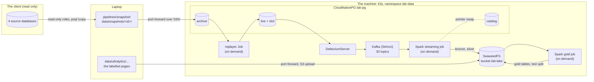

# Spec: the data path (phase 2a)

How the lab copies the client's OCR tables once, replays their history into its own Postgres, captures every change
with Debezium into Kafka, and keeps them as versioned Iceberg tables from which the gold sets are cut. It delivers the
phase 2a part of outcomes T2 and T4 ([the outcomes](../../README.md#outcomes)). The design notes behind it:
[the WAL, the slot and Debezium](../notes/wal-slot-debezium.md), [the JDBC catalog](../notes/iceberg-jdbc-catalog.md),
[object storage](../notes/object-storage.md), [Spark pod memory](../notes/spark-pod-memory.md),
[GitOps and direct runs](../notes/gitops-and-direct-runs.md). How to run it: [the data path runbook](../runbooks/data-path.md).
It builds on the [phase 1 platform](gpu-box-platform.md).

**State: approved and built on 2026-11-01**, every row and acceptance threshold as written; three checks were run
narrower than written ([acceptance](#acceptance)). A change found during the build is made here first, then in the code.

## Decisions

**The one rule behind every choice: the client is read once, through read-only roles; everything after the copy runs
on the lab's own data, and each stage can be rebuilt from the one before it.** The archive rebuilds `live`, Kafka
rebuilds bronze, bronze rebuilds silver, and a gold table keeps its own versions.

| # | Question | Decision | Why |
|---|---|---|---|
| 1 | Which tables | 14: 8 service tables from each OCR service database, 6 Odoo tables from each Odoo database. Other OCR outputs are left out of this phase | What the two questions need ("what did the system propose", "what did a person decide"), nothing that names a person; `ir_attachment` is needed by the gold join |
| 2 | Snapshot form | One CSV per table, written on the laptop by `psql \copy (SELECT ...)` through the four read-only roles, with the DDL of the copied columns and a `manifest.json` (row counts and sha256 per file) | A SELECT is the only way to drop people's columns and keep only OCR rows **before** anything leaves the client; `pg_dump` copies whole tables. psql needs no package |
| 3 | How the two environments land | As is, one schema per source database in `archive`: `dev_svc`, `stg_svc`, `dev_odoo`, `stg_odoo` | The archive stays a faithful copy; merging is a silver step (row 18), where a mistake is fixed by a rebuild |
| 4 | How the machine gets the client's Blob files | **The laptop copies** what each phase needs into the lab's object store, with my own `az` login; the machine holds no Azure key or identity. 2a copies only the detector's labelled pages, already on the laptop | No credential on a shared machine; no live change in the client's cloud |
| 5 | How `live` is filled | One paced replay in real time order; the speed is a flag (default: the whole history in about 10 minutes), turned down if the machine or the lag suffers; a slice mode replays one result's saves for the T4 check | One code path. T4 measures the path, not a queue, so only at a pace the path keeps up with |
| 6 | Where the replayer runs | A Kubernetes Job on the machine: a public Python image, code from a ConfigMap, the Postgres driver installed from PyPI at start (the machine reached PyPI on 2026-10-31) | Next to the lab's Postgres, so the T4 latency has no laptop tunnel in it; no image of the lab's own (no registry yet) |
| 7 | What `live` looks like | The client's four sources mirrored: the same four schemas and DDL as `archive`, in one database, except the history columns (row 24) | CDC captures a source as it is; one database means one slot |
| 8 | The lab's Postgres | One CloudNativePG `Cluster`, PG 17 (the client's major version), one instance; databases `archive`, `live` and `catalog` declared as `Database` objects | The operator gives logical WAL, the replication role, Secrets and Services; "The Database object must reference a specific Cluster, determining where the database will be created" ([CloudNativePG 1.30, database management](https://cloudnative-pg.io/docs/1.30/declarative_database_management/)) |
| 9 | How Debezium runs | The Debezium Operator, one `DebeziumServer` on `live`: `pgoutput`, slot `lab_debezium`, reading a publication declared as a CloudNativePG `Publication` object (the copied tables and the heartbeat table); Debezium does not create publications | No registry or image build; the only slot is on the lab's database ([why](../notes/wal-slot-debezium.md#decision-1-no-slot-on-a-shared-database)); the publication lives in Git with the rest |
| 10 | Debezium's heartbeat | On: every interval Debezium updates the one row of a heartbeat table in `live`, in a schema of its own, `lab_meta` (an upsert, so the table never grows) | WAL is shared by the whole server, and the `archive` load and the catalog's commits write WAL that the slot holds until Debezium confirms a later position in `live` (the install order starts Debezium only after the first `archive` load and after `replay.py init` made `live`'s tables and the heartbeat table, so that load holds nothing; later reloads and the catalog's commits are what the heartbeat is for): "As WAL is shared by all databases, the amount used tends to grow until an event is emitted by the database for which Debezium is capturing changes" ([Debezium Postgres connector](https://debezium.io/documentation/reference/stable/connectors/postgresql.html)) |
| 11 | Debezium's own offsets | A file on a persistent volume (the operator's `storage.data: persistent`), flushed at a short interval set in the code; `snapshot.mode` `initial`, so a lost file means a fresh snapshot of `live` (op `r` events, absorbed by silver's LSN rule), never lost changes | A full new fill must forget the offsets together with the slot: deleting one file does it, while an offsets topic would be one more thing to delete and recreate in order. The operator offers file, memory, JDBC, Redis, ConfigMap and Kafka stores (its `DebeziumServer` CRD at 3.7.0, `source.offset`) |
| 12 | Event format and topics | JSON values **without** an embedded schema; one topic per source table, `lab.<schema>.<table>` (28), plus the heartbeat table's topic and Debezium's heartbeat topic: 30, each declared as a `KafkaTopic`: one partition, replication factor 1, **no time limit** for the 28 (the two heartbeat topics keep one day: they need no history); topic auto-creation off. A full new fill deletes and recreates the 28 | Small, readable events; the Spark job takes each table's columns from the snapshot's DDL. Kept topics let Spark rebuild bronze from offset 0; the reset keeps the volume from filling with repeated fills |
| 13 | Object store | SeaweedFS, one bucket `lab-lake`, on a local-path volume | MinIO's community edition is archived; SeaweedFS is Apache-2.0, with a Helm chart and Spark in its CI ([object storage](../notes/object-storage.md#why-seaweedfs)) |
| 14 | Iceberg catalog | The Iceberg JDBC catalog in the `catalog` database | No extra service; the pointer swap is a Postgres transaction ([the JDBC catalog](../notes/iceberg-jdbc-catalog.md)). PyIceberg sharing it is checked, not relied on |
| 15 | How Spark runs | The Kubeflow Spark Operator launching `SparkApplication`s on the Spark 4.1.4 image; Iceberg, the Kafka source and the Postgres JDBC driver fetched once from Maven Central onto the volume `spark-data` ([jars.txt](../../pipelines/lake/jars.txt), each checked against its SHA-1) and put on the driver's and executors' classpath: the operator runs `spark-submit` in its own pod, where `--packages` would download them. The first build step proved a 4.1.4 job launches under the operator (built on Spark 4.0.4); the named fallback was the Apache spark-kubernetes-operator 1.0.0 | Iceberg 1.12.0 has no runtime past Spark 4.1; the most used operator, with a named fallback |
| 16 | Shape of the streaming job; the 30 s trigger | One job: each 30-second micro-batch appends its events to bronze, then merges them into silver, in `foreachBatch`; one checkpoint | Half the memory of two jobs on a shared machine; 30 s leaves half of T4's minute for the rest of the path |
| 17 | When Spark runs | Only while needed: a fill, a T4 check, a gold build; stopped after. Events wait in Kafka; Spark resumes from its checkpoint. The gold job never runs beside the stream | Spark is the biggest memory user (about 3 GiB); the machine gets it back between runs |
| 18 | Where the two environments merge | In silver: one table per entity holding both environments, an `env` column, key `env` + the source id; plus `silver.pdf`, one row per `content_hash` | Silver cleans and standardizes; every gold set reads one clean view |
| 19 | The human gold set; the excluded table | Its own Iceberg table `gold.human_picks`, with its own snapshot id; it records the snapshot copy id and the silver snapshots it read. The slots that cannot join go to `gold.human_picks_excluded` with the reason | A training run logs one id; the table stays readable after silver is rebuilt by a new fill |
| 20 | The detector test split | 26 of the 132 garment specs (20%, rounded down), drawn with a fixed seed, by whole garment spec, from the labelled pages' copy `2026-09-24-4a208a33d4ca`; written as a file list under the bucket's `splits/` prefix | Whole garment specs: no page of a test document is seen in training (the AI team's split is by page, and 99 of its 146 validation pages come from documents also in training) |
| 21 | Who builds the gold sets | `gold.human_picks`: a Spark batch `SparkApplication`, run on demand ([gold.py](../../pipelines/lake/jobs/gold.py)). The test split: the laptop script that uploads the labelled pages' copy ([split_upload.py](../../pipelines/dataset/split_upload.py)) | Same image, catalog and settings the streaming job proves; the split needs only the copy's file names, which are on the laptop (row 4), and no Spark |
| 22 | Memory budget on the machine; the 8 GiB quota | Once the data path is installed, `lab-up` needs 10 GiB available (6 GiB before); every pod has a memory limit; the `lab-data` namespace has a quota of 8 GiB of limits; each Spark run first checks free memory | The AI team comes first: 2.8 to 26 GiB available in one day. Argo CD starts everything it owns at `lab-up` (no partial start), so the floor covers the always-on part: 4.75 GiB of limits in `lab-data` ([box budget](#box-budget), Spark and the replayer left out), the four operators' 1.4 GiB, and the platform's 2.2 GiB; a Spark run checks again for its own 3 GiB |
| 23 | Versions | CloudNativePG operator 1.30.1, PG 17; Strimzi 1.3.0 with Kafka 4.3.1; Debezium Operator and `debezium/server` 3.7.0; the Kubeflow Spark Operator chart 2.5.2; Spark 4.1.4 (Scala 2.13); Iceberg 1.12.0; SeaweedFS 4.51; each chart's exact version pinned in the code | Chosen on 2026-10-31, the newest release of each that fits the others; pinned in [the Argo CD applications](../../infra/argocd/apps/) and [jars.txt](../../pipelines/lake/jars.txt) |
| 24 | How a row's past is replayed | `live` writes each row as the copy knows it at that moment: a run inserted as started (status and completion columns empty; a `NOT NULL` column gets its in-progress value, checked on `schema.sql`), updated to its final row at `completed_at`; a result's `result_history` versions replayed one by one as updates of `result`, the history column itself never written to `live`; a row with only one known state written once | The client's rows carry their final state; inserting them as is would show the future at the run's start. Each history version as its own update is what CDC would have seen, and keeps events small |
| 25 | Large rows | The manifest records each table's largest event; topic, producer and consumer size limits are set above it (Kafka's default is about 1 MB). The largest is a template's `settings`, 0.71 MB in the copy of 2026-11-01; a template's full row is 72 MB, all of it its `settings_history`, which follows row 24 and never becomes one event | An event above the limit stops Debezium |

## Layout

Argo CD owns everything that runs for the whole session: the operators, the `Cluster` and its `Database` and
`Publication` objects, `Kafka`, `KafkaNodePool`, the `KafkaTopic`s, the `DebeziumServer`, SeaweedFS, the namespace's
quota (`infra/argocd/apps/` for the charts, `infra/argocd/lab-data/` for the objects). The on-demand runs (replayer,
Spark jobs) are manifests in `pipelines/*/k8s/`, started with `kubectl` from the laptop: Argo CD would restart a
finished Job or a stopped stream. A run therefore takes its code from the laptop's working copy, which may differ from
GitHub ([two paths](../notes/gitops-and-direct-runs.md)), so **the commit stamp**: every Job and `SparkApplication` a
launcher creates, and the pods they start, carry two labels: the commit the working copy was at (`git rev-parse HEAD`),
and whether the launcher's own folder (`pipelines/replay/` or `pipelines/lake/`, the code and manifests a run sends)
had uncommitted or untracked changes. A run marked clean ran exactly that commit's code; the flag ignores the rest of
the repo, so a docs edit during a session does not mark every run. The copy's `schema.sql`, which the lake jobs also
read, is data named by its copy id, not by a commit. Nothing listens outside the cluster: no NodePort, no
LoadBalancer ([phase 1](gpu-box-platform.md#sharing-the-box)). The laptop reaches Postgres and SeaweedFS with
`kubectl port-forward` through the SSH tunnel.

**Credentials.** The client's read-only passwords stay on the laptop and never reach the machine. CloudNativePG
generates the password of `live`'s owner, the role it creates at bootstrap; the other roles' passwords and SeaweedFS's
S3 key are generated once by a runbook step on the laptop ([lab-credentials.py](../../infra/scripts/lab-credentials.py)),
written straight into cluster Secrets and never printed (never in Git; Argo CD does not manage them, so it never prunes
them). The `Cluster`, SeaweedFS and Spark reference them by name. When the laptop needs a credential (the `archive`
load, the dataset upload), it reads it into a mode 600 file in its scratch folder, never printing it; a new tool login
on the laptop gets its own isolated config folder ([the rule](../../AGENTS.md#which-mode-a-session-runs-in-owner-2026-10-25)).

## Snapshot

**Input:** the four read-only roles (`psql service=<name>`). **Output**, under the gitignored `data/snapshots/<id>/`:

| Path | Holds |
|---|---|
| `<source>/<table>.csv` | One file per copied table and source (`dev_svc`, `stg_svc`, `dev_odoo`, `stg_odoo`), written by `\copy (SELECT ...) TO` with a header row |
| `schema.sql` | The four schemas and the copied tables with their columns, types and primary keys, generated from the source catalog for the copied columns only |
| `manifest.json` | Per file: source, table, row count, bytes, sha256, the people count, the sha256 of the SELECT that made it, the columns left out, the largest row (as JSON) and the largest event (the row as `live` holds it, without its history column, JSON-encoded as Debezium sends it); the copy's start and end times; no host, role or password |

The id is the copy's date plus the first 12 hex digits of the manifest's sha256, as the
[dataset intake](dataset-intake.md#ultralytics-snapshot-to-a-local-yolo-copy) names its copies.

**Contract.**

- **No person leaves the client.** No column that references a user or partner is selected, in any table: the
  columns found from the source catalog's foreign keys to `res_users` and `res_partner` (`create_uid`, `write_uid`,
  `published_by_id`, a template's `customer_id`), and the OCR service's two user ids, which are Odoo user ids kept
  without a foreign key (`document.owner_user`, `document_run.triggered_by`: 1 to 3 digits in every row,
  2026-11-01). Inside the JSON, read on 2026-11-01:
  - each history entry (`result_history`, a template's `settings_history`) keeps `create_date`, `name`, `payload`
    and `revision_id`, and loses `create_uid` and `create_user_name`, its author;
  - a result's `header.createdBy` holds a user's name, in every result and in each history version's payload:
    removed from both. A scan of every other JSON column found no user's name;
  - a template's title (`name`) is not copied: 9 of 79 in development and 25 of 99 in staging contain a user's name;
    its `code`, never empty, names it.

  A result's saver becomes one column, `saved_by_domain`, computed inside the SELECT from the email domain of the
  result's last writer (`write_uid`): my team's domain is `team`, the client's is `client`, anything else `other`
  (results last saved by my team and by the client: development 11 and 4, staging 4 and 8). Before committing, each Odoo source's transaction counts the copied rows in
  which any string equals a user's name, and the copy stops unless every count is 0.
- **Only OCR rows:** `product_document` only where OCR was requested, a request ticket set (development 550 of 3,632
  rows, staging 192 of 192, 2026-11-01), without its product and sale columns; `ir_attachment` only those documents'
  PDFs (`ir_attachment_id`, `origin_attachment_id`) and every `ocr-page-*` page image, never the bytes (`db_datas`),
  the text extracted from the file (`index_content`) or its link token (`access_token`, a credential).
- **One consistent picture per source:** each source is read in one `REPEATABLE READ READ ONLY` transaction. The
  session sets its own statement timeout for the copy; a table too large for one statement is copied in primary-key
  ranges inside the same transaction.
- A rerun makes a new copy with a new id; a refresh is always a new full copy (under 1 GB on disk at the source; the
  CSV size is recorded in the manifest), never a patch.
- **Load:** `schema.sql`, then every CSV into `archive` through a port-forward. The load refuses a copy whose files do
  not match the manifest, checks the row counts after, and records the copy id in `archive.lab_meta.copy`. `archive`
  holds one copy at a time; loading another is part of the reset (below).

## Replay

The replayer reads `archive` and writes `live` in event-time order, each row as the copy knows it at that moment
(row 24):

| Event | Time | Writes |
|---|---|---|
| Baseline | Before the first run (2026-08-04 15:25 UTC, as read on the sources on 2026-10-31) | Every row whose time is earlier (templates, elements, prompts, documents, attachments created before), or that has no time at all, written once, unpaced |
| A run starts | `started_at` | The `document` if new, without its `latest_successful_run_id`; the run with status and completion columns empty. A run that never ended (13 in the copy of 2026-11-01) is written as it is, with its children, at this one event |
| A run ends | `completed_at` (failed runs have one too) | The run's final row; its pages, units, candidates, records, elements and stages; the document's final row once the run it names as latest successful has ended |
| A result or a template is saved | Each history version's `create_date`, oldest first (the arrays are stored newest first), then `write_date`, never before the last version | The first version as an insert, each later one as an update of `result` (a template's `settings`), its publication columns empty before `published_at`; the current row last |
| Other rows | `create_date`; `write_date` if later and the row has a known earlier state | Insert, then update |

- **History timestamps:** every history version carries its own `create_date` (2,585 entries in both environments,
  none without one, 2026-11-01), so each version is replayed at that time.
- **Speed:** a flag, the speed-up (replayed seconds per real second); the default plays the whole history in about 10
  minutes: 86.6 days and about 240,000 rows as read on the sources on 2026-10-31 (199,000 in the service tables, about
  40,000 in Odoo's), so a speed-up near 12,500 and about 400 rows a second. The Job derives the speed-up from the
  copy's own span, and logs its progress and the speed it kept.
- **Slice mode:** replays one named result's saves into an already filled `live`, at a human pace (a fixed gap
  between saves, a flag, 30 s by default; the real gaps can be days): the T4 check.
- **Never deletes:** the copy holds no deleted rows, so the replay writes inserts and updates only.
- **How:** every write is an upsert on the primary key, so Debezium sees an insert, then updates. The history versions
  are read once into a temporary table of the replayer's `archive` session (a version read from a 72 MB history value
  took 0.7 s, from the table 22 ms). `verify` compares `live` with `archive` table by table (rows and content, history
  columns left out): on a local PostgreSQL 17 an unpaced fill wrote 245,221 rows in 215 s, 1,140 a second, and all 28
  tables were equal (2026-11-01).
- One transaction per event time; on failure the Job stops, and the fill is restarted from empty.

**A full new fill** (a new copy, or a fresh start) is one runbook procedure, in this order: pause Argo CD's auto-sync
for the data objects; stop Spark and the `DebeziumServer`; drop the slot and remove Debezium's offset file; empty
`live` (and reload `archive` if the copy changes); delete the 28 table topics and wait until Kafka reports them gone;
remove Spark's checkpoint; drop bronze and silver; resume auto-sync (Argo CD recreates the topics and Debezium, which
creates a new slot on an empty `live`); start Spark, then, once Debezium reports it is streaming, the replayer. The
replayer refuses to fill a non-empty `live`. **Gold tables are never dropped by a reset.**

## Lab Postgres

One `Cluster` `lab-pg` in `lab-data`, one instance, PG 17, on a 10 GiB local-path volume. Databases: `archive`, `live`,
`catalog`, each a `Database` object. Roles: `replayer` owns `live` (the bootstrap database) and is granted read access
to `archive` after each load; `archive` owns `archive` (the laptop loads as it); `debezium` has `replication: true`,
read access to `live` and write access to `live.lab_meta`; `spark` owns `catalog`. All but `replayer` are managed roles
declared in the `Cluster`. The publication is `FOR ALL TABLES` in `live`, which holds only the four mirrored schemas and
`lab_meta`, so it is exactly the copied tables and the heartbeat table, tables created later included. The operator's
defaults give `wal_level=logical` and 32 slots. `pg_stat_statements` is loaded and its extension created in `live` (for
B6). `max_slot_wal_keep_size`, set well below the volume's size (the value in the code), caps what a slot can hold,
"the maximum size of WAL files that replication slots are allowed to retain"
([PostgreSQL 17 replication settings](https://www.postgresql.org/docs/17/runtime-config-replication.html)), so a stopped
Debezium can never fill the volume; past the cap the slot is lost and the next step is a new fill, which on the lab's
own copy costs minutes.

## CDC and Kafka

- **Debezium:** rows 9 to 11. Delivery is at least once: after a crash, events since the last flushed offset are sent
  again (the sinks below absorb them).
- **Kafka:** one `KafkaNodePool` holding both roles (KRaft: one node is broker and controller), `replicas: 1`, a 10 GiB
  volume, replication factors 1, the broker's heap bounded, message size limits per row 25. The Topic Operator creates
  the topics from the `KafkaTopic` objects.
- **Event shape:** the Debezium envelope (`before`, `after`, `op`, `source`, `ts_ms`), key = the row's primary key.
  `source.lsn` and `source.ts_ms` travel to bronze.

## Object store

SeaweedFS in `lab-data` in the chart's all-in-one mode (one pod running the master, volume, filer and S3 gateway on one
volume), its S3 endpoint the `seaweedfs-all-in-one` Service on port 8333, inside the cluster only, one bucket `lab-lake`
created by the chart's bucket hook:

| Prefix | Holds | Written by |
|---|---|---|
| `warehouse/` | The Iceberg tables: `bronze`, `silver`, `gold` | Spark |
| `datasets/ultralytics/<copy id>/` | The labelled pages' copy as on the laptop (images, labels, `manifest.json`; about 0.5 GB) | The laptop (row 4) |
| `splits/<copy id>/` | The test split's file list (`test.txt`) and `split.json` (seed, counts, the list's sha256) | The laptop, with the copy |

## Spark and the catalog

- **Catalog** `lab`: Iceberg's JDBC catalog in `catalog`, warehouse `s3://lab-lake/warehouse/`.
- **Streaming job** (rows 15 to 17): subscribes to the 28 table topics; every 30 seconds, in `foreachBatch`:
  1. **Bronze:** appends the batch to `bronze.<schema>_<table>` (one table per topic: the whole envelope, plus the
     Kafka partition and offset). Each table's commit stores the batch id as a snapshot property; a table whose last
     committed batch id is already this one is skipped, so a retried batch is never appended twice.
  2. **Silver:** for each source table, keeps only the newest event per key in the batch (highest `source.lsn`), then
     merges into `silver.<table>` (both environments, key `env` + id): an event is applied only if its `source.lsn` is
     newer than the row's stored one. A delete event, which the replay never sends, would mark the row deleted
     (`_is_deleted`: Iceberg reserves `_deleted` for its own row deletes) and keep its LSN, so an older duplicate
     cannot bring it back. Silver tables use merge-on-read: a MERGE writes small delete files instead of rewriting
     whole data files (the template rows are up to 0.7 MB); the maintenance run compacts them. A batch holds at most
     5,000 events. `silver.pdf` is rebuilt from `silver.document` (non-null `content_hash`).
- **Checkpoint** on a persistent volume: it survives a pod restart and `lab-down`.
- **Columns** of bronze and silver come from the snapshot's `schema.sql`; a column the DDL does not know fails the
  batch (no silent schema drift).
- **Snapshots kept:** a 30-second trigger makes thousands of snapshots per fill, so after each fill a Spark maintenance
  run expires bronze and silver snapshots older than the fill and compacts small files. Gold snapshots never expire,
  and each published gold version is tagged (Iceberg tags name a snapshot).
- **Before each run:** the job's launcher checks the machine's available memory against the Spark pods' limits plus a
  margin, and refuses to start below it.

## Gold sets

**`gold.human_picks`**, rebuilt on demand from silver by the join rule: a result's slot crop -> its page image's
`ir_attachment` name `ocr-page-<run>-p<n>[-annot|-clean]` (the attachment id read from `/web/content/<id>`, which can end
in `?unique=...`) -> the units of that run and page in either environment -> the unit whose box, taken for the same
render (`bbox_annot`, `bbox_clean` or `bbox`), overlaps the crop at IoU 0.9 or more, both relative to their page image.
On the copy of 2026-11-01 the rule joins 200 of 250 crops (development 90, staging 110) and finds the other 50 without
a page image; without the two details it joined 192, then 70 ([how the join was found](../how-i-work.md#3-the-gold-join-from-70-to-200)).
One row per slot: `env` of the result, result id, slot id, element code, run id, page, unit id, IoU, `saved_by_domain`,
and the candidate the service ranked first for that element. `gold.human_picks_excluded` lists the slots that do not
join, with the reason (page image gone, no unit above the threshold). Each build records the snapshot copy id and the
silver snapshot ids it read.

**The detector test split:** the garment spec of a page is its file name before `_p<page>`; the 132 garment specs are
sorted, shuffled with a fixed seed (in the code), and the first 26 are test (341 pages, test.txt sha256
`dad44960e5cc607479f0c9b8caf0a0a646181a99df0b2b9491ac1908203edc1c` for the copy `2026-09-24-4a208a33d4ca`). The list of
their page files (images present in the copy: 2,040 of 2,041) and its sha256 go to `splits/<copy id>/`; the rest is
train and validation, split when training is built. The list's sha256 is in the runbook's acceptance output.

## Box budget

- Workloads in namespace `lab-data`, a `ResourceQuota` of 8 GiB of memory limits and a `LimitRange` that gives a default
  limit to a pod that sets none (a chart's hook Job). The operators run in their own namespaces, each with a memory
  limit, about 1.4 GiB together: in its chart values, except the Debezium operator, whose chart has no such value, so a
  `LimitRange` in its namespace sets it. Sizes (the values live in the code, measured after the first fill and
  revised): Postgres 1 GiB, Kafka 1.5 GiB, Strimzi's entity operator 0.5 GiB, SeaweedFS 1 GiB, Debezium 0.75 GiB, the
  replayer 0.25 GiB; Spark 3 GiB in all, the driver 512 MiB of heap plus 640 MiB of overhead and the executor 1 GiB plus
  896 MiB ([sparkapp.yaml](../../pipelines/lake/k8s/sparkapp.yaml); the executor was OOMKilled at 1.4 GiB, then at 2 GiB
  with a 1.5 GiB heap, and the driver at 1 GiB, during the first fill, 2026-11-01,
  [why](../notes/spark-pod-memory.md)), only while running, never two Spark jobs at once.
- `lab-up`'s memory floor (`min_mem_available_mib` in [vars.yml](../../infra/ansible/vars.yml)) rises from 6 GiB to
  10 GiB once the data path is installed.
- Disk: every volume on local-path under `/mnt/data/k3s/storage` (about 30 GiB of claims; `/mnt/data` had 336 GB free
  on 2026-10-31, the pre-check keeps 50 GB). Pod logs land on `/` (`/var/log/pods`, 38 GB free, 91% used, on
  2026-10-31); the kubelet rotates each container's log.

## Lab-down and lab-up

Does `lab-down` include the new services? It does, generically, and this section adds what is specific to the data
path.

**What already covers it.** `lab-down` stops k3s, kills every container with `k3s-killall.sh`, and counts what is left:
container shims, kubelet mounts, pod network spaces, `cni0`/`flannel` links, `KUBE-`, `CNI-`, `FLANNEL` rules, all 0
([playbooks](gpu-box-platform.md#ansible-playbooks), A7 of phase 1). Every data path service is a pod behind ClusterIP
Services with local-path volumes (plain folders, not mounts), so it adds no host object those counts would miss.

**What is added:**

| Gap | Contract |
|---|---|
| A kill stops a replay or a Spark batch mid-flight | `lab-down` first stops the on-demand runs, with `k3s kubectl` on the machine: it lists the running replayer Jobs and `SparkApplication`s in `lab-data`, deletes them, and waits for their pods to end (with a timeout), then stops k3s. A stopped fill restarts from empty (replay contract) |
| The stores are killed, not shut down | Accepted by design and tested: Postgres recovers from its WAL, Kafka recovers its log, Debezium resends from its last flushed offset (at least once), and the sinks are idempotent (bronze by batch id per table, silver by LSN) |
| Nothing proves the data path comes back | `lab-up` waits for `lab-pg`'s primary, the Kafka broker, SeaweedFS and the `DebeziumServer` to be ready, and prints their state |
| The output does not name the data path | `lab-down` prints the `lab-data` pods before the stop; the existing counts stay the proof that nothing runs |

## Teardown additions

Added to the [platform's teardown inventory](gpu-box-platform.md#teardown) in the build commit that creates them: the
data path's volumes (Postgres, Kafka, SeaweedFS, Debezium's offsets, Spark's checkpoint and package cache) under
`/mnt/data/k3s/storage`, removed by step 3 with the data dir, checked absent. The operators' CRDs, webhooks and Secrets
live in the cluster state, also inside the data dir. Pod logs under `/var/log/pods` are already step 4. Nothing of the
data path is written outside k3s: `footprint.yml`, rerun after the first session, found nothing outside k3s (B16). On the laptop, the
copy (`data/snapshots/`) and the scratch credential files are removed by the runbook's roll back.

## Acceptance

Phase 2a is done when all of these hold, recorded in the runbook with real output (B for phase 2a; A were
[phase 1's](gpu-box-platform.md#acceptance)). Expected counts are queries on the copy; the numbers in brackets are those
of 2026-10-31, for reference. The checks as run, with their output: [verify end to end](../runbooks/data-path.md#verify-end-to-end).

| # | Check | Expected |
|---|---|---|
| B1 | The snapshot's manifest against its files; the copy's columns and history entries | Every sha256 and row count matches; no column referencing a user or partner; no author field in any history entry; the people counts recorded in the manifest all 0 |
| B2 | `archive` after the load | Row counts equal the manifest's, per table and source |
| B3 | A 4.1.4 Spark job under the chosen operator | Completes and writes one Iceberg table through the JDBC catalog |
| B4 | A full fill at the default speed | Finishes; Debezium's lag under 10 s throughout; each silver table's rows equal the development rows plus the staging rows of that table in `archive` |
| B5 | `silver.pdf` | The number of distinct non-null `content_hash` over both environments' `document` in `archive` [232] |
| B6 | T4, slice mode: one result's save | Reaches silver within 60 s of its commit (from `source.ts_ms` to the silver snapshot's commit time); `pg_stat_statements`, reset before the check, shows no query on the copied tables in `live` from any role but the replayer's (no polling) |
| B7 | Slot WAL: Debezium stopped while the replayer writes, then started | The slot's retained WAL grows, then is released; never above `max_slot_wal_keep_size` |
| B8 | Heartbeat: `live` idle while another database writes WAL (an `archive` reload or a gold build's catalog commits) | The slot's confirmed position keeps advancing; its retained WAL stays small |
| B9 | Idempotence: a Spark batch retried, Debezium restarted mid-fill | No duplicate silver row; bronze holds each batch once per table |
| B10 | `gold.human_picks` | One row per slot that joins by the rule on the copy [200], `human_picks_excluded` the rest with reasons [50]; read twice by its snapshot id, the same rows |
| B11 | The test split | 26 garment specs; none in both test and the rest; the list's sha256 recorded |
| B12 | `lab-down`, then `lab-up`, with `live` idle | `lab-down`'s counts all 0; after `lab-up`, `archive`'s counts and every silver table's rows and content equal those before; a resumed stream adds no silver row (heartbeat topics left out of any comparison) |
| B13 | Memory | `lab-data` stays within its quota; the peak recorded |
| B14 | The largest event | The manifest's largest event crosses Debezium, Kafka and Spark |
| B15 | The AI team's Docker, before and after the session | Unchanged (`check.yml`, as phase 1's A5) |
| B16 | Teardown preview | `teardown.yml --check --diff` covers the new rows; `footprint.yml` finds nothing outside k3s |

**As run** (2026-11-01). All sixteen passed as run; three were run narrower than worded here:

| Check | As worded | As run |
|---|---|---|
| B7 | Debezium stopped while the replayer writes | Debezium stopped while 58 MB were written into another database on the same server: the slot held them (74 MB of WAL) and released them at its first heartbeat after the restart |
| B9 | A Spark batch retried, and Debezium restarted mid-fill | Five stream failures, each batch retried: 0 duplicates in bronze's 245,234 events, and silver's counts equal to the copy. Debezium was not restarted during a fill |
| B12 | Silver's rows and content equal before and after | Row counts compared in `archive`, `live`, Kafka and silver, all unchanged; the resumed stream added no row |

## Not chosen

| Option | Why not |
|---|---|
| A replication slot on the client's development server | Holds WAL whenever the lab is off and, on a managed server, can make the server read-only ([why](../notes/wal-slot-debezium.md#decision-1-no-slot-on-a-shared-database)) |
| `pg_dump` for the snapshot | Copies whole tables: people's columns and all of Odoo's attachment rows would leave the client |
| Merging the environments in the replayer | `live` would no longer look like the client's sources, and a merge mistake would reach every table downstream |
| Bulk load, then a paced tail | Two code paths; bronze would lose the earlier saves of the bulk rows |
| Inserting each row with its final state | A run would show its result at the moment it started |
| Debezium on Strimzi's Kafka Connect | Needs an image registry first |
| Avro and a schema registry | One more service on a shared machine; the snapshot's DDL already gives the columns |
| Topics kept 7 days | Bronze could be rebuilt from Kafka only within a week |
| SeaweedFS as separate master, volume, filer and S3 pods | Four pods and their memory for one bucket on one disk; all-in-one is the same software in one pod |
| Two CloudNativePG clusters | Twice the pods and memory for an isolation the `Database` split already gives |
| A REST catalog (Lakekeeper, Polaris) | One more service; nothing in 2a needs another engine |
| Separate bronze and silver jobs | Twice the Spark pods, an extra hop toward T4's minute |
| The gold set as a view or a silver table | A view has no snapshot id of its own; silver is "latest state of each source row", not a dataset |
| A machine identity for the client's Blob | A secret on a shared machine and a live role assignment in the client's cloud |
| Spark always on | Holds about 3 GiB of the shared machine while nothing changes |
