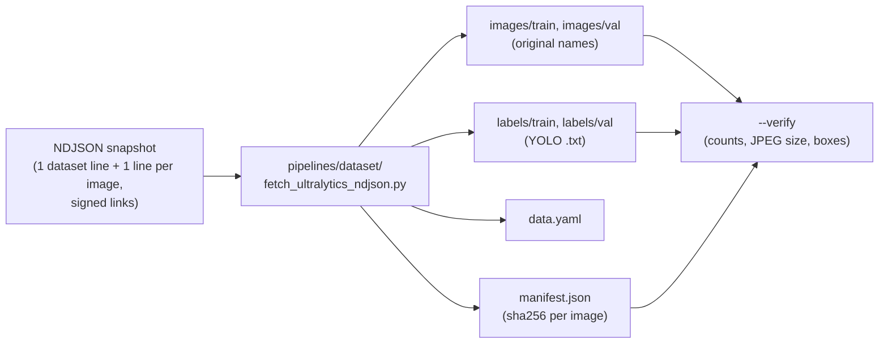

# Spec: dataset intake

How the detector dataset of the AI team (my team's engineers who build the OCR workload) enters the lab: what goes in, what comes out, and the checks that
prove the copy is complete. It serves [D14](../design.md#decisions) (the lab retrains the detector) and
outcome [T1](../design.md#outcomes) (reproducible training from a named dataset version).
How to run it: [runbook](../runbooks/ultralytics-dataset-download.md). The dataset: the AI team's labelled pages,
on Ultralytics Platform ([the workload](../design.md#the-workload)).

## Ultralytics snapshot to a local YOLO copy

**Why our own fetch.** Ultralytics has a converter (`ultralytics.data.converter.convert_ndjson_to_yolo`,
read in 8.4.142, the version that trained production), but it renames every image to its line number
(`r["file"] = f"{i}.jpg"`). The original names, `<document>_p<page>.jpg`, carry the document, which the lab
needs to split by document and to measure the leakage of [V9](../design.md#to-verify). It also installs
missing packages on its own (`check_requirements("aiohttp")`) and reports usage analytics unless settings
turn it off. The signed image links expire, so the images are fetched once into the laptop's gitignored
`data/` ([D16](../design.md#decisions): real data stays out of Git).

**Input.** One NDJSON file: line 1 is the dataset (`name`, `task: detect`, `class_names`, `version`,
`updated_at`); every other line an image (`file`, signed `url`, `width`, `height`, `split`,
`annotations.boxes` as `[class, x_center, y_center, width, height]` in 0-1).

**Output**, under `data/ultralytics/<dataset name>/<snapshot id>/`, where the snapshot id is the dataset's
`updated_at` date plus the first 12 hex digits of the NDJSON's sha256 (the export says `version: latest`,
so the file itself is the version):

| Path | Holds |
|---|---|
| `images/<split>/<file>` | The image, under its **original** name |
| `labels/<split>/<stem>.txt` | One line per box, `class x_center y_center width height`, values as in the NDJSON; an empty file for a page with no box (a background page) |
| `data.yaml` | `train: images/train`, `val: images/val`, `names` from `class_names`, and no `path`, so the folders resolve against the file's own folder wherever the copy is moved: loadable by Ultralytics as is |
| `manifest.json` | The NDJSON's sha256 and dataset fields (no URL), per image: split, file, bytes, sha256, width, height, number of boxes; and under `missing`, each image the source answers `HTTP 404` for |

**Behaviour.**

- Never prints, logs or stores an image URL: the links are signed and count as credentials.
- Standard library only, run with `python3 -I`; no package installs, no analytics.
- Idempotent: an image already on disk that passes the checks is not fetched again, so a rerun after a
  failure fetches only what is missing.
- Fetches concurrently and retries each image a few times. An image that still fails for any reason but `HTTP 404`
  makes it exit non-zero, to be rerun; one the source answers `HTTP 404` for is recorded under `missing`, and the copy
  is written without it.
- Does not re-split, deduplicate or upload. The frozen test split by document and the copy to the lab's object store
  were made in phase 2a ([gold sets](data-path.md#gold-sets), [object store](data-path.md#object-store)); train and validation are cut in 2b.

**Acceptance** (`--verify`, which reads only local files, for the first four rows; the last reruns the fetch):

| Check | Expected for the 2026-09-24 snapshot (one image recorded missing at the source) |
|---|---|
| Images per split equal the NDJSON's, less the recorded missing | train 1,894 (1,895 in the NDJSON), val 146 |
| Every image is a JPEG whose size equals the NDJSON's `width` x `height` | 2,040 of 2,040 |
| Label lines equal the NDJSON's boxes of the images present | 3,492 lines (3,493 in the NDJSON); 51 empty label files |
| Every image's sha256 equals the manifest's | 2,040 of 2,040 |
| A second run fetches nothing | 0 downloads |
