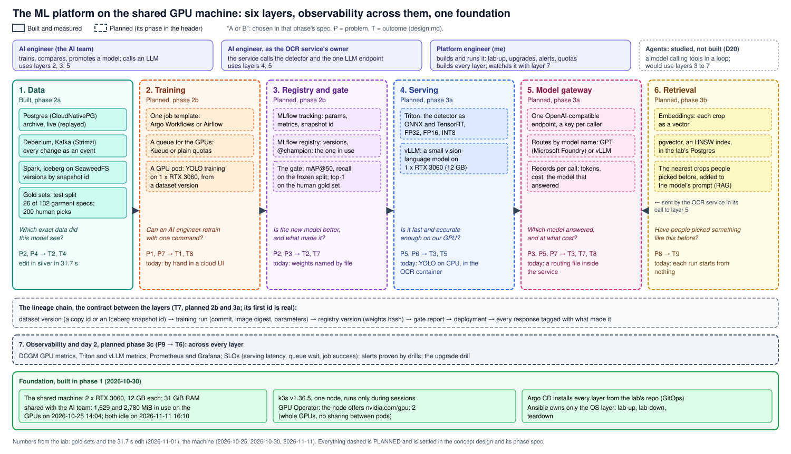
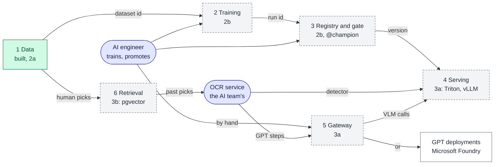
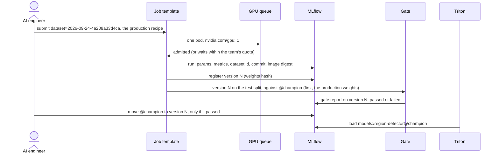
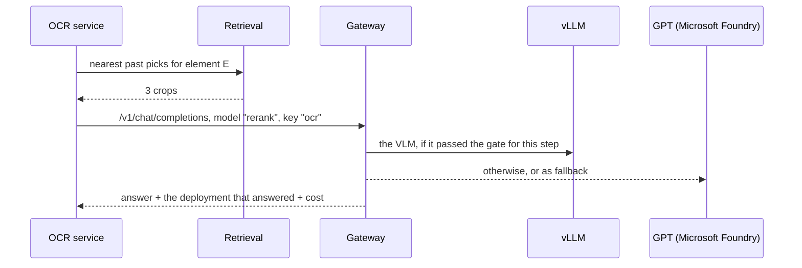
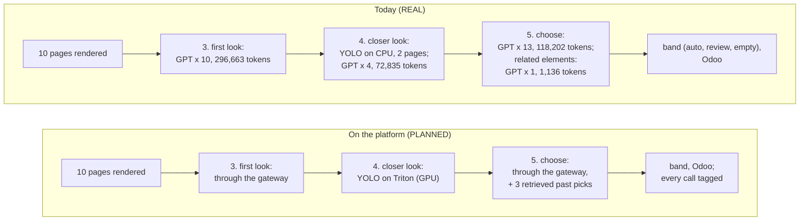
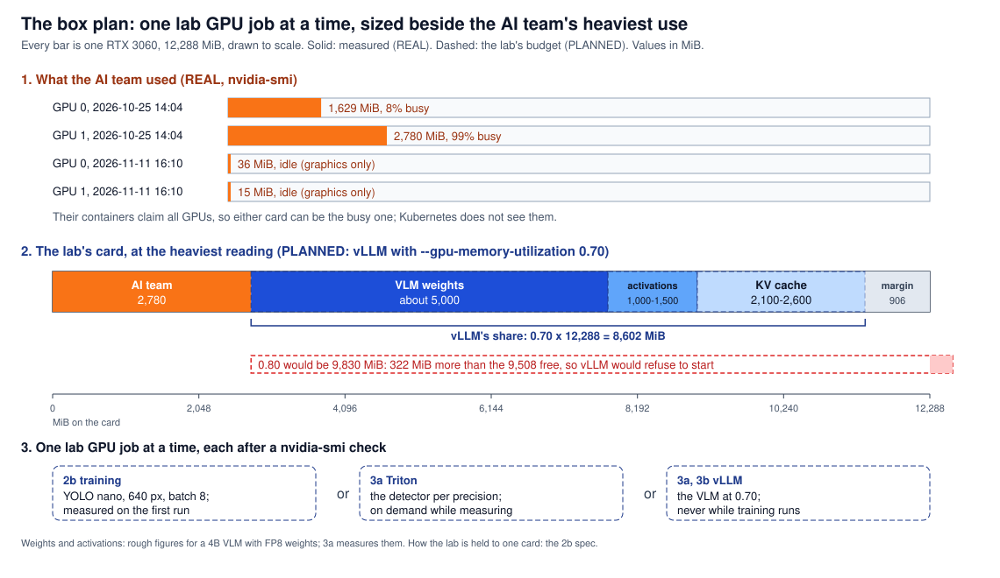

# Spec: the ML platform, the concept design

**The whole platform the lab builds on the shared GPU machine: one path from a versioned dataset to a model that is
gated, served and observed, for the AI team who build the OCR's models and the service that calls them.**

- **Where it fits:** it answers the [problem statements](../../README.md#problem-statements) with the
  [outcomes](../design.md#outcomes) T1 to T9, and rests on decisions [D6, D7, D15 and D20](../design.md#decisions).
- **Built so far:** the foundation ([phase 1](gpu-box-platform.md)) and the data layer ([phase 2a](data-path.md)).
- **What comes next:** each later phase spec (2b, 3a, 3b, 3c) refines one of its sections, and turns one planned part
  of the picture into a built one.

**State: set 2026-11-11, before phase 2b is built.** Values marked **REAL** are measured, with their date;
everything else is **PLANNED**.

## The one idea

**One path from a versioned dataset to a model that is gated, served and observed, for the engineers who build the
models; every step leaves an id the next step records, and every result is measured against today's system.**

| Problem | Outcome | Layer | Phase | Status |
|---|---|---|---|---|
| [P1](../../README.md#problem-statements) training cannot be reproduced | [T1](../design.md#outcomes) reproducible detector training | Training | 2b | Planned |
| P2 no trustworthy evaluation | T2 frozen test split, gold set, scoreboard | Data; registry and gate | 2a, 2b | Half done (the datasets, 2026-11-01) |
| P3 no gate, no lineage | T7 one gate and full lineage | Registry and gate; gateway | 2b, 3a | Planned |
| P4 no dataset can be rebuilt | T4 versioned datasets from CDC | Data; registry and gate | 2a, 3a | Half done (an edit in silver in 31.7 s) |
| P5 every element goes to GPT | T3 fewer GPT calls by a self-hosted vision-language model (VLM) | Serving; gateway | 3a | Planned |
| P6 the detector on CPU | T5 GPU serving with measured trade-offs | Serving | 3a | Planned |
| P7 no self-service on the team's GPUs | T8 one command per task, a queue within quotas | Training; gateway | 2b, 3a | Planned |
| P8 past picks never reused | T9 retrieval of past picks | Retrieval | 3b | Planned |
| P9 no view of serving health | T6 serving and GPU observability | Observability | 3c | Planned |

Each outcome's metric, baseline and target are in [the design](../design.md#outcomes); this spec does not repeat them.

## The map

**Six layers in a line, each handing the next an id; the AI team reaches them by hand and through its OCR service.**

Green is built, grey dashed is planned; `@champion` is the alias of the model version in use
([below](#an-ai-engineer-retrains-and-promotes-the-detector)). Under every layer: **7 Observability** (3c: DCGM,
NVIDIA's GPU metrics; Prometheus; SLOs; it watches
training, serving and the gateway) and the **foundation** (built in phase 1: the machine, k3s, the GPU Operator, Argo
CD), both built and run by the platform engineer.

## The users and their interfaces

**The platform's user is the AI team, who train the detector, own the prompts, and build and run the OCR service that
calls the models ([who is involved](../use-case.md#who-is-involved)); I am the platform engineer, and I build and run
the platform for them.** Odoo calls the OCR service, not the platform, so it is the service's caller and not a user
here. The AI team uses the platform in two ways: by hand, to train and promote; and through its service, which calls
the models.

**PLANNED**; each row becomes a "use it" section of a runbook, with its real output, when its phase is built.

| User | Wants to | Uses | Phase |
|---|---|---|---|
| AI engineer | Retrain the detector on a named dataset | One command: submit the job template with a dataset id and recipe parameters | 2b |
| AI engineer | Compare runs, promote a model, roll back | The MLflow UI; moving an alias | 2b |
| AI engineer | Try an LLM or the VLM by hand | One OpenAI-compatible endpoint with their own key | 3a |
| The OCR service (built by the AI team) | Detect regions on a page | Triton's HTTP or gRPC endpoint, the model by name | 3a |
| The OCR service | Score and rank crops | The same gateway endpoint, a model name, optional retrieved examples | 3a, 3b |
| Platform engineer (me) | Start and stop the lab, upgrade, read alerts, set quotas | `lab-up`, `lab-down` ([lab session](../runbooks/lab-session.md)), Grafana, Argo CD | 1, 3c |

### An AI engineer retrains and promotes the detector

`@champion` is the alias of the version in use. The name comes from champion/challenger testing: every new model is
a challenger that must beat the one in use before it takes its place; MLflow's own docs name the production alias
`champion` ([model registry](https://mlflow.org/docs/latest/ml/model-registry/)). Here the
challenger is tested offline, on the frozen test split.

### The OCR service calls the gateway

## One document, today and on the platform

**REAL today:** one 10-page men's blazer document of Brand A, in development, with one GPT model: 28 GPT calls and
488,836 input tokens (2026-10-24). The steps are the use case's [flow](../use-case.md#the-flow); the band is
`auto`, `review` or `empty`, set per element at step 5.

| Step | Today (REAL) | On the platform (PLANNED) | Outcome |
|---|---|---|---|
| Detector | The production weights on CPU, 2 vCPU, one page at a time | The same weights on Triton, FP32, FP16 and INT8 measured | T5 |
| GPT steps | 28 calls, routed by the service's own file | The same calls through one gateway; each step may go to the VLM once it passes the gate | T3, T7 |
| Context for choosing | None: each run starts from nothing | The nearest past human picks | T9 |
| Record | Tokens per step in the run | Tokens, cost and the answering model per call; the detector version per response | T7 |

**The lab does not change the service's code** ([D17](../design.md#decisions)). On the machine, its calls reach Triton
and the gateway in one of two ways:

- **the service's own image, pointed at them by configuration:** its routing file already names each GPT step's
  deployment through an environment variable;
- **a lab client** that makes the same calls on the same pages.

The detector moves to Triton only through the second route, since the service loads its weights inside its container.
The 3a spec chooses the route; the results are a proposal the AI team can adopt.

## The layers

**Every layer answers the same five questions** ([the design's context](../design.md#context)); security and tenancy
(2b, 3a) and day 2 (3c) cross them. Each phase spec grows its rows into sections. **PLANNED** unless marked.

| Layer | Who, through what | On what real thing | Under which constraint | How an engineer starts | Against today |
|---|---|---|---|---|---|
| Foundation (built) | Platform engineer: `lab-up`, `lab-down` | The shared machine, 2 x RTX 3060 | Runs only in sessions; the AI team first | [lab session](../runbooks/lab-session.md) | **REAL**: A1 to A11 passed 2026-10-30 |
| 1 Data (built) | AI engineer reads a dataset by id | The client's OCR tables (copy `2026-11-01-ffcc03c52aea`), the labelled pages' copy | `lab-data`'s 8 GiB quota (the data path's namespace) | [data path runbook](../runbooks/data-path.md) | **REAL**: B1 to B16 passed 2026-11-01 |
| 2 Training | AI engineer: the job template | The production recipe, the 2,040 copied pages | One GPU per job; the AI team's use of the GPUs | One submit command | A person in a cloud UI |
| 3 Registry and gate | AI engineer: MLflow, the `@champion` alias | The production weights as the baseline; the test split, 26 garment specs, 341 pages | MLflow's store on the existing Postgres and bucket | The MLflow UI | Weights named by file |
| 4 Serving | The OCR service: Triton; the gateway for the VLM | The production weights; a small open VLM | 12 GB per card, minus the AI team's use ([the box plan](#the-box-plan)) | One endpoint per model | YOLO on CPU; GPT for every element |
| 5 Gateway | The OCR service and the AI engineer by hand: one endpoint, a key | The development GPT deployments in Microsoft Foundry, and vLLM | Keys and budgets in a database on the existing Postgres; the image pinned by digest, because a gateway holds every model key: one candidate, LiteLLM, had its own releases compromised twice in 2026 ([one incident](https://docs.litellm.ai/blog/security-incident-oct-21-2026)) | One base URL and a key | A routing file inside the service |
| 6 Retrieval | The OCR service, before its gateway call | The 200 human picks, their crops | pgvector, already in the lab's Postgres image (REAL: CloudNativePG's `standard` image) | A retrieval call per element | No reuse |
| 7 Observability | Platform engineer: Grafana, alerts | DCGM, Triton and vLLM metrics, the queue's or the jobs' metrics | The machine's memory | Dashboards, and alert rules with runbook rows | Logs to stderr only |
| Security and tenancy | Platform engineer: namespaces, quotas, keys | The AI team's jobs; the GPT key | The AI team's jobs in their own namespace with a quota of 1 GPU and memory limits; one gateway key per caller (the OCR service, an AI engineer by hand), each with a budget; the GPT key held only by the gateway, as a Sealed Secret; images pinned by digest, non-root, NetworkPolicy ([D9](../design.md#decisions)) | A key per caller | No gateway between the service and GPT |
| Day 2 | Platform engineer: drills | MLflow's store, the cluster's versions | The upgrade drill (k3s, the GPU Operator, MLflow's database schema); MLflow's store backed up with the lab's Postgres and bucket; rollback by moving `@champion` | A runbook per drill | A rollback means finding an old weights file by its name and changing an environment variable |

## The lineage chain

**Each layer records the id it received and the id it made; the chain has two roots, because the detector learns from
the AI team's labelled pages and the GenAI steps are judged on the client's human picks.**

The two roots are separate sources:

- **The detector's dataset** is the copy of the AI team's labelled pages ([data path, decision 20](data-path.md#decisions)).
- **`gold.human_picks`** is built from the copy of the client's tables through silver, and records the silver
  snapshots it read ([decision 19](data-path.md#decisions)); its snapshot was read twice with the same result (B10,
  [runbook](../runbooks/data-path.md#5-the-gold-sets-box-then-laptop)).

## The box plan

**The lab runs one GPU job at a time, on one card, with a memory budget that fits beside the heaviest use the AI team
has been seen to make of either card; an `nvidia-smi` check comes before every GPU job.**

**REAL**, two readings:

- 2026-10-25 14:04: the AI team's processes held 1,629 MiB on GPU 0 (8% busy) and 2,780 MiB on GPU 1 (99% busy).
- 2026-11-11 16:10: both cards idle (36 and 15 MiB, graphics only).

Their containers claim **all** GPUs, so either card can be the busy one, and Kubernetes does not see them
([what Kubernetes cannot see](../notes/gpus-on-the-hosts-driver.md#what-kubernetes-cannot-see)). The plan is
therefore sized on the heaviest reading, on whichever card the lab gets:

| On the lab's card | MiB | How |
|---|---|---|
| The card | 12,288 | REAL |
| The AI team's heaviest reading | 2,780 | REAL, GPU 1, 2026-10-25 |
| Free beside it | 9,508 | |
| vLLM's share at 0.80, a first budget | 9,830 | More than the free memory: vLLM would refuse to start |
| vLLM's share at **0.70** (PLANNED) | 8,602 | Leaves 906 MiB for the AI team's process to grow |
| Left for the KV cache at 0.70 | about 2,100 to 2,600 | After about 5,000 of weights (a 4B VLM with FP8 weights) and 1,000 to 1,500 of activations: about 15,000 to 18,500 tokens at 144 KiB a token, an estimate until 3a measures it |

| Phase | Budget (PLANNED) | How it lives beside the AI team |
|---|---|---|
| 2b training | Measured on the first run (YOLO nano, 640 px, batch 8) | Started only after an `nvidia-smi` check; one training job at a time |
| 3a Triton | Small next to the VLM; measured per precision | On demand during measurements |
| 3a, 3b vLLM | `--gpu-memory-utilization` 0.70 | Never started while training runs |
| CPU and memory | `lab-up`'s floor, `lab-data`'s 8 GiB quota ([2a box budget](data-path.md#box-budget)); MLflow, the gateway and the queue add their own limits | The pre-checks of [phase 1](gpu-box-platform.md#ansible-playbooks) |

How the lab is held to one card (the device plugin offering one GPU, or the pre-check choosing the idler card) is
decided and tested in the 2b spec, as the [phase 1 spec](gpu-box-platform.md#decisions) left it (decision 5). Each
phase reads `nvidia-smi` again before it starts.

## Acceptance at concept level

Each phase spec turns these into numbered checks; a target not fixed yet is set in that spec **before** its run
([outcomes](../design.md#outcomes)).

| Phase | Proves | First measured |
|---|---|---|
| 2b | T1 (mAP@50 within 0.02 of the production weights on the test split; a rerun from the dataset id within 0.005), T2 (the scoreboard), T7 (a worse detector blocked), T8 (a second job waits) | The production weights on the test split |
| 3a | T3, T4 (a gate report rebuilt from the gold set's snapshot id), T5 (at most 0.005 of mAP@50 and recall lost at FP16, 0.02 at INT8), T7 (a worse prompt blocked, every output tagged), T8 (one endpoint) | Today's CPU latency; GPT's top-1 on the gold set |
| 3b | T9 | Retrieval recall@k on the gold set, the query's own document left out |
| 3c | T6 | The SLO baselines from the first week of metrics |

## Not chosen and deferred

| What | State | Why |
|---|---|---|
| The student ranker and active learning | Deferred to the extended work, not scheduled ([D14](../design.md#decisions) B) | Training a new model is the AI team's work; T3 is pursued by serving a VLM |
| Agents, built | Studied, not built ([D20](../design.md#decisions)) | The OCR is a fixed workflow; the layers an agent needs are built for the OCR first |
| More than one node | Not chosen | One machine; high availability is shown in the AWS track ([D18](../design.md#decisions)) |
| A real AWS account | Not chosen | The AWS track runs on LocalStack and kind |
| GPU sharing (time-slicing) | Not proposed; the 2b spec closes phase 1's decision 5 with it | It adds pods, not memory: two pods on one card share its 12 GB |

## Settled, and left to the phase specs

Settled on 2026-11-11: the users (the AI team, by hand and through their service; the platform engineer builds and
runs the platform); retrieval called by the OCR service; the service's code unchanged; the alias `@champion`; security
and tenancy and day 2 as rows of the layers; T4's rebuild through the gold set (3a); [the box plan](#the-box-plan); the
T1 and T5 targets in the [outcomes](../design.md#outcomes).

| Left to | What |
|---|---|
| 2b spec | The orchestrator: Argo Workflows, or Airflow, which many on-premise data platforms already run ([D6](../design.md#decisions)) |
| 2b spec | The queue: Kueue, or plain quotas |
| 2b spec | How the lab is held to one card |
| 3a spec | The VLM and its quantisation, the gateway, the route of the service's calls (its image by configuration, or a lab client), T3's target |
| 3b spec | The embedding model, T9's target |
