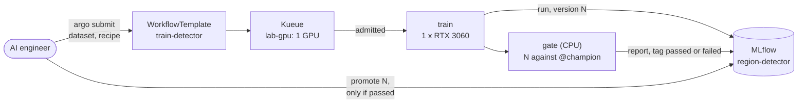
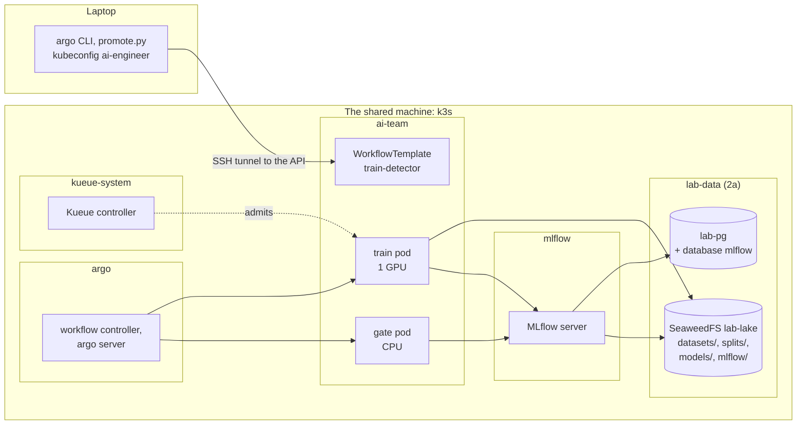

# Spec: the training platform (phase 2b)

How an AI engineer retrains the region detector on the shared machine with one command: a dataset id in, a job that
waits for its GPU in a queue, a training run from the production recipe recorded in MLflow, a registered version, a
gate report against `@champion`, and a person who promotes. It refines layers 2 and 3 of the
[concept design](ml-platform.md#the-layers) and its [box plan](ml-platform.md#the-box-plan), confirms the orchestrator
of [D6](../design.md#decisions), and delivers the 2b part of outcomes T1, T2, T7 and T8 for the detector
([the outcomes](../../README.md#outcomes)). It builds on the [phase 1 platform](gpu-box-platform.md) and the
[data path](data-path.md). The design note behind the gate: [a promotion gate on 26 documents](../notes/promotion-gate.md).
How to run it: [the training platform runbook](../runbooks/training-platform.md). The story of the phase:
[its review](../phases/phase-2b-training-platform.md).

**State: approved, built and accepted on 2026-11-15**: 12 of 14 acceptance checks passed, E5 (T1 as written) not met
and E9 in part ([acceptance](#acceptance)). A change found during the build was made here first, then in the code.
Values marked **REAL** are measured, with their date.

## The one rule

**The AI engineer gives a dataset id and a recipe name; the template fixes everything else, the run records every id
it used, a rule written here before any run judges the result, and only a person moves `@champion`.**

## Decisions

| # | Question | Decision | Why |
|---|---|---|---|
| 1 | The orchestrator | **Argo Workflows**: one `WorkflowTemplate`, `train-detector`, in the AI team's namespace, a two-step DAG: `train` (GPU) then `gate` (CPU). Submitted with `argo submit --from workflowtemplate/train-detector -p dataset=<id> -p recipe=<name>` | A CRD and a controller, installed by Argo CD like the lab's other operators; each step is a pod a GPU queue can hold. Airflow's scheduler, DAG processor, API server and metadata database would cost memory on a machine seen with 2.8 GiB available, for asset triggers a hand-started retrain does not use. In Airflow, each step would be a `KubernetesPodOperator` task |
| 2 | The gate's metric | mAP@50-95 on the test split decides; recall at the OCR service's own setting (confidence 0.65, NMS IoU 0.3, a match at IoU 0.5) is a guard; both must be **non-inferior** to `@champion` within a margin, judged on a 95% bootstrap interval over the test documents ([the gate](#the-gate)). mAP@50 and precision at the service's setting are on the report and decide nothing | mAP@50 is 0.990 for the production weights, near its ceiling: a margin of 0.02 there admits a model that misses twice as much. mAP@50-95 (0.957) has room, needs no threshold, and is Ultralytics' own fitness, so the epoch a run keeps and the gate agree on direction; the service cuts crops from the boxes, so tighter boxes matter. A region missed at 0.65 is a crop the user can never pick ([baseline](ml-platform.md#t1s-baseline-measured-ahead-of-2b)) |
| 3 | T1's tolerance | Reproduced when the recipe's model is within **0.02 of production on mAP@50-95** (at least 0.937) and **0.01 on mAP@50** (at least 0.980) on the test split; a rerun from the same dataset id, image digest and card type within **0.005** on mAP@50-95 ([the outcomes](../design.md#outcomes)) | Looser than the gate on purpose: the lab trains without the 26 test documents, on 1,608 pages against production's 1,894 (REAL, 2026-11-15: 106 documents left, 11 of them, 91 pages, for validation), so a small drop is the data, not the platform. "Reproduced but not promotable" is an allowed result |
| 4 | The queue | **Kueue**, its pod integration: one `ClusterQueue` `lab-gpu` with a quota of 1 `nvidia.com/gpu`, one `LocalQueue` `ai-team`; only the `train` step's pod carries the queue label `kueue.x-k8s.io/queue-name` (through the template's `metadata.labels`); the `gate` pod asks for no GPU and is not queued. An unlabelled pod is left alone | T8 asks that a second job **waits**: a `ResourceQuota` rejects the pod instead, and the Job retries blindly. Kueue's pod integration is its documented path for Argo Workflows: "Each pod in a Workflow will create a new Workload resource" ([Kueue, Argo Workflows](https://kueue.sigs.k8s.io/docs/tasks/run/external_workloads/argo_workflow/)), so one labelled step is one Workload. One GPU is the box plan's "one lab GPU job at a time" |
| 5 | Holding the lab beside the AI team (revised twice during the build) | **GPU 0 reserved for the AI team in Kubernetes.** A placeholder pod `ai-team-docker-gpu0` in namespace `gpu-reserve` (busybox, `sleep`, no CUDA, `nvidia.com/gpu: 1`) holds GPU 0, the card the AI team's Docker work was seen using, so the scheduler can give the lab's one GPU job only GPU 1. `lab-up` makes sure it holds GPU 0 (device minor 0, read from the device node in the pod) and recreates it until it does. The `train` step's first act still reads its card's free memory (`torch.cuda.mem_get_info`, which counts every process on the card, Docker's too) and exits with code 75 below the floor; that code is not retried | REAL, 2026-11-15 08:28: the AI team held **10,126 MiB at 98% on GPU 0** and 269 MiB on GPU 1. Pinning the lab to GPU 1 through the device plugin's `NVIDIA_VISIBLE_DEVICES` was tried first and did not take: the plugin hands out cards by CDI and still offered both (allocatable 2). A reservation pod does take: the device plugin gave the test pod `/dev/nvidia0`, minor 0, GPU 0's UUID (REAL, 10:05). It also makes the other runtime's use visible to Kubernetes |
| 6 | Where the code and template live, and the commit stamp | `pipelines/detector/` is a small Helm chart: the `WorkflowTemplate`, the code as a ConfigMap read from the chart's own files (`train.py`, `gate.py`, the recipes), the namespace's objects. Argo CD renders it from GitHub and passes its synced commit as a Helm parameter, `gitCommit: $ARGOCD_APP_REVISION`, which every pod gets as `LAB_GIT_COMMIT` and a label `lab/git-commit` | One install path, through Git, so a run's code is exactly a commit; no launcher on the laptop, unlike 2a's on-demand runs ([GitOps and direct runs](../notes/gitops-and-direct-runs.md)). Argo CD substitutes its build variables in a Helm source's `parameters`, not in `values` ([build environment](https://argo-cd.readthedocs.io/en/stable/user-guide/build-environment/), [Helm](https://argo-cd.readthedocs.io/en/stable/user-guide/helm/)). Each run also records the sha256 of every code file |
| 7 | The training image | The public image `ultralytics/ultralytics:8.4.142`, the version that trained production, **pinned by digest** (`sha256:75653076524f...`, amd64, 4.65 GB compressed; built on `pytorch/pytorch:2.11.0-cuda12.8-cudnn9-runtime`), with `mlflow-skinny` (MLflow's client without the server) and `boto3` added at the pod's start from PyPI, every package of their closure pinned with its hash (`--require-hashes --no-deps`, [requirements.txt](../../pipelines/detector/requirements.txt)), into an `emptyDir` put first on `PYTHONPATH`, so the image's own packages are not touched. The base weights `yolo26n.pt` copied once into the bucket, with their sha256; no download from the internet during a run | The image has no `mlflow` (only in Ultralytics' `logging` extra); CUDA 12.8 runs on the machine's driver 610.43.02 ([CUDA release notes](https://docs.nvidia.com/cuda/cuda-toolkit-release-notes/)). The registry choice ([O2](../design.md#open-decisions)) stays open: a run's software is named by the image digest and a hashed lock file. Ultralytics would otherwise download the base weights at each run from a release that can change |
| 8 | The data a run reads | The `train` step downloads the dataset copy (the lab's copy of the AI team's labelled pages, `2026-09-24-4a208a33d4ca`, made in 2a) `datasets/ultralytics/<id>/` from SeaweedFS into an `emptyDir`, checks every file against the copy's manifest, removes the test split's 26 documents (its list's sha256 checked against `dad44960...`), and cuts its own validation set **by document**: 11 of the remaining 106 documents (10%, rounded up), drawn with a fixed seed; the list's sha256 is logged | The AI team's validation split leaks by page (P2); a by-document cut keeps the epoch selection honest. The test split stays the gate's alone |
| 9 | The recipe | A recipe is a YAML file in [recipes/](../../pipelines/detector/recipes/). `production.yaml` holds the production checkpoint's `train_args`; the template sets only `data`, `device`, `project` and `workers` (4, against production's 8, for the pod's memory; the run records it); the AI engineer may override `epochs` (T7's worse model is 5 epochs) | The engineer passes what changes; two runs differ only where someone said so (T1) |
| 10 | MLflow | MLflow's own Helm chart (`oci://ghcr.io/mlflow/charts/mlflow`) with its `-full` image, which carries the Postgres driver and `boto3`; one server in namespace `mlflow`, `--allowed-hosts` naming its Service (the default allows only localhost and private addresses, so an in-cluster name would get 403): its backend store a database `mlflow` on the lab's CloudNativePG cluster with its own role; its artifacts in the bucket `lab-lake` under `mlflow/`, proxied by the server (`--serve-artifacts`), so a client needs the MLflow URL and no S3 key. Reached only inside the cluster and through `kubectl port-forward` | Both stores already run (phase 2a); no new database or bucket |
| 11 | Registering | Version 1 of `region-detector` is the production weights, registered once by the platform engineer with their MD5 and sha256 and the checkpoint's `train_args`, its dataset tagged unknown (trained on Ultralytics Platform, 2026-09-07); `@champion` is set to 1. Every later version is registered by the `train` step from its `best.pt` | The gate needs something to beat, and lineage starts from production as it is, gaps named |
| 12 | Who promotes | A person, with [promote.py](../../pipelines/detector/promote.py) `<version>`: it moves `@champion` only when the version's gate report passed against the **current** champion, and records who, when and the previous version as tags. Rollback is the same command with an earlier champion. The MLflow UI can still move an alias by hand: MLflow without its auth app has no permission on aliases, so the command is the guard, not MLflow | The gate informs, a person decides ([concept](ml-platform.md#an-ai-engineer-retrains-and-promotes-the-detector)). MLflow's auth app is not added in 2b |
| 13 | The AI engineer's identity | The AI engineer works with a kubeconfig of their own: a ServiceAccount `ai-engineer` in namespace `ai-team` bound to a Role that can submit workflows from the template and read workflows, pods, logs and Kueue workloads, and nothing else (no Secret, no pod created directly) | Tenancy shown, not described ([security and tenancy](ml-platform.md#the-layers)); the admin kubeconfig stays the platform engineer's |
| 14 | Retries | `retryStrategy: {limit: 1, retryPolicy: OnError}` on `train`: a retry only when the pod was lost (the node or the kubelet), never when the program failed (a CUDA out of memory, code 75) | A failure from a busy card would fail again on the same card |
| 15 | Versions | Argo Workflows **v4.1.6**, argo-helm chart `argo-workflows` 2.0.18; Kueue **v0.20.6** (chart `oci://registry.k8s.io/kueue/charts/kueue`); MLflow **3.18.0** (chart and image `v3.18.0-full`, client the same version); Ultralytics **8.4.142**; each chart pinned in the code, the training and MLflow images by digest | Read 2026-11-15 from GitHub's releases, the charts' `Chart.yaml` and `values.yaml`, PyPI, Docker Hub and ghcr. Ultralytics stays at production's version, not the newest (8.4.213), so T1 changes the platform and not the library |
| 16 | A diagnostic split (added after T1's first result) | A submission may set `split=as-copy`: the copy's own train and validation pages, as production trained (1,894 and 146 pages), the test documents **included**. Such a version is tagged `diagnostic: trained-on-test`; the gate still scores it, and `promote.py` refuses it. The default stays `by-document` (row 8) | T1's first run gave mAP@50-95 0.846 against production's 0.957 on the test split (REAL, 2026-11-15). Two causes fit: production trained on 321 of the test split's 341 pages, every page of 24 of its 26 documents (its test score is near a training score), or the copy and base weights differ from what production trained on (its `train_args` name another dataset folder, and the copy was last updated after production was trained). The same recipe on production's own split separates them. T1's target is not changed by it. **Result** (REAL, 2026-11-15, version 5): 0.955 on the test split, against production's 0.957 (difference -0.002 [-0.017, +0.012], gate passed, never promotable); but 0.759 and 0.726 on the copy's validation pages and the 7 validation-only documents, where production scores 0.962 and 0.970: production's scores on every page set of the copy behave like training scores ([T1's baseline](ml-platform.md#t1s-baseline-measured-ahead-of-2b)) |

## Layout

| Path | Holds | Installed by |
|---|---|---|
| [`infra/argocd/apps/`](../../infra/argocd/apps/): `argo-workflows.yaml`, `kueue.yaml`, `mlflow.yaml` | The three charts, each pinned, with memory limits | Argo CD |
| [`infra/argocd/lab-ml/`](../../infra/argocd/lab-ml/) | The queue (`ResourceFlavor`, `ClusterQueue`, `LocalQueue`), the `mlflow` database and role on `lab-pg`, the namespaces' quotas | Argo CD |
| [`pipelines/detector/`](../../pipelines/detector/) (a Helm chart) | `train.py`, `gate.py`, `register_production.py`, `promote.py`, `recipes/`, two `WorkflowTemplate`s (`train-detector`, and `gate-detector`, which `train-detector` calls and which also runs alone to score a version, E2), the ConfigMap of the code, the `ai-team` Role and ServiceAccounts, the NetworkPolicy | Argo CD, from GitHub (row 6); `register_production.py` and `promote.py` run on the laptop |

## The job

What `train-detector` does, step by step; each step's real output is in the
[runbook](../runbooks/training-platform.md).

| Step | Pod | Does | Records in MLflow |
|---|---|---|---|
| `train` | Ultralytics image, 1 GPU, queued | Checks its card's free memory (row 5); downloads the copy and checks it (row 8); cuts the validation documents; trains with the recipe; registers `best.pt` as version N | A run in experiment `region-detector`: every recipe parameter, per-epoch metrics (Ultralytics' callback), the dataset as an input whose digest is the copy id, tags `git_commit`, `image_digest`, `base_weights_sha256`, `test_split_sha256`, `val_docs_sha256`, `gpu_name`, `gpu_uuid`; the artifact `weights/best.pt`; version N with tags `weights_sha256` and `run_id` |
| `gate` | Ultralytics image, CPU only, not queued | Downloads version N and `@champion`'s weights and the test pages; scores both with [gate.py](../../pipelines/detector/gate.py); applies the rule | A run in experiment `region-detector-gate`: both versions, every metric of both with the difference's interval, the rule's margins, the result; the report as an artifact; on version N the tags `gate` (`passed` or `failed`), `gate_champion_version`, `gate_run_id` |

If the `train` pod is deleted (`lab-down`, a person), it ends its MLflow run as `KILLED`; a stopped training is
started again from the beginning (no resume in 2b).

## The gate

**One rule, fixed here before any 2b run: version N passes when it is not worse than `@champion` by more than a margin,
on mAP@50-95 and on recall at the service's setting, each judged on the lower end of a 95% interval over the test
documents.** Why a gate at all when validation already picks the best epoch, and why "not worse" rather than "better":
[the design note](../notes/promotion-gate.md).

| Contract | Value |
|---|---|
| Test set | The frozen test split: 26 documents, 341 pages, 585 boxes ([data path, decision 20](data-path.md#decisions)); its list's sha256 checked first |
| How each model is scored | Ultralytics' own validator at the recipe's `imgsz=640`, `single_cls`: once at its defaults (confidence 0.001, NMS IoU 0.7) for mAP, once at the service's setting (confidence 0.65, NMS IoU 0.3) for recall and precision, a predicted box counting as found at IoU 0.5. Both models in the same pod, on the same device |
| Per page | The validator's own matching of each page is kept, so any set of documents can be scored again with Ultralytics' `ap_per_class` without running the model again |
| The interval | 2,000 resamples of the 26 documents with replacement, seed 0; on each, both models scored on the same documents; the 2.5th and 97.5th percentiles of the difference (version N minus `@champion`) |
| Passes when | The lower end of the difference is at least **minus m1** on mAP@50-95 **and** at least **minus m2** on recall at the service's setting; **m1 = 0.02, m2 = 0.02**, set from the [measurement below](#the-margins-measured-before-approval) |
| Also says | **Better** when the lower end on mAP@50-95 is above 0 |
| Shown, not deciding | mAP@50, precision at the service's setting, each with its interval; the pages, boxes and seconds |
| Report | One JSON and one text table on the gate's run; the tags on version N. The gate never moves an alias |

### The margins, measured before approval

The margins are set from a measurement, not a guess, because 26 documents give a wide interval and a margin narrower
than the noise would fail a model as good as production. **REAL**, 2026-11-15 08:07 to 08:16, the laptop's CPU (Intel
Core 5 210H), Ultralytics 8.4.142, torch 2.15.0+cpu, with [gate.py](../../pipelines/detector/gate.py) itself; the test
split's list matched `dad44960...` first:

| Pair (champion against) | mAP@50-95, difference [95%] | Recall at 0.65, difference [95%] | mAP@50, difference | What it shows |
|---|---|---|---|---|
| Itself alone | 0.957 [0.941, 0.971] | 0.947 [0.925, 0.968] | 0.990 [0.984, 0.994] | The per-page bookkeeping gives T1's baseline exactly (Ultralytics' own `val`: 0.9566 and 0.9895); recall at the service's setting, measured for the first time: 0.947, precision 0.962 |
| Its own weights scored at 672 px instead of 640 (a near twin, for calibration only) | -0.004 [-0.007, +0.001] | -0.003 [-0.010, +0.003] | -0.000 [-0.002, +0.001] | How narrow a **paired** difference is when two models fail on the same pages |
| An earlier detector of the AI team (single class, 640 px, trained 2026-07-16) | -0.784 [-0.819, -0.741] | -0.632 [-0.694, -0.564] | -0.630 | A real earlier detector, far worse here (0.173 on mAP@50-95; its class was likely drawn by another labelling rule): blocked by any margin |

What sets the margins: a retrained model makes errors less like the champion's than a twin does, so its interval falls
between the twin's (about 0.004 on mAP@50-95 and 0.007 on recall, each side) and that of two unrelated models (the
champion's own interval, about 0.015 and 0.02, times 1.4 for two). **m1 = 0.02 on mAP@50-95, m2 = 0.02 on recall at
the service's setting.** A model as good as the champion then passes unless its errors are nearly unrelated to the
champion's; one worse by 0.01 passes only with a tight interval; one worse by 0.02 fails. The gate stays stricter than
T1, which allows 0.02 on the point value. The margins are not changed after a 2b run sees its numbers.

## Box budget

Every value lives in the code; the REAL lines are what the build measured.

| What | Memory limit | When |
|---|---|---|
| Argo Workflows' controller and server | 512 MiB together (the chart sets none by default, so the lab sets each) | Always, while the lab is up |
| Argo CD's application controller (phase 1's) | 2 GiB, from 1 GiB. REAL, 2026-11-15: OOM-killed 24 times once 2b's Applications were synced (it caches every object of every kind it manages, Kueue's and Argo Workflows' CRDs and their objects included); each kill left a sync `Running`, which looked like a stuck sync | Always |
| Kueue's controller | 512 MiB (its own request) | Always |
| MLflow's server | 1 GiB, one worker, **its job runner off** (`MLFLOW_SERVER_ENABLE_JOB_EXECUTION=false`). REAL, 2026-11-15: OOM-killed at 1 GiB on its first start, then 2,011 MiB at idle under 2 GiB, because MLflow 3.18's server starts a job runner for its GenAI features with eight `huey` consumers of about 250 MB each; tracking and the registry need none of them ([its switch](https://raw.githubusercontent.com/mlflow/mlflow/v3.18.0/mlflow/environment_variables.py)) | Always |
| The `train` pod | 6 GiB, 4 CPUs; `/dev/shm` an in-memory `emptyDir` of 1 GiB inside that limit | During a training |
| The `gate` pod | 3 GiB, 4 CPUs | After a training |

- Namespace `ai-team`: a `ResourceQuota` of 32 GiB of memory limits and no GPU line, a `LimitRange` giving a default
  to a pod that sets none (Argo's own `wait` container included). A quota counts every pod once it is created, even
  one Kueue holds gated and which uses no memory, so a GPU line of 1 would reject the second training instead of
  letting it wait (T8), and the memory line must leave room for several queued `train` pods (6.25 GiB of limits each
  with Argo's containers) and a `gate`: four and a gate. REAL, 2026-11-15: at 16 GiB the third queued training was
  refused by the quota (`exceeded quota: budget`) and waited in Argo's retries instead of Kueue's queue. What the
  machine can run at once is the `ClusterQueue`'s 8 GiB and 1 GPU, Kueue's alone.
- `lab-up`'s floor rises by the always-on part, from 10 GiB to 12 GiB available; a training run waits in the queue,
  and `train` checks its card (row 5); the machine's own memory is checked by the platform engineer before submitting.
- Disk: the Ultralytics image is 4.65 GB compressed, pulled once into k3s's image store on the data disk; a run's
  `emptyDir` (about 1 GB: the copy and the run's files) is under `/var/lib/kubelet`, bound to the data disk
  ([phase 1, row 1](gpu-box-platform.md#decisions)).
- GPU: one card, one job. REAL, 2026-11-15: one training took 2,107 MiB of VRAM at 88% GPU utilization on GPU 1;
  the pod 4,210 MiB of RAM and 2 CPUs. The lab as a whole: 6.8 GiB of RAM idle, 13.2 GiB while training.

## Security and tenancy

| Concern | 2b's answer |
|---|---|
| Who may do what | The `ai-engineer` ServiceAccount (row 13); the workflow pods run as a ServiceAccount `train-detector` with only what Argo's executor needs (`workflowtaskresults`) |
| Network | A NetworkPolicy in `ai-team`: egress to DNS, the MLflow Service, SeaweedFS's S3 port, and PyPI for the pinned packages (row 7); no other egress; no ingress |
| Credentials | The `train` pod reads the bucket with an S3 key of its own, read-only on the bucket `lab-lake` (SeaweedFS scopes an identity's actions by bucket; MLflow's own identity reads and writes it), made by [lab-credentials.py](../../infra/scripts/lab-credentials.py) straight into a Secret; MLflow's database role likewise; neither is in Git |
| Images | The images the lab chooses (the training image, MLflow's) pinned by digest; the operators' images by their chart's pinned version, as in 2a. The training pods run as user 1000, not the image's root: it works once Ultralytics' settings point its weights, runs and datasets folders at the pod's `/work` (its default is the image's `/ultralytics/`, not writable), which also makes its AMP check load the pinned base weights instead of downloading them |
| Exposure | Nothing listens outside the cluster; the Argo and MLflow UIs through `kubectl port-forward` only ([phase 1](gpu-box-platform.md#sharing-the-box)) |

## Lab-down and lab-up

| Gap | Contract |
|---|---|
| A kill stops a training mid-run | `lab-down` first lists the running workflows in `ai-team`, stops them (`argo stop`, so the `train` pod ends its MLflow run as `KILLED`), and waits for their pods to end, as it does for 2a's Spark runs |
| Nothing proves the training platform comes back | `lab-up` waits for the Argo controller, Kueue and MLflow to be ready, and prints the registry's `@champion` |

## Teardown additions

Added to the [platform's teardown inventory](gpu-box-platform.md#teardown) in the build commit that creates them:
the training platform's objects (Argo Workflows', Kueue's and MLflow's CRDs, webhooks, the workflows' history), the
`mlflow` database inside `lab-pg`'s volume, the bucket's `mlflow/` and `models/` prefixes inside SeaweedFS's volume,
the Ultralytics image in k3s's image store, all under k3s's data folder: removed with it, checked absent. The `train`
pods' `emptyDir`s live under `/var/lib/kubelet`, also removed. Nothing of 2b is written outside k3s; the footprint
scan reran after the first 2b session and proved it. No new credential leaves the cluster except the `ai-engineer`
kubeconfig on the laptop, removed by the runbook's roll back.

## Acceptance

Phase 2b is done when all of these hold, each with its real output in the runbook (E for phase 2b; A, B and C are
phase 1's, 2a's and the AWS track's). The results: [verify end to end](../runbooks/training-platform.md#verify-end-to-end).

| # | Check | Expected | As run (2026-11-15) |
|---|---|---|---|
| E1 | Install | The Applications `argo-workflows`, `kueue`, `mlflow`, `lab-ml`, `detector` `Synced` and `Healthy`; the `ClusterQueue` `lab-gpu` with a quota of 1 GPU; MLflow's store on `lab-pg`, its artifacts under `s3://lab-lake/mlflow/` | Passed |
| E2 | Version 1 | `region-detector` version 1 is the production weights (their MD5 starting `eb9f4b532b7f`), `@champion` points to it; the gate's code scores it at the T1 baseline (mAP@50-95 0.957, mAP@50 0.990, within 0.001) on the machine's CPU | Passed: 0.957 and 0.990 exactly |
| E3 | One command (T8) | As `ai-engineer`, one `argo submit` with a dataset id and a recipe runs `train` then `gate`; `kubectl auth can-i` shows that identity cannot create a pod or read a Secret | Passed |
| E4 | Lineage | From version N back to the run, the dataset copy id, the test split's and validation list's sha256, the recipe, the commit, the image digest, the base weights' sha256 and the card, every one present in MLflow | Passed |
| E5 | T1 | The production recipe from the dataset id: within 0.02 of version 1 on mAP@50-95 and 0.01 on mAP@50, on the test split | **Not met**: 0.846 against 0.957. On production's own split, 0.955 (row 16): production's scores on this copy are near training scores |
| E6 | T1, the rerun | The same submission again, on a card of the same type: within 0.005 of E5's run on mAP@50-95 | Passed: equal to four decimals on every metric |
| E7 | T8, the queue | Two submissions back to back: the second's `train` Workload is `Admitted False`, its pod gated with no node, until the first's `train` ends; then it runs | Passed |
| E8 | T7, a worse model blocked | A 5-epoch run of the same recipe: its gate report `failed`; `promote.py` refuses it; `@champion` unchanged | Passed: 0.787, refused |
| E9 | Promotion and rollback | A version whose report passed is promoted with `promote.py`; `@champion` moves; rolled back to the previous champion; no version deleted. If no version passed, the refusal is recorded | **In part**: no promotable version passed, so the refusals are recorded (two failed, one diagnostic) and the move waits for the first version that passes |
| E10 | T2, the scoreboard | One table in MLflow (the `region-detector-gate` experiment) listing every gated version with its test-split scores and intervals | Passed |
| E11 | The AI team first | `train` exits with code 75, not retried, when its floor is set above the card's free memory; the training's GPU peak measured; the AI team's Docker unchanged | Passed |
| E12 | Memory | `ai-team` within its quota; the always-on footprint measured; `lab-up`'s floor revised | Passed: 12 GiB floor |
| E13 | `lab-down` mid-training, then `lab-up` | The run ends `KILLED`; `lab-down`'s counts all 0; after `lab-up` the registry is unchanged (versions, tags, `@champion`) | Passed, in 39 s |
| E14 | Teardown preview | The teardown preview covers the new rows; the footprint scan finds nothing outside k3s | Passed: nothing of 2b outside k3s; one gap left by phase 1 (`~/.local`) found and added to the teardown |

## Not chosen

| Option | Why not |
|---|---|
| Airflow | Decision 1 |
| Superiority (pass only if better beyond noise) | A faithful retrain would almost always fail on 26 documents; the gate says "not worse", the report says "better", the person decides |
| mAP@50 as the gate's metric | At 0.990 it has 0.010 of room left |
| A plain `ResourceQuota` instead of a queue | It rejects the second job instead of making it wait |
| Pinning the lab to a card through the device plugin (`NVIDIA_VISIBLE_DEVICES`) | It did not take: the plugin hands out cards by CDI and still offered both; the AI team's card is reserved instead, so the lab gets the other (row 5) |
| The gate on the GPU | A second GPU admission for a few minutes of scoring on 341 pages; on the CPU both models run in the same pod on the same device, and the GPU stays free for the AI team |
| An image of the lab's own | Needs the registry decision O2; the public image by digest and a hashed lock file name the software as well |
| MLflow's auth app | One more thing to run and back up; the promote command is the guard in 2b, and its limit is written (row 12) |
| Kubeflow Pipelines or Trainer | A layer above Argo Workflows for many pipelines and distributed training; one single-GPU job on one machine needs neither |
