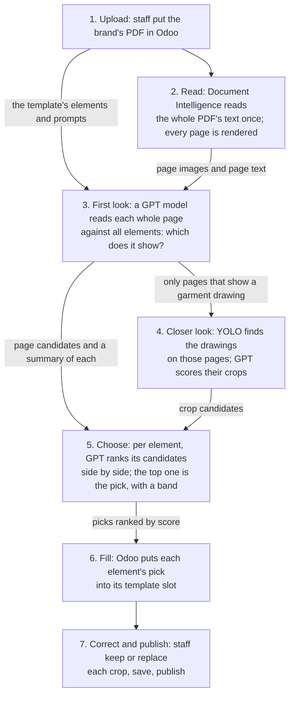

# The use case: template-driven document extraction

The workload this lab is built around: what the business does, who is involved, how one document moves through the system,
what "correct" means, and where the system falls short today. The [README](../README.md) sets the lab's goals against
these gaps.

**The one idea: a brand's document, in the brand's own layout, is mapped onto the manufacturer's standard template,
slot by slot. For each slot, the system proposes the region of the source that fills it, and a person confirms.**

This is a well-known problem: template-driven document extraction, part of intelligent document processing. Every
building block is public; what makes this case hard is the data.

## In one paragraph

A garment manufacturer, my team's client, produces garments for about a dozen brand customers. A brand sends a
**garment specification document** (a garment spec, for short): a PDF of drawings, measurement tables, materials and
notes, in the brand's own layout. Before production, the client's technical staff rebuild it as a
**standard technical document** of their own, laid out from a **template** for that brand, product category and gender, and send it
to the factory. The OCR system pre-fills the template, so staff check and fix instead of cutting and pasting by hand.

The system runs in a development environment and a staging environment; staging is the one the staff work in.

## Who is involved

| Actor | Role |
|---|---|
| Brand customer | Sends the garment specification document |
| The client's technical staff | Build the templates; check and fix the pre-filled document; publish it |
| The AI team, part of my team | Build and test the OCR service; train its detector |
| The factory | Produces from the standard technical document |

## Inputs and outputs

| | What it is | Real example |
|---|---|---|
| **Input** | The brand's garment specification document, a PDF uploaded to Odoo | Brand A, men's blazer: about 10 pages |
| **Template** | The client's layout for one brand, category and gender: pages, slots, and the elements expected in them, each element with a prompt | "Brand A, men's blazer": 25 pages, 20 expected elements |
| **Output** | The standard technical document: the template filled with crops, tables and text from the original | For the same blazer, made by hand before the OCR system existed: about 11 pages |

A template's pages follow the garment, and each slot expects an element (a drawing, a table, a label), which
carries a prompt that says what to look for. Elements come from a shared catalogue: in staging, 206 element records
(133 default, 73 custom) under 100 distinct codes; the most used are 11 custom elements, in 51 templates each.

**One element and its prompt.** `sleeve_head`, in the team's own English version (the same text in the 5
templates that carry one, 1,549 characters): the instruction GPT follows when it judges a page or a crop for
this element. It is also among the elements whose pick varied most in the same document's runs
([below](#where-it-falls-short-today)).

<details>
<summary>The prompt</summary>

```text
Identification Criteria (Required)

Select only the image that satisfies all of the following conditions:

The image is a technical construction diagram, not a real garment photograph.
The title or nearby label contains one or more of the following keywords:
SLEEVE HEAD
SLEEVE HEAD ROLL
SLEEVE HEAD INSERT
SLEEVE HEAD FELT
(its name in the local language)
The illustration shows:
A sleeve cap or upper sleeve pattern.
A curved insert positioned along the sleeve cap.
The insert follows the armhole curve.
The sleeve seam is visible in the center of the pattern.
If the page contains multiple reinforcement diagrams, select only the diagram labeled SLEEVE HEAD.
Visual Features

The extracted diagram should clearly contain:

Title SLEEVE HEAD.
Sleeve pattern outline.
Curved sleeve head reinforcement positioned at the top of the sleeve.
Center sleeve seam.

The reinforcement piece is typically shown as a highlighted strip following the sleeve cap curve.

Exclusion Rules

Do NOT extract:

CANVAS
CHEST PIECE
HAIR CLOTH
SHOULDER PRESSING
Garment photographs
Pocket construction
Collar construction
Sleeve photographs
Measurement charts
Sewing instructions
Fabric information
Label placement diagrams
Technical specifications

Exclude any diagram that is not specifically labeled SLEEVE HEAD.

Expected Output

Return a single high-resolution cropped image containing only the Sleeve Head construction diagram. The image should clearly display the sleeve pattern, the curved sleeve head reinforcement, and the title SLEEVE HEAD, while excluding all unrelated page content.
```

</details>

## The flow

The business view in seven steps. Each step uses what the one before it produced.



1. **Upload.** Staff upload the original in Odoo, which stores it and queues a request. The service pulls the
   template's elements and their prompts separately.
2. **Read.** Azure Document Intelligence reads the whole PDF once and returns its text, lines and tables; the service
   renders every page as an image. Nothing is judged yet.
3. **First look.** A GPT model looks at each whole page, with that page's text, against all the template's element
   prompts at once, and lists the elements the page shows, each with a score. Each page and element pair becomes a
   candidate.
4. **Closer look.** Only on the pages flagged for a garment drawing (front body, back body), a one-class YOLO detector
   finds the drawings, and GPT scores each crop.
5. **Choose.** For each element, GPT ranks all its candidates from steps 3 and 4 side by side; the top one is the
   pick, and the element gets a band: `auto` when the top candidate scores high and leads the next one clearly,
   `review` otherwise or when its candidates were borrowed from a related element, `empty` when it has none.
6. **Fill.** Odoo puts each element's pick into the slot labelled with it, ranked by the score of step 5. It does not
   read the band.
7. **Correct and publish.** Staff keep, swap, drag in or remove crops; nobody edits a box. The result is saved with
   its history and published.

What a correction is matters for training: a person's choice says "this crop is element X" or "not this one", never
where a box should be. Those choices fit a crop-to-element ranker; the detector's boxes come from the AI team's own
labelled pages.

## The building blocks are public

| Stage | Public building blocks |
|---|---|
| Read the document | Layout OCR services: [Azure Document Intelligence](https://learn.microsoft.com/en-us/azure/ai-services/document-intelligence/overview), [Amazon Textract](https://aws.amazon.com/textract/), [Google Document AI](https://cloud.google.com/document-ai) |
| Find regions on a page | Object detectors ([YOLO](https://docs.ultralytics.com/)); layout models trained on public sets ([DocLayNet](https://github.com/DS4SD/DocLayNet)) |
| Match a region to a slot | LLM scoring and ranking (GPT models in [Microsoft Foundry](https://learn.microsoft.com/en-us/azure/foundry/what-is-foundry)) |
| Confirm | Human review in [Odoo](https://github.com/odoo/odoo), open source |

## Where each piece lives

| Piece | Stored in |
|---|---|
| Original PDF | Azure Blob Storage, and an Odoo attachment |
| Templates: layout, expected elements, prompts | Odoo's Postgres; template images in Odoo's filestore on Azure Files |
| OCR runs: regions, scores, bands | The OCR service's Postgres; page renders in Blob Storage |
| Curated results and their history | Odoo's Postgres; their crops in Odoo's filestore |
| Detector weights | Blob Storage |
| Detector training data | The AI team's Ultralytics Platform workspace |

Four databases matter to the lab: Odoo's and the OCR service's, in development and in staging. They are the sources
the lab copies once and replays ([phase 2a](runbooks/data-path.md)).

## What "correct" means: four partial sources of truth

No single source says what the right output is.

| Source | Judges | Strength | Weakness |
|---|---|---|---|
| **Templates** | Which elements a document of this kind must contain | Defined by the client's staff, per brand, category and gender | Says what, not which crop; templates multiply (one brand has 23 in development and 33 in staging, across five garment categories, many of them unfinished versions, copies and dated variants), and no field marks which one is official |
| **Curated results** | Which crop a person kept for each slot | A human decision on the real document | 27 in development and staging together (2026-10-31), 3 published (2026-10-22), 15 of the 27 last saved by my team |
| **Reference pairs**: an original and its hand-made standard document | The whole output, end to end | Made by the client before the system existed | A PDF, so matching it to slots takes work |
| **The AI team's labelled pages** | Where the regions are (the YOLO step) | 2,041 pages from 132 documents, 3,493 human boxes; the set that trained the production weights | One class only; split by page, so 99 of 146 validation pages come from documents also in training |

Across both environments, 250 human picks carry a crop; 200 of them join back to the model output they were cut
from, the lab's human gold set.

## Where it falls short today

| Gap | Evidence |
|---|---|
| A GPT call for every element of every document | The service asks GPT about each element the template expects ([the flow](#the-flow)); 73 of staging's 206 element records are custom elements users added, each with its own prompt (2026-10-24), which a model with fixed classes cannot answer |
| The same document gets different answers | Below: about 1 element in 4 flips between runs of one model; model upgrades move more |
| Little feedback | 27 curated results, 3 published |
| No lineage for the detector, no comparison for changes | Nothing records which detector weights made a run, and weight file names do not match their contents; models and prompts change by configuration with no evaluation before use |
| The detector is trained by hand in the Ultralytics Platform web UI | About 15 datasets in the workspace, none marked as the one behind production |
| An optimistic validation, no frozen test set | 99 of 146 validation pages share a document with training |
| Human picks and predictions in separate stores | Odoo's JSON and the service's database, joined only by run, page and an approximate box match; no dataset can be rebuilt |
| The model's doubt never reaches the person | Odoo fills each slot by score alone and does not read the `review` band |
| The detector runs on CPU | Inside the OCR container |
| No operational alerting | Incidents are found by people |

**The same document, run again** (2026-10-24). One brand's blazer document was processed 21 times in staging, across two model
upgrades; in development, 6 of its runs used the newest model:

| Runs | Elements | Same pick every run | 2 to 3 picks | 4 or more |
|---|---|---|---|---|
| Staging, all models (21) | 40 | 27 | 6 | 7 |
| Staging, one model (16) | 31 | 24 | 7 | 0 |
| Development, the newest model (6) | 39 | 32 | 6 | 1 |

The least stable elements across all staging runs are the front body with its collar and the sleeve head, 5
different picks each. More elements appear across all runs (40) than in one template (20) because the element lists
changed over time.

**Every run's outcome, staging** (2026-10-24): `auto` 3,270 elements, `empty` 6,798 (no candidate found for the
element), `review` 2,061 by the model's own doubt and 936
forced by a rule. The `review` elements are the ones the system is unsure of, and the person checking is never told which they are.

What the lab sets out to change, goal by goal: [the README](../README.md#the-goals).
